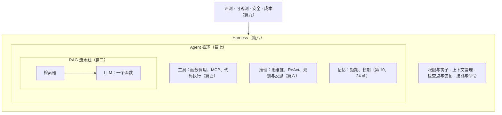

# 模型之外：LLM 应用架构掰开揉碎

> 开源知识库系列 · 第二卷。第一卷讲模型内部，这一卷讲模型外面怎么搭系统。

**"LLM 和 RAG 是平行的，还是包含关系？Agent 又是什么？"**

两个答案都不对。LLM 是一个部件，RAG 是用这个部件搭的一种系统，Agent 是把多种系统编排起来的循环。它们不在同一层。

这本书用 37 章把"模型之外"的这一整层讲清楚：RAG、微调、工具调用、多模态、Agent、Harness 各自解决什么问题，什么时候该用，什么时候不该用，以及一次调用到底花多少钱、等多少秒。

- 📖 在线阅读：<https://feihuiwu2022.github.io/llm-app-book/>（仓库公开并启用 Pages 后可用）
- 🚀 想先看结论：[第 36 章 决策树](src/ch36-decision-tree.md)
- 🧭 想从头读：[第 1 章 LLM、RAG、Agent 到底是什么关系](src/ch01-llm-rag-agent.md)

## 一张图看懂全书



LLM 有四个天生的短板，全书所有技术都挂在这张表上：

| 短板 | 裸模型的表现 | 改哪里 | 代表技术 | 在哪一篇 |
|---|---|---|---|---|
| **不知道** | 问本车胎压，编一个看起来合理的数 | 改上下文 | 提示工程、RAG、GraphRAG、CAG、记忆 | 篇二 |
| **不稳定** | 要求固定 JSON 格式，十次里有一两次跑偏 | 改权重 | 微调、LoRA、蒸馏 | 篇三 |
| **做不了** | 说"已调好空调"，实际什么都没发生 | 改外部能力 | 函数调用、MCP、代码执行 | 篇四 |
| **想不深** | 多步问题只答第一步 | 改推理过程 | 思维链、ReAct、规划、反思 | 篇六 |

遇到一个新名词，先问它改的是哪一行，就知道它和谁平行、能替代谁。

## 这本书有什么不一样

**从实物讲起。** 不说"RAG 增强了模型的知识"，而是把一次请求的 JSON、一块切好的文本、一条工具调用请求原样摆出来，看它长什么样、有多大。

**结论可以复算。** 每章至少一处能用纸笔验证的数字。几个例子：

| 结论 | 算式 | 出处 |
|---|---|---|
| 单步 95% 正确，20 步的任务成功率只有 36% | 0.95²⁰ | 第 20 章 |
| Agent 跑 10 轮，累计输入是单次的 40 多倍 | N × F + a × N × (N − 1) ÷ 2 | 第 35 章 |
| 50 条测试集上，正确率的误差是正负 11 个百分点 | 1.96 × √(0.8 × 0.2 ÷ 50) | 第 32 章 |
| 一个 14 GB 的模型，LoRA 附加文件约 8 MB | 64 × 2 × 8 × 4096 × 2 字节 | 第 11 章 |
| 过滤器拦住 99% 的注入，攻击者试 100 次仍有 63% 穿透 | 1 − 0.99¹⁰⁰ | 第 34 章 |

**每章都讲"什么时候不该用"。** 多数资料只告诉你一项技术能做什么。这本书的每一章都有一节专门讲它的代价和不适用的场景，最后两章给出完整的选型方法。

**代码能直接跑。** 9 个配套脚本只用 Python 标准库，不需要密钥、不需要联网、不需要装任何依赖。

## 三分钟跑起来

```bash
git clone https://github.com/feihuiwu2022/llm-app-book.git
```

```bash
cd llm-app-book
```

```bash
python code/ch21_agent.py
```

你会看到一个不到五十行的 Agent 完成一个两步任务，以及它的上下文怎样逐轮变长：

```text
任务：帮我看看胎压正不正常，另外车里有点热，把空调调低两度。

第 1 轮｜输入 135 字符｜调用 get_tire_pressure、search_manual
第 2 轮｜输入 576 字符｜调用 search_manual
第 3 轮｜输入 843 字符｜调用 set_ac_temperature
第 4 轮｜输入 1057 字符｜给出最终答复

答复：胎压：右前185千帕，低于手册规定的190千帕报警线（前轮标准240千帕），请尽快减速靠边检查；其余三个轮胎正常。空调已从24度调到22度。
空调真实状态：22 度
```

全部配套代码：

| 脚本 | 演示什么 | 对应章 |
|---|---|---|
| `ch03_shortcomings.py` | 四个短板的探针与自动判分 | 3 |
| `ch05_chunk.py` | 切块、向量库大小复算、余弦相似度 | 5 |
| `ch06_retrieve.py` | 向量召回、BM25、RRF 融合、拼提示词 | 6 |
| `ch13_function_call.py` | 函数调用的四步往返 | 13 |
| `ch19_react.py` | 思考、行动、观察的 ReAct 循环 | 19 |
| `ch21_agent.py` | 最小 Agent 主循环 | 21 |
| `ch24_memory.py` | 三层记忆、冲突更新、遗忘 | 24 |
| `ch29_extend.py` | 技能按需加载、命令、钩子 | 29 |
| `ch35_cost.py` | 成本与延迟账本 | 35 |

说明：为了离线可跑，代码里的模型是写死规则的替身，循环、检索、工具执行、钩子都是真的。想接真实模型，按 `code/llm.py` 开头的说明设置三个环境变量即可。

## 按需要选读

| 你是谁 | 建议路线 |
|---|---|
| 刚接触，想建立整体认识 | 第 1 → 2 → 3 章，然后按兴趣跳 |
| 要做知识库问答 | 第 5 → 6 → 7 章，再看第 9 章判断是否真的需要检索 |
| 纠结 RAG 还是微调 | 第 12 章，带成本复算 |
| 要做 Agent | 第 13 → 19 → 21 → 23 章，再读篇八 |
| 想理解 Claude Code 这类工具的设计 | 第 28 → 29 → 30 → 31 章 |
| 系统要上线 | 篇九：评测、可观测、安全、成本 |
| 只想知道该选什么方案 | 第 36 章决策树，第 37 章三个案例 |

## 目录

### 篇一 地图
- [01 LLM、RAG、Agent 到底是什么关系](src/ch01-llm-rag-agent.md)
- [02 一次调用的解剖：上下文窗口里到底装了什么](src/ch02-anatomy-of-a-call.md)
- [03 四个短板的实测](src/ch03-four-shortcomings.md) ▶

### 篇二 改上下文
- [04 提示工程：一切的地基](src/ch04-prompt-engineering.md)
- [05 RAG 全链路（上）：切块与嵌入](src/ch05-rag-chunk-embed.md) ▶
- [06 RAG 全链路（下）：召回、重排、生成](src/ch06-rag-retrieve-generate.md) ▶
- [07 RAG 为什么会答错：七类失败与定位方法](src/ch07-rag-failures.md)
- [08 GraphRAG 与 KAG：当知识有结构](src/ch08-graphrag-kag.md)
- [09 CAG 与长上下文：什么时候可以不检索](src/ch09-cag-long-context.md)
- [10 记忆：短期、长期与遗忘](src/ch10-memory.md)

### 篇三 改模型
- [11 微调、LoRA、蒸馏各改了什么](src/ch11-finetune-lora-distill.md)
- [12 RAG 还是微调：选型判据与成本复算](src/ch12-rag-or-finetune.md)

### 篇四 行动
- [13 函数调用：模型是怎么"调"工具的](src/ch13-function-calling.md) ▶
- [14 MCP：工具接入的标准化](src/ch14-mcp.md)
- [15 代码执行与结构化输出](src/ch15-code-exec-structured-output.md)

### 篇五 多模态
- [16 多模态输入的原理与账本：图、音、文档怎么变成 token](src/ch16-multimodal-input.md)
- [17 多模态接入 Agent 的接口设计](src/ch17-multimodal-agent-interface.md)

### 篇六 推理与控制流
- [18 CoT 与推理模型：让模型多想几步](src/ch18-cot-reasoning-models.md)
- [19 ReAct：想一步、做一步、看一步](src/ch19-react.md) ▶
- [20 规划与反思](src/ch20-planning-reflection.md)

### 篇七 Agent 系统
- [21 Agent 主循环：五十行代码的最小 Agent](src/ch21-agent-loop.md) ▶
- [22 Agentic RAG：检索从流程变成工具](src/ch22-agentic-rag.md)
- [23 上下文管理：长任务为什么会跑偏](src/ch23-context-management.md)
- [24 记忆系统实现：分层、存储形态、更新与合并](src/ch24-memory-system.md) ▶
- [25 编排模式：串联、路由、并行、生成加评审、交接](src/ch25-orchestration-patterns.md)
- [26 多 Agent：什么时候值得拆](src/ch26-multi-agent.md)
- [27 常驻 Agent：从被动应答到主动找活](src/ch27-always-on-agent.md)

### 篇八 Harness
- [28 Harness：模型之外的那层壳](src/ch28-harness.md)
- [29 扩展机制：技能、命令、钩子](src/ch29-skills-commands-hooks.md) ▶
- [30 命令行与无头模式：Agent 的接口形态](src/ch30-cli-headless.md)
- [31 长任务：检查点、恢复与人工介入](src/ch31-long-running-tasks.md)

### 篇九 工程化
- [32 评测：怎么知道改好了还是改坏了](src/ch32-evaluation.md)
- [33 可观测与调试](src/ch33-observability.md)
- [34 安全：提示注入与权限边界](src/ch34-security.md)
- [35 成本与延迟账本](src/ch35-cost-latency.md) ▶

### 篇十 选型方法论
- [36 决策树：给定场景怎么组合](src/ch36-decision-tree.md)
- [37 案例拆解：车主手册问答、售后客诉分诊、测试用例生成 Agent](src/ch37-case-studies.md)

### 附录
- [术语表](src/appendix-glossary.md)

▶ 表示该章有可运行的配套代码。

## 每章的固定结构

1. 一个具体问题开场
2. 掰开：这个东西的实物形态
3. 为什么这样设计
4. 优势、劣势、什么时候不该用
5. 常见误解
6. 三句话以内的小结，加参考文献

全书用同一个虚构的车载助手场景贯穿：一本编造的车主手册、四个轮胎、一台空调。从第 5 章的切块到第 37 章的案例，例子是连着的。

## 读之前请知道

- **当前是初稿**，37 章已齐，尚未通读修订。
- **书里的费用都按假设单价计算**，不是任何厂商的报价，正文均有标注。换成你的实际价格，公式不变。
- **代码里的模型是替身**，第 3 章的"翻车"数字来自脚本设定，不代表任何真实模型。
- **参考文献尚未逐条核对**，引用前请自行确认。
- **产品细节会过时**。篇八以 Claude Code 为主要实例，第 27 章引用了 DeepSeek 的 Super-agent 原型（基于媒体报道），具体字段以各自的官方文档为准。书里力求讲的是不随产品变化的设计原则。

## 本地预览

```bash
cargo install mdbook mdbook-mermaid
```

```bash
mdbook-mermaid install .
```

```bash
mdbook serve
```

## 参与

发现错误、数字对不上、例子跑不通，欢迎提 Issue 或 Pull Request。全书规划和待定事项见 [BLUEPRINT.md](BLUEPRINT.md)。

## 许可证

文字内容 CC BY-SA 4.0，代码 MIT。详见 [LICENSE.md](LICENSE.md)。
