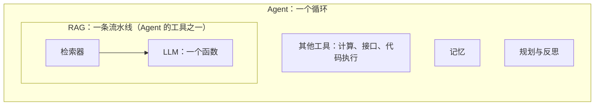

# 01 LLM、RAG、Agent 到底是什么关系

## 从一个问题开场

"LLM 和 RAG 是平行的，还是包含关系？"

两个答案都不对。这个问题相当于问"发动机和四驱系统是平行还是包含"：发动机是一个部件，四驱是围绕发动机搭出来的一套系统，它们不在同一层。

本章只做一件事：把这三个词放到正确的层上，再给出一张贯穿全书的表。

## 掰开：三样东西的实物形态

**LLM 是一个函数。** 输入一段文字，输出下一段文字。它的全部知识固化在权重文件里，训练结束那一刻就冻结了。它没有记忆、不能联网、不能执行任何操作。你在聊天产品里感受到的"记得上文"，是外面的程序每次把历史对话重新拼进输入里实现的。

**RAG 是一条流水线。** 它由两个部件串成：一个检索器和一个 LLM。用户提问后，检索器先从资料库里找出几段相关文字，程序把这几段文字和问题拼在一起，再交给 LLM 作答。LLM 本身一个参数都没变，变的只是它这一次看到了什么。

**Agent 是一个循环。** 程序让 LLM 先想下一步做什么，然后替它执行（查资料、调接口、跑代码），把结果拼回输入，再让它想下一步，直到任务完成。

所以层级是这样的：

*图 F01　三层嵌套。RAG 里包含一个 LLM；Agent 里可以包含 RAG。*

一句话：**LLM 是部件，RAG 是用这个部件搭的一种系统模式，Agent 是把多种模式编排起来的更大的系统。**

## 为什么需要在 LLM 外面搭东西

因为这个函数有四个天生的短板。用一个车主手册问答的例子看：

| 用户说 | 裸 LLM 的表现 | 短板 |
|---|---|---|
| "我这款车的胎压标准是多少？" | 编一个看起来合理的数 | **不知道**：权重里没有这本手册 |
| "按固定 JSON 格式返回故障码" | 十次里有一两次格式跑偏 | **不稳定**：行为靠概率 |
| "帮我把空调调到 24 度" | 回复"好的已调好"，实际什么都没发生 | **做不了**：只能输出文字 |
| "排查一下为什么续航掉得快" | 给一段泛泛的建议 | **想不深**：需要查数据、多步排除 |

四个短板对应四个可以动手的地方。

## 全书主线：四个旋钮

| 改哪里 | 代表技术 | 补的短板 |
|---|---|---|
| 改上下文（这一次给它看什么） | 提示工程、RAG、GraphRAG/KAG、CAG、记忆 | 不知道 |
| 改权重（模型本身） | 微调、LoRA、蒸馏 | 不稳定 |
| 改外部能力（它能调用什么） | 函数调用、MCP、代码执行 | 做不了 |
| 改推理过程（它怎么想） | CoT、ReAct、规划、反思 | 想不深 |

*图 F02 的表格版。*

现在可以回答"和 RAG 平行的有哪些"了。平行有两层含义：

- **同一行的近亲**：提示工程、CAG、记忆、GraphRAG/KAG。它们和 RAG 做的是同一件事，都在决定往上下文窗口里放什么，区别只在内容从哪来、怎么选。
- **不同行的同级**：微调、工具调用、推理技术。它们和 RAG 是同一层级的增强手段，但各补各的短板，互不替代。

Agent 不在这张表的任何一行里。它是把四行都用上的那个循环。

还有两样东西也不在表里，后面会单独讲：

- **多模态**不是第五个旋钮。它改变的是输入输出的形态：图片、声音同样被转成 token 放进上下文，四个旋钮照常适用。第 16、17 章展开。
- **Harness** 是模型之外让 Agent 运转的那一整层：主循环、上下文组装、工具执行、权限、状态。它是四个旋钮在 Agent 里的承载者，篇八展开。

## 哪些用于 Agent

业界引用最多的拆法来自 Lilian Weng 2023 年的文章：Agent 以 LLM 为大脑，外加规划、记忆、工具使用三个组件。对照四个旋钮：

| Agent 组件 | 用到的技术 | 来自哪一行 |
|---|---|---|
| 规划 | CoT、ReAct、任务拆解、反思 | 改推理过程 |
| 工具使用 | 函数调用、MCP、代码执行 | 改外部能力 |
| 记忆 | 短期靠上下文窗口，长期常用检索实现 | 改上下文 |
| 大脑 | 基座模型，必要时微调以稳定工具调用格式 | 改权重 |

这里有一个值得记住的角色变化：**RAG 进了 Agent 之后，从流程降级为工具。** 普通 RAG 是"每次提问必检索一次"的固定流水线；在 Agent 里，检索只是工具箱里的一件，由模型自己决定要不要查、查什么、查完够不够。这种用法叫 Agentic RAG，第 22 章展开。

## 常见误解

**"RAG 给模型增加了知识。"** 没有。权重没变，模型只是这一次读到了那段资料，下一次不给它看，它仍然不知道。

**"CAG 是利用历史对话做个性化。"** 不对，那是记忆机制。CAG 是 Cache-Augmented Generation：资料量不大时，把资料整体预先放进上下文并缓存模型的中间计算结果，推理时不再检索。第 9 章展开。

**"KAG 是和 RAG 并列的另一种范式。"** 更准确的说法是 RAG 的一个分支：它来自蚂蚁集团，用知识图谱加逻辑推理来弥补向量检索在专业领域的模糊性。第 8 章展开。

**"提示工程、RAG、微调、记忆、规划是七八种并列技术。"** 它们不在同一层。提示工程是所有技术的地基；记忆是一种需求，RAG 是实现它的手段之一；规划是控制流。按"改哪里"分层才不会乱。

**"微调和 RAG 二选一。"** 它们补的是不同短板，经常一起用。真正的选型问题是先上哪个，第 12 章给判据。

## 小结

- LLM 是部件，RAG 是系统模式，Agent 是编排多种模式的循环，三者是嵌套关系。
- 所有增强技术都可以按"改上下文、改权重、改外部能力、改推理过程"归到四行里。
- 遇到一个新名词，先问它改的是哪一行，就知道它和谁平行、能替代谁。

## 参考

- Lewis et al., *Retrieval-Augmented Generation for Knowledge-Intensive NLP Tasks*, 2020
- Chan et al., *Don't Do RAG: When Cache-Augmented Generation is All You Need for Knowledge Tasks*, arXiv:2412.15605
- Liang et al., *KAG: Boosting LLMs in Professional Domains via Knowledge Augmented Generation*, arXiv:2409.13731
- Lilian Weng, *LLM Powered Autonomous Agents*, 2023, lilianweng.github.io/posts/2023-06-23-agent
