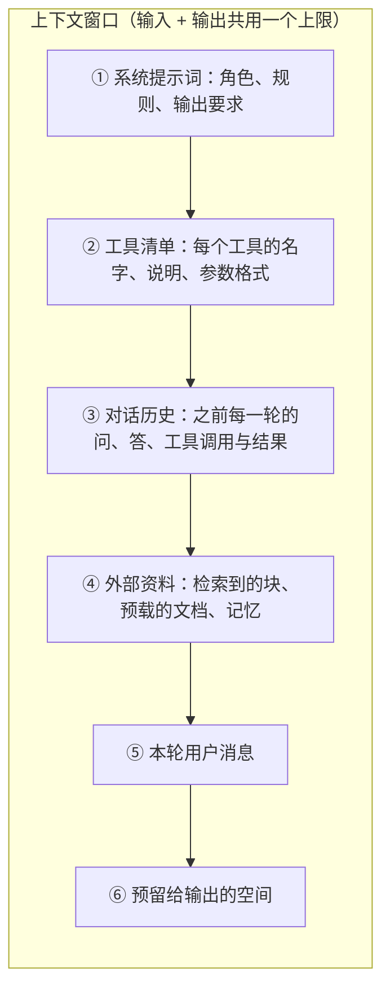

# 02 一次调用的解剖：上下文窗口里到底装了什么

## 从一个问题开场

你在聊天产品里问了第二句话："那后轮呢？"模型答对了，它显然知道上一句聊的是胎压。

可第 1 章说过，LLM 是一个没有记忆的函数。它是怎么"记得"的？

答案是它不记得。外面的程序把第一轮的问和答原样抄了一遍，连同第二句话一起重新发了过去。本章把这一次调用掰开，看看发过去的到底是什么。

## 掰开：一次请求的实物形态

一次调用就是一次 HTTP 请求，请求体是一段 JSON。第二轮提问时，程序实际发出的内容大致是这样（各家字段名略有出入，结构相同）：

```json
{
  "model": "某个模型",
  "max_tokens": 1024,
  "system": "你是车载助手，回答要简短。",
  "tools": [ { "name": "search_manual", "description": "…", "parameters": { } } ],
  "messages": [
    { "role": "user",      "content": "前轮胎压标准是多少？" },
    { "role": "assistant", "content": "前轮冷态胎压标准是 240 千帕。" },
    { "role": "user",      "content": "那后轮呢？" }
  ]
}
```

注意 `messages` 里的前两条。它们是上一轮的内容，由程序保存、由程序重发。模型这一次读到的是一份完整的对话记录，它是在给这份记录续写下一段。

**"多轮对话"是程序层面的事，模型层面只有一次又一次互不相干的单次调用。**

模型拿到这段 JSON 后，服务端会按固定模板把它拼成一整段文字，再切成 token。模型真正的输入就是这一串 token，它分不出哪些是"系统提示"、哪些是"用户说的"，只是在训练时学会了对不同位置的文字区别对待。

## 掰开：窗口里的六个分区

上下文窗口是模型一次能处理的 token 总数上限。输入和输出共用这个额度。



*图 F03　上下文窗口内容分区。前五格是输入，由程序拼装；第六格是模型这一次要写的。*

全书后面的技术，绝大多数是在决定某一格里放什么：

| 分区 | 谁往里放 | 对应章节 |
|---|---|---|
| ① 系统提示词 | 开发者手写 | 第 4 章 |
| ② 工具清单 | 开发者定义，或经 MCP 自动获取 | 第 13、14 章 |
| ③ 对话历史 | 程序逐轮累加 | 第 10、21 章 |
| ④ 外部资料 | RAG、GraphRAG、CAG、记忆 | 第 5 到 10 章 |
| ⑤ 用户消息 | 用户 | |
| ⑥ 输出 | 模型 | 第 15、16 章 |

## 手算一次：窗口用了多少

假设窗口上限是 128,000 token，按 1 个汉字约合 1 个 token 粗算。一个带工具、带检索的车载助手，第 7 轮提问时：

| 分区 | 估算 | token |
|---|---|---|
| ① 系统提示词 | 约 800 字 | 800 |
| ② 工具清单 | 3 个工具，每个约 400 | 1,200 |
| ③ 对话历史 | 前 6 轮，每轮问答合计约 500 | 3,000 |
| ④ 外部资料 | 5 块 × 400 字 | 2,000 |
| ⑤ 用户消息 | 一句话 | 50 |
| ⑥ 预留输出 | `max_tokens` | 1,024 |
| **合计** | | **8,074** |

只用了窗口的 6.3%，看起来绰绰有余。但有两格会一直涨：

- **对话历史每轮加 500。** 聊到第 200 轮，光历史就是 100,000。
- **如果每轮都检索，资料也留在历史里。** 每轮多 2,000，连同问答每轮共涨 2,500，约 50 轮就会撞上 128,000 的上限。

所以窗口够不够用不看第一轮，要看最后一轮。长对话和 Agent 任务几乎一定会撞上限，第 21 章专门讲撞上之前怎么办。

## 输出是怎么出来的

模型一次只生成一个 token。它算出词表里每个 token 作为下一个的概率，按概率抽一个，把抽中的接到输入末尾，再算下一个，直到抽中结束符或写满 `max_tokens`。

这带来三个直接后果：

- **同样的输入，两次输出可能不同。** 因为是抽签。温度参数控制抽签的随意程度，调低更保守，但调到 0 也不保证每次逐字相同。这是"不稳定"短板的来源。
- **输出比输入慢得多、贵得多。** 输入是一次读完的，输出要一个一个算。第 26 章算这笔账。
- **写到一半会被截断。** `max_tokens` 设小了，JSON 写到一半就停，下游解析直接失败。响应里的结束原因字段会告诉你是正常结束还是被截断，生产代码必须检查它。

## 为什么这样设计

无状态让服务端简单：任何一台机器都能处理任何一次请求，不用为每个用户保存会话。代价转移给了调用方，调用方要自己保存历史、自己决定每次带哪些内容。

这个代价同时也是一种权力。因为上下文完全由你拼装，你可以删掉过时的历史、插入检索到的资料、替换系统提示词。第 1 章那张表里"改上下文"的一整行技术，都建立在这个事实上。

## 优势、劣势、什么时候不该用

**优势**：行为完全由输入决定，同一份输入可以原样重放，调试和评测都依赖这一点。

**劣势**：历史越长，每一轮越贵、越慢；窗口有上限，早晚要取舍留什么。

**不该做的事**：因为窗口装得下就什么都往里放。内容越多，模型越容易漏掉关键信息，第 9 章有具体讨论。

## 常见误解

**"模型记住了我们之前聊的内容。"** 是程序每次重发的。换一个会话，或者程序没带上历史，它就一无所知。

**"系统提示词是一种特殊的、模型必须服从的指令。"** 它只是位置靠前、训练时被赋予了较高权重的一段文字。模型大概率遵守，但没有任何机制保证。第 25 章讲由此产生的安全问题。

**"窗口大小就是模型能读的文档长度。"** 窗口要分给六个分区，还要给输出留空间。能放资料的只是其中一格。

**"temperature 设为 0 输出就确定了。"** 更稳定，但不保证逐字一致。需要严格格式时要靠第 15 章的结构化输出。

## 小结

- 一次调用是无状态的：程序把系统提示词、工具清单、历史、资料、问题拼成一份输入，模型续写一段输出。
- 上下文窗口由输入输出共用，其中对话历史和外部资料两格会随轮数增长，估算要看最后一轮。
- 输出是逐个 token 抽样出来的，所以会波动、比输入贵、可能被截断。

## 参考

- Vaswani et al., *Attention Is All You Need*, 2017
- 本系列第一卷：分词、注意力与逐 token 生成的内部过程
