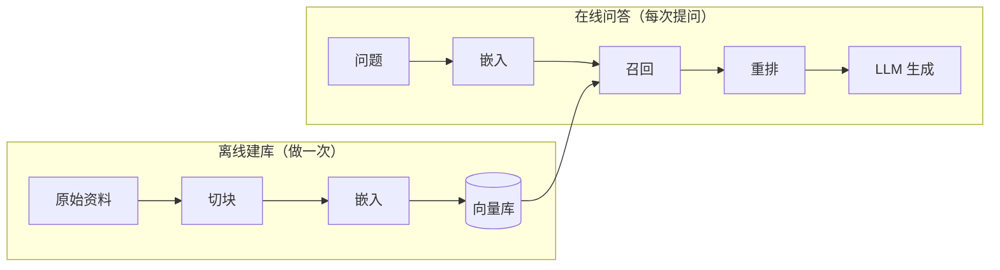
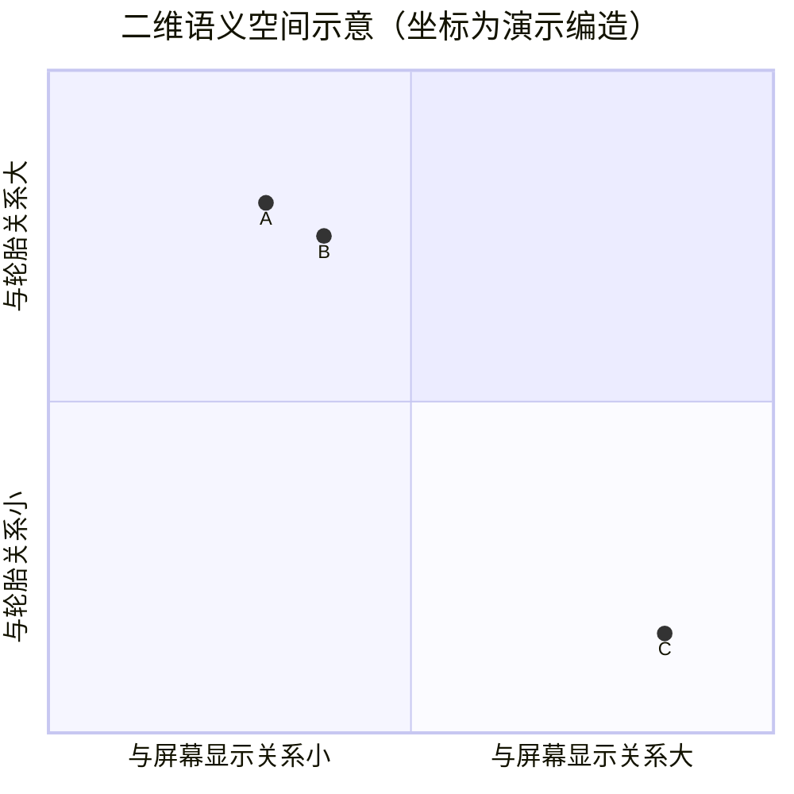

# 05 RAG 全链路（上）：切块与嵌入

> ▶ 本章配套代码：`code/ch05_chunk.py`，只用 Python 标准库，可直接运行。

## 从一个问题开场

第 1 章说 RAG 是"先检索，再把找到的资料和问题一起交给模型"。那么一本 20 万字的车主手册，为什么不整本塞给模型，非要先切碎？

三个原因：

- **装不装得下。** 上下文窗口有上限。一本手册也许装得下，一个部门的全部文档装不下。
- **贵不贵。** 模型按输入长度计费、计时。每问一次都读 20 万字，绝大部分是白读。
- **准不准。** 资料越长，模型越容易漏掉中间的关键句。给它 5 段相关的，比给它 500 页全文答得更准。

所以 RAG 要做两件事：提前把资料切成小块建好索引（离线），提问时只取最相关的几块（在线）。



*图 F04　RAG 的两条流程。本章讲上面这条，第 6 章讲下面这条。*

## 掰开：切块

切块就是把长文本切成一段一段。最朴素的做法是定长切：每块固定字数，相邻两块留一点重叠。

```python
def chunk(text, size, overlap):
    step = size - overlap
    return [text[i:i + size] for i in range(0, len(text), step) if text[i:i + size]]
```

拿一段 384 字的示例手册，按每块 80 字、重叠 20 字切，得到 7 块。看前两块的交界处：

```text
块0: ……胎压标签贴在驾驶员侧门框下方。建议每月检查一次胎压，长途行
块1: 侧门框下方。建议每月检查一次胎压，长途行驶前务必检查。胎压监测系统在任一轮胎压力低于190千帕时点亮黄色警告灯。……
```

块 0 在"长途行"三个字处被拦腰切断，这句话在块 0 里是残的。因为有 20 字重叠，块 1 里保留了完整的这一句。**重叠的作用就是保证被切断的句子至少在一块里是完整的。**

### 两个参数怎么定

| 参数 | 调小 | 调大 |
|---|---|---|
| 块大小 | 定位精确，但一块里信息不完整，答案可能被切成两半 | 上下文完整，但一块里混进多个话题，检索时被无关内容稀释 |
| 重叠 | 省存储，但边界处容易丢句子 | 边界安全，但块数变多、内容重复 |

常见起点是块大小 300 到 500 字、重叠取块大小的 10% 到 20%，然后用自己的问题集实测调整。没有通用最优值。

### 比定长更好的切法

定长切不看内容，会把标题和正文切开、把表格切成两半。改进方向按代价从低到高：

1. **按结构切**：先按章节标题、段落、句号切，超长的再定长切。大多数场景到这一步就够用。
2. **带上标题**：每块前面补上它所属的章节路径，例如"第三章 车轮与轮胎 > 胎压"。这样"它的标准值是多少"这种离开上下文就看不懂的句子，检索时仍然能被找到。
3. **按语义切**：用模型判断话题在哪里转换。效果更好，建库更慢更贵。

## 掰开：嵌入（语义向量化）

切完之后，怎么判断哪一块和问题"相关"？

计算机不会像人一样比较两段话的意思，它只会算数。所以要先做一步转换：**把一段文字变成一组数字，并且让意思相近的文字，变出来的数字也相近。** 这一步就叫嵌入，英文 Embedding。

"嵌入"这个译名不直观。如果只想记一个好懂的说法，可以把它读作**语义向量化**：把文字的意思，变成一个可以计算的向量。

### 实物形态：一组定长的数字

```text
"胎压低于多少会报警"  →  嵌入模型  →  [0.021, -0.337, 0.118, …, 0.094]   共 1024 个数
```

这组数字叫**向量**。长度由嵌入模型决定，常见的有 512、768、1024、1536 几档。在模型允许的输入长度之内，不管输入是 5 个字还是 500 个字，输出都是这么长。

### 把向量当成坐标

1024 个数没法想象，先看只有 2 个数的情况。两个数就是平面上的一个点，也就是一组坐标。

拿三句话，假设嵌入模型把它们变成了下面的二维坐标。这是为了说明而编的数字，真实模型的输出有上千维：

| | 句子 | 坐标 |
|---|---|---|
| A | 胎压低于多少会报警？ | (0.30, 0.80) |
| B | 轮胎气压不足时，系统如何提醒？ | (0.38, 0.75) |
| C | 如何调节中控屏幕的亮度？ | (0.85, 0.15) |

把三个点画出来：



A 和 B 用词几乎没有重合，一个说"胎压""报警"，一个说"轮胎气压""提醒"，但它们说的是同一件事，所以两个点挨在一起。C 说的是另一件事，离得很远。

这就是嵌入的全部用意：**每段文字在一个"语义空间"里有一个位置，意思相近的落在附近，意思无关的落在远处。** 向量就是这个位置的坐标。所以嵌入也可以通俗地叫作语义坐标化。

有两点要说明，免得把示意图当真：

- 图里给两根轴起了名字，是为了好懂。真实的嵌入向量有上千个维度，单独拿出某一维，通常说不出它代表什么含义。有意义的是整体的远近关系。
- 这些坐标不是人设定的，是嵌入模型从海量文本里学出来的。经常出现在相似上下文里的文字，会被它放到相近的位置。

### 为什么叫"嵌入"

这个词来自数学，意思是把一个对象放进另一个空间里，并保持它原有的关系。

对应到这里：文字本来是一串符号，谈不上"距离"；嵌入模型把它们放进一个可以算距离的数值空间，并且让"意思相近"这层关系在新空间里表现为"位置相近"。所以"嵌入"强调的是**放进去**这个动作，得到的那组数字叫向量。

几个相关的词，对照一下：

| 词 | 指什么 |
|---|---|
| 嵌入（Embedding） | 把文字映射成向量的这个过程；口语里也常用来指得到的向量 |
| 嵌入模型 | 做这件事的模型 |
| 向量（Vector） | 得到的那组数字，也就是语义空间里的坐标 |
| 向量空间 | 所有这些向量所在的空间 |
| 相似度 | 用数学方法算出来的、两个向量有多接近 |

### 为什么不叫"数字化"或"浮点化"

因为那样说漏掉了最要紧的一点。

把文字变成数字有很多种办法。最简单的是按字的编码转：每个字本来就对应一个编号。这也是"数字化"，但"胎压"和"轮胎气压"的编号毫无关系，算不出它们意思相近。

"浮点化"只说了数字的存储格式是小数，同样没有提到语义。

嵌入的价值不在于"变成了数字"，而在于**变成数字之后，意思之间的远近关系被保留了下来**。"语义向量化"比"数字化"多出来的"语义"两个字，才是关键。

另外留意一个容易写错的字：是**向量**，不是"相量"。相量是电工学里描述交流电的术语，和这里无关。

本书后文沿用行业通行的叫法"嵌入"，方便你查阅其他资料时能对上。读到它时，在心里换成"语义向量化"即可。

### 相近怎么算：余弦相似度

上面说"挨在一起""离得很远"，是凭眼睛看的。计算机需要一个算得出来的数。最常用的是余弦相似度。

把向量看成从原点出发的箭头，两个箭头夹角越小就越相近。夹角的余弦值就是相似度，1 表示方向完全一致，0 表示毫不相关。

先用上面三句话的二维坐标算一遍：

| | 相似度 |
|---|---|
| A 与 B（都在问胎压报警） | **0.99** |
| A 与 C（胎压报警，屏幕亮度） | 0.51 |

A 和 B 的相似度接近 1，A 和 C 低得多。检索时拿问题的向量去和每一块的向量算这个数，取最高的几块，就是下一章的"向量召回"。

公式：两个向量逐位相乘再求和，除以两个向量各自的长度。

再用三维的小向量把计算过程完整手算一遍。问题 q = [1, 2, 0]，文档 d1 = [2, 3, 1]，文档 d2 = [0, 1, 3]：

| | 逐位相乘求和 | q 的长度 | 文档的长度 | 相似度 |
|---|---|---|---|---|
| q 与 d1 | 1×2 + 2×3 + 0×1 = 8 | √5 ≈ 2.236 | √14 ≈ 3.742 | 8 ÷ (2.236 × 3.742) ≈ **0.956** |
| q 与 d2 | 1×0 + 2×1 + 0×3 = 2 | √5 ≈ 2.236 | √10 ≈ 3.162 | 2 ÷ (2.236 × 3.162) ≈ **0.283** |

d1 更相关。真实系统做的是同一件事，只是每个向量有上千位，文档有几十万个。运行配套代码会得到相同的两个数。

### 嵌入模型和 LLM 是什么关系

它们是两个不同的模型，分工不同：

| | 嵌入模型 | LLM |
|---|---|---|
| 输入 | 一段文字 | 一段文字 |
| 输出 | 一个定长向量 | 下一段文字 |
| 体量 | 通常比 LLM 小得多 | 大 |
| 在 RAG 里干什么 | 建库时给每一块算向量，提问时给问题算向量 | 最后读资料写答案 |

有一条硬约束：**建库和提问必须用同一个嵌入模型。** 不同模型的向量不在同一个坐标系里，互相比较没有意义。换嵌入模型就要整库重算。

## 资源账本：向量库有多大

向量库的主体是一张大表，每一行是一块的向量，外加原文和来源信息。向量部分的大小可以直接算：

**占用 = 块数 × 维度 × 4 字节**（每个数用 32 位浮点存）

先算块数。20 万字的手册，每块 400 字、重叠 50 字，每切一块实际前进 350 字：

- 块数 = (200,000 − 50) ÷ 350 ≈ 571.3，向上取整为 **572 块**
- 占用 = 572 × 1024 × 4 = 2,342,912 字节 ≈ **2.2 MB**

一本手册的向量库比一张照片还小。再看大规模的情况：

- 100 万块 × 1024 × 4 字节 ≈ **3.9 GB**

规律很简单：维度翻倍，占用翻倍；块切小一半，块数翻倍，占用也翻倍。实际还要加上索引结构和原文，按向量部分的 1.5 到 2 倍预留比较稳妥。

## 为什么这样设计

把"找资料"交给一个单独的小模型和一个向量库，而不是让 LLM 自己读全部资料，是在用离线的一次性计算换在线的速度和成本：嵌入只在建库时算一次，提问时只需算一个问题的向量，再做一次数值比较。

## 优势、劣势、什么时候不该用

**优势**：资料可以随时增删，不用动模型；答案能追溯到具体哪一块。

**劣势**：切块会破坏上下文，跨块的信息（"上一节说的那个值"）天然难找；嵌入只抓大意，对型号、故障码、数字这类要求一字不差的内容不敏感，第 6 章用关键词检索补这个短板。

**不该用的时候**：资料总量很小、能整个放进上下文时，直接放进去更简单也更准，这就是第 9 章讲的 CAG。

## 常见误解

**"块越小检索越准。"** 只对了一半。块太小，单块信息不完整，找到了也答不出来。

**"向量维度越高越好。"** 维度高，表达能力上限高，但存储和计算都线性增长。先用中等维度的模型实测，不够再换。

**"嵌入模型理解了文字的意思。"** 它只是把相似用法的文字映射到相近的位置。"胎压过高"和"胎压过低"在向量空间里很可能挨得很近，因为它们出现的语境几乎一样。

## 小结

- 离线建库分两步：切块决定检索的最小单位，嵌入把每一块变成可以比较的向量。
- 块大小和重叠是一对需要实测的参数；按结构切并带上标题，是性价比最高的改进。
- 向量库大小等于块数 × 维度 × 4 字节，建库和提问必须用同一个嵌入模型。

## 参考

- Lewis et al., *Retrieval-Augmented Generation for Knowledge-Intensive NLP Tasks*, 2020
- Reimers & Gurevych, *Sentence-BERT: Sentence Embeddings using Siamese BERT-Networks*, 2019
