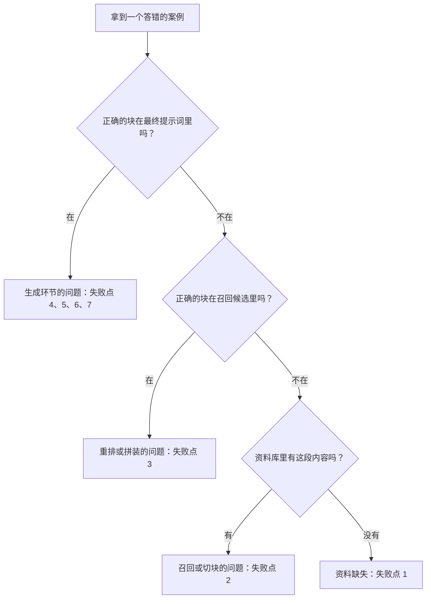

# 07 RAG 为什么会答错：七类失败与定位方法

## 从一个问题开场

RAG 上线后，用户反馈"胎压报警线答错了"。你打开日志，只看到一句错误的答案。

第 6 章结尾说过，链路长的代价是任何一环出错，最后都只表现为"答错了"。本章解决的问题是：**拿到一个错误答案，怎么在十分钟内确定是哪一环坏了。**

## 掰开：答案要闯过的七道关

正确答案从资料库走到用户眼前，要连续闯过七道关，倒在任何一关都是答错。下面这个分类来自 Barnett 等人 2024 年对三个真实 RAG 系统的复盘：

| 编号 | 失败点 | 发生了什么 | 发生在哪一环 |
|---|---|---|---|
| 1 | 资料库里没有 | 答案根本没收录，模型编了一个 | 建库 |
| 2 | 没召回 | 资料库里有，但没进召回的候选 | 召回 |
| 3 | 没进上下文 | 召回了，但重排或截断时被挤掉 | 重排、拼装 |
| 4 | 没读出来 | 正确的块就在提示词里，模型没用它 | 生成 |
| 5 | 格式不对 | 要表格给了段落，要 JSON 给了散文 | 生成 |
| 6 | 详略不对 | 答得太笼统或太琐碎，没答到点上 | 生成 |
| 7 | 答不全 | 答案分散在几块里，只答出一部分 | 召回、生成 |

前三类是**答案没送到模型面前**，后四类是**送到了但没用好**。这条分界线是定位的第一刀。

## 定位方法：从后往前问三个问题

拿到一个答错的案例，把这一次请求的中间产物调出来（所以中间产物必须记日志，第 24 章讲），依次问：

三个问题都只需要做字符串查找，不需要任何模型：

1. 在最终提示词里搜答案的关键字（例如"190千帕"）。
2. 在召回阶段返回的候选列表里搜。
3. 在原始资料里搜。

这就是第 6 章那句话的展开："先看正确的那一块有没有出现在提示词里。"

## 每类失败的常见原因和对策

### 失败点 1　资料库里没有

原因多是文档没收录，或者解析时丢了：扫描件没做文字识别、表格被解析成乱码、图片里的文字被跳过。

对策：补资料；检查解析质量。同时确保提示词里有"资料中未提及就直说"那句退路，让系统在缺资料时拒答，而不去编造。

### 失败点 2　没召回

| 具体原因 | 怎么看出来 | 对策 |
|---|---|---|
| 用词不一致，用户说"轮胎气压"，资料写"胎压" | 关键词一路找不到 | 加向量一路；或先让模型改写问题 |
| 精确编码找不到，如故障码 | 向量一路找不到 | 加关键词一路（第 6 章） |
| 答案被切块切断 | 原文里那句话横跨两块 | 增大重叠；按结构切（第 5 章） |
| 块里缺主语，"其标准值为…" | 块单独读不知道在说什么 | 每块带上章节标题 |
| 问题太口语、太短 | "那个灯亮了咋办" | 结合对话历史改写成完整问题 |

### 失败点 3　没进上下文

召回了 50 块，正确的排在第 12 名，而你只取前 5。对策：加重排模型；或者适当放宽最终取用的块数。

### 失败点 4　没读出来

正确的块在提示词里，模型却答错。常见原因：

- 送进去的块太多，无关内容盖过了正确内容；
- 几块之间互相矛盾（新旧两版手册都在库里），模型选了错的那个；
- 正确内容夹在很长的上下文中间。

对策：减少块数，宁缺毋滥；给每块带上版本和日期，并在提示词里说明以哪个为准；清理库里的过期文档。

### 失败点 5、6　格式与详略

属于提示词问题，按第 4 章的办法处理：给明确的格式要求和示例。

### 失败点 7　答不全

"前后轮胎压各是多少，满载时呢？"需要三个数。如果它们分散在不同块里，而你只召回到其中一块，答案就只有三分之一。

对策：把复合问题拆成几个子问题分别检索；或者改用第 20 章的 Agentic RAG，让模型自己判断查得够不够。

## 手算一次：整条链路的正确率

每一关都可以单独测通过率。假设在 100 道题的测试集上测得：

| 关卡 | 含义 | 通过率 |
|---|---|---|
| 收录 | 答案在资料库里 | 98% |
| 召回 | 正确的块进了前 50 | 90% |
| 重排 | 正确的块留在了前 5 | 95% |
| 生成 | 给了正确的块，模型答对 | 92% |

端到端正确率 = 0.98 × 0.90 × 0.95 × 0.92 ≈ **0.77**

这张表立刻告诉你该把时间花在哪：召回是最低的一环。把生成从 92% 提到 96%，端到端从 77% 到约 80%；把召回从 90% 提到 96%，端到端到约 82%。**先修最弱的一环，而不是最顺手的一环。**

多数团队的直觉是先换更强的模型，因为最省事。但只要问题出在前三关，换模型不会带来任何改善。

## 为什么这样设计

把失败按环节分类，是因为每个环节的修法完全不同、负责的人也可能不同。"答错了"这个现象不指向任何动作，"失败点 2，原因是用词不一致"直接指向"加一路关键词召回"。

## 优势、劣势、什么时候不该用

**优势**：定位只靠日志和字符串查找，不需要额外的模型和工具。

**劣势**：前提是你知道正确答案在哪一块。对没有标准答案的开放性问题（"总结一下保养要点"），这套方法只能部分适用。

**不够用的时候**：错误来自多块信息的综合推理，例如每一块都对，合起来的结论错了。这要靠第 23 章的评测方法逐条核对答案里的每个论断。

## 常见误解

**"RAG 能消除幻觉。"** 只能减少。失败点 1 和 4 都会产生幻觉：没有资料时编，有资料时不用。

**"答错了就调提示词。"** 提示词只管得了失败点 4 到 7。前三类调提示词无效。

**"召回率上去了，答案就准了。"** 召回是必要条件。为了召回率把候选数放得很大，会直接推高失败点 4。

**"每个错例都要单独修。"** 先把 30 到 50 个错例归到七类里数一数。通常一两类占了大半，修掉它们效果最大。

## 小结

- RAG 的失败分两大段：答案没送到模型面前（缺资料、没召回、没进上下文），和送到了没用好（没读出来、格式、详略、不全）。
- 定位从后往前查三处：最终提示词、召回候选、原始资料，全是字符串查找。
- 分环节测通过率，连乘得到端到端正确率，先修最弱的一环。

## 参考

- Barnett et al., *Seven Failure Points When Engineering a Retrieval Augmented Generation System*, arXiv:2401.05856, 2024
- Liu et al., *Lost in the Middle: How Language Models Use Long Contexts*, 2023
