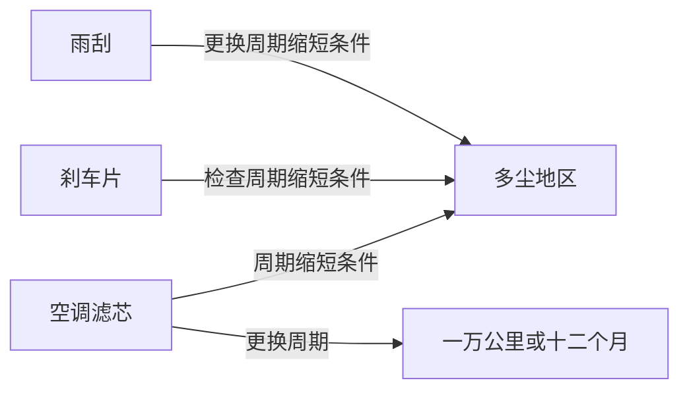

# 08 GraphRAG 与 KAG：当知识有结构

## 从一个问题开场

向量库建好了，问"胎压报警线是多少"答得很好。换两个问题：

- "这本手册里，哪些保养项目的周期会受多尘环境影响？"
- "整本手册一共提了哪几类安全注意事项？"

第一个问题的答案散落在滤芯、刹车、雨刮等十几处，没有哪一块同时提到它们。第二个问题的答案根本不在任何一块里，它需要读完全书后归纳。

第 5、6 章的 RAG 每次只取最像问题的几块。**答案需要把很多块连起来、或者需要俯视全局时，取几块的办法就不够了。** 这是 GraphRAG 和 KAG 要补的地方。

## 掰开：图的实物形态

知识图谱由两样东西组成：实体（点）和关系（边）。最小单位是一个三元组：

```text
（前轮，冷态胎压标准值，240千帕）
（胎压监测系统，报警阈值，190千帕）
（空调滤芯，更换周期，一万公里或十二个月）
（空调滤芯，周期缩短条件，多尘地区）
（刹车片，检查周期缩短条件，多尘地区）
```

存成图之后，"哪些项目受多尘环境影响"变成一次查询：找出所有指向"多尘地区"的边，沿边取回另一端的实体。这种查询不依赖用词是否相似，也不受"只取前几块"的限制。



## 掰开：GraphRAG 的两个阶段

GraphRAG 这个名字泛指"用图组织检索内容的 RAG"，这里以微软 2024 年公开的做法为例。

### 离线建图

1. **切块**，同普通 RAG。
2. **抽取**：让 LLM 读每一块，输出其中的实体和关系。这一步每一块都要调一次 LLM。
3. **聚类**：用社区发现算法（原文用 Leiden）把联系紧密的实体归成一组一组的社区，并且分层，大社区里套小社区。
4. **写摘要**：让 LLM 为每个社区写一段摘要。

建完之后手里有三样东西：原文块、图、各层社区摘要。

### 在线查询

| 查询方式 | 适合的问题 | 怎么做 |
|---|---|---|
| 局部查询 | 围绕某个具体实体的问题 | 找到问题提到的实体，取它的邻居、相关原文块、所在社区摘要，拼成上下文 |
| 全局查询 | 俯视全库的归纳性问题 | 让 LLM 分别读各个社区摘要并各写一份局部答案，再把局部答案汇总成最终答案 |

全局查询就是开场第二个问题的解法：归纳在建库时已经做过一遍了，查询时是在归纳的结果上再归纳。

## 资源账本：建图有多贵

沿用第 5 章的数：20 万字手册，572 块，每块 400 字。按 1 字约 1 token 粗算。

抽取阶段每块调一次 LLM：

- 每次输入 = 抽取提示词约 600 + 块 400 = 1,000 token
- 每次输出（实体和关系列表）约 300 token
- 合计输入 572 × 1,000 = **572,000**，输出 572 × 300 = **171,600**

再加社区摘要。假设形成 60 个社区，每个社区读入 2,000、写出 300：输入 120,000，输出 18,000。

**建图总计约：输入 69 万 token，输出 19 万 token。**

对比普通 RAG 建库：只需要把 20 万字过一遍嵌入模型，嵌入模型的单价通常比 LLM 低一到两个数量级，而且没有输出。

所以 GraphRAG 的建库成本是普通 RAG 的很多倍，资料每更新一次还要重新抽取受影响的部分。全局查询也贵：要读几十个社区摘要，一次查询是几十次 LLM 调用。

## 掰开：KAG 多了什么

KAG 来自蚂蚁集团，面向的是医疗、政务、金融这类要求严谨的专业领域。它认为上面那种让 LLM 自由抽取出来的图有两个问题：抽出来的关系名五花八门，没有统一规范；图只用来帮助找文本，没有真正用来做推理。

它的几个关键设计：

| 设计 | 做什么 | 解决什么 |
|---|---|---|
| 受约束的图谱 | 实体类型、关系类型预先由领域专家定义，抽取结果要对齐到这套定义上 | 自由抽取的图噪声大、同一关系有多种叫法 |
| 图与原文互相索引 | 图上每个节点能指回它出自的原文块，每个原文块能指向它包含的节点 | 图的结论可追溯到原文，原文检索也能借助图扩展 |
| 逻辑形式推理 | 把问题拆成若干步明确的操作（检索、筛选、数值计算、比较），逐步执行 | "满载时后轮比前轮高多少"这类需要计算和比较的问题 |

最后一条举个例子。"满载时后轮胎压比前轮标准值高多少？"会被拆成：

1. 取（后轮，满载胎压）→ 270
2. 取（前轮，冷态胎压标准值）→ 240
3. 计算 270 − 240 → 30

每一步都是确定的操作。纯向量 RAG 做这道题，是把相关的块交给 LLM，指望它自己读出两个数再心算，出错的环节更多。

代价是需要预先定义领域的类型体系。这是一笔不小的人工投入，只有在知识相对稳定、对准确性要求高的领域才划算。

## 为什么这样设计

向量检索把每一块当成孤立的点，块与块之间的联系在切块那一刻就丢了。图把这些联系显式地存回来。GraphRAG 侧重利用图做聚类和摘要，解决全局性问题；KAG 侧重利用图做受约束的推理，解决专业领域的严谨性问题。

## 优势、劣势、什么时候不该用

**优势**：能回答多跳问题和全局归纳问题；推理路径可以展示，便于核查。

**劣势**：
- 建库贵，更新贵；
- 图的质量取决于抽取质量，抽错的关系会被当作事实使用；
- 系统复杂，出问题时要排查的环节更多。

**不该用的时候**：问题基本是"查一个具体事实"。这类问题第 6 章的两路召回已经够好，上图只会增加成本。判断方法是把线上真实问题抽 100 条分类，多跳和全局问题占比很低时，不值得上。

## 常见误解

**"GraphRAG 是 RAG 的升级版，应该全面替换。"** 它补的是特定类型的问题。在简单事实查询上它不比普通 RAG 好，而且贵很多。常见做法是两者并存，按问题类型分流。

**"有了图，就不需要向量了。"** 两个系统都仍然依赖向量：找到问题对应的实体、取回原文块，都要用。

**"图是 LLM 抽的，所以是准的。"** 抽取会出错，也会遗漏。专业领域要么像 KAG 那样加类型约束，要么需要人工抽检。

**"KAG 和 GraphRAG 是一回事。"** 都用图，目标不同。一个偏向全局摘要，一个偏向领域内的严谨推理。

## 小结

- 普通 RAG 每次只取几块，答不好需要连接多处信息或俯视全局的问题；图把块之间的联系显式存下来。
- GraphRAG 在建库时抽取实体关系、聚类并预写社区摘要，查询分局部和全局两种；KAG 用预定义的类型体系和逻辑形式推理追求专业领域的严谨。
- 两者的建库成本都远高于普通 RAG，先统计真实问题里多跳和全局问题的占比，再决定要不要上。

## 参考

- Edge et al., *From Local to Global: A Graph RAG Approach to Query-Focused Summarization*, arXiv:2404.16130, 2024
- Liang et al., *KAG: Boosting LLMs in Professional Domains via Knowledge Augmented Generation*, arXiv:2409.13731, 2024
- Traag, Waltman & van Eck, *From Louvain to Leiden: Guaranteeing Well-Connected Communities*, 2019
