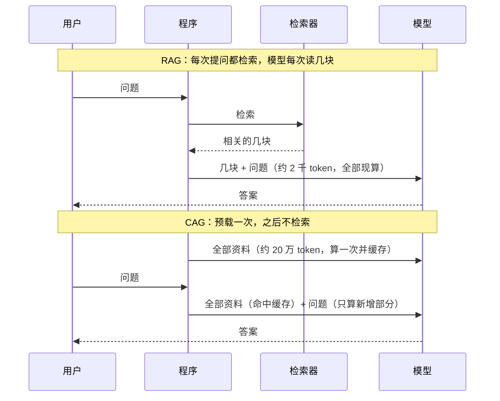

# 09 CAG 与长上下文：什么时候可以不检索

## 从一个问题开场

第 5 章开头问过：一本 20 万字的手册，为什么不整本塞给模型？当时给了三个理由：装不下、贵、不准。

几年过去，三个理由都松动了。上下文窗口从几千 token 涨到了几十万甚至上百万，一本手册确实装得下；服务商提供了提示缓存，重复的内容大幅打折。

于是有人提出反过来的做法：**资料不大时，干脆全放进去，不检索。** 这就是 CAG。本章算清楚它什么时候划算。

## 掰开：CAG 的实物形态

CAG 是 Cache-Augmented Generation 的缩写，分两步：

1. **预载**：把全部资料放在提示词的最前面，让模型完整处理一遍，把处理过程中的中间计算结果保存下来。
2. **复用**：之后每次提问，直接加载保存的结果，只需要计算新增的那句问题。

要保存的"中间计算结果"叫 KV 缓存。模型读一段文字时，每一层都会为每个 token 算出两组向量（键和值）。这些向量只取决于这个 token 和它前面的内容。所以只要开头那段资料不变，它对应的 KV 缓存就可以原样重用。内部细节见第一卷。

*图 F05　RAG 与 CAG 的推理时序对比。RAG 把工作量放在每次提问的检索上，CAG 把工作量放在一次性的预载上。*

## 两种落地形态

| | 用服务商的提示缓存 | 自己部署模型，自己存 KV 缓存 |
|---|---|---|
| 怎么做 | 每次请求照常带上全部资料，把资料放在开头并标记为可缓存 | 预载后把 KV 缓存存到内存或磁盘，提问时加载 |
| 省了什么 | 命中缓存的部分按折扣价计费，处理也更快 | 省掉重复计算 |
| 限制 | 缓存有有效期，一段时间没人用就失效；必须是完全相同的前缀才能命中 | 缓存很占空间 |

大多数团队用的是左边这种。原始论文描述的是右边这种。

### 手算：KV 缓存有多大

**占用 = 2 × 层数 × token 数 × 每层键值向量的宽度 × 每个数的字节数**

开头的 2 是键和值两组。假设一个 32 层的模型，键值向量宽度 4096，用 16 位浮点（2 字节）存，预载 20 万 token：

- 2 × 32 × 200,000 × 4,096 × 2 = 104,857,600,000 字节 ≈ **98 GB**

接近一百 GB，只为一本手册。很多模型用了分组注意力，键值宽度只有这个数的几分之一，占用同比例缩小，但仍然是几十 GB 的量级。对比第 5 章算过的：同一本手册的向量库是 2.2 MB。

这就是自己做 CAG 的主要成本：用存储换计算。

## 资源账本：和 RAG 比一次提问的费用

用第 35 章的假设单价（输入每百万 token 10 元，缓存命中每百万 1 元，输出每百万 40 元），回答同一个问题、输出 200 token：

| 方案 | 输入 token | 单次费用 | 每天一万次 |
|---|---|---|---|
| RAG（5 块 × 400 字） | 2,100 | 0.029 元 | 290 元 |
| 整本放入，不缓存 | 200,100 | 2.009 元 | 20,090 元 |
| 整本放入，缓存命中 | 200,100 | 0.209 元 | 2,090 元 |

缓存把"整本放入"的费用降了约十倍，但仍比 RAG 贵约七倍。这些数字可用 `code/ch35_cost.py` 复算，单价换成你的实际价格。

费用之外的两笔账：

- **RAG 的隐性成本**：要搭建和维护切块、嵌入、向量库、重排一整条链路，还要承担第 7 章那七类失败。
- **CAG 的隐性成本**：缓存有有效期，访问稀疏时每次都按未命中计费；资料一改，缓存全部作废重算。

## 长上下文不等于读得准

装得下不代表用得好。两个已被反复观察到的现象：

- **中间容易丢**：关键信息位于长输入的中段时，被用上的概率低于在开头或结尾。
- **越长越分散**：输入越长，无关内容越多，模型在具体细节上出错的概率上升。

新模型在这两点上有改善，但没有消除。所以资料只是"装得下"时，不能默认答案就可靠，要用自己的问题集测一遍。

反过来，CAG 有一个 RAG 天生做不到的长处：**模型看到的是全文。** 需要跨章节对照、需要全局归纳的问题，RAG 取几块是答不好的（第 8 章为此动用了图），全文在手则可以直接回答。

## 选型判据

| 条件 | 倾向 CAG | 倾向 RAG |
|---|---|---|
| 资料总量 | 远小于窗口，比如不到窗口的一半 | 接近或超过窗口 |
| 更新频率 | 很少变 | 经常增删改 |
| 访问密度 | 密集，缓存能持续命中 | 稀疏 |
| 问题类型 | 需要通读、对照、归纳 | 查具体事实 |
| 是否要出处 | 可有可无 | 必须精确到段落 |
| 工程投入 | 想尽快上线，不想维护检索链路 | 可以投入 |

一个实用的顺序：资料不大时，先用"全文放入加缓存"上线，这是最简单的可用系统。等资料涨到装不下、或者费用成为问题，再迁到 RAG。这时你已经积累了真实问题，评测 RAG 也有了依据。

两者也可以组合：把每次都要用的核心资料（产品基本信息、术语表）预载并缓存，把海量的长尾资料交给检索。

## 为什么这样设计

RAG 的假设是模型读不了多少，所以要替它筛。当这个假设不再成立，筛选这一步带来的出错风险就可能大于它省下的成本。CAG 是对这个变化的直接回应：去掉检索，也就去掉了检索出错的可能。

## 常见误解

**"CAG 是利用历史对话做个性化。"** 那是记忆（第 10 章）。CAG 缓存的是固定资料的计算结果。

**"窗口够大了，RAG 就过时了。"** 企业资料动辄上亿字，任何窗口都装不下；即使装得下，每次读全部也比读几块贵。两者适用的规模不同。

**"用了缓存，长上下文就没有代价。"** 缓存降的是价格和首字延迟，降不了长输入带来的准确率损失。

**"缓存命中是自动的。"** 只有前缀逐字相同才命中。在资料前面放一个当前时间、或者每次打乱文档顺序，缓存就全部失效。易变的内容要放在最后。

## 小结

- CAG 把全部资料预载进上下文并缓存其计算结果，之后提问不再检索；最常见的落地形态是服务商的提示缓存。
- 它用更高的单次费用和存储，换来没有检索链路、没有检索失败、模型能看到全文。
- 资料小、稳定、访问密集、需要通读时倾向 CAG；资料大、常变、需要精确出处时倾向 RAG；资料不大时先用 CAG 上线是合理的起点。

## 参考

- Chan et al., *Don't Do RAG: When Cache-Augmented Generation is All You Need for Knowledge Tasks*, arXiv:2412.15605
- Liu et al., *Lost in the Middle: How Language Models Use Long Contexts*, 2023
- 本系列第一卷：KV 缓存与「资源账本」篇
