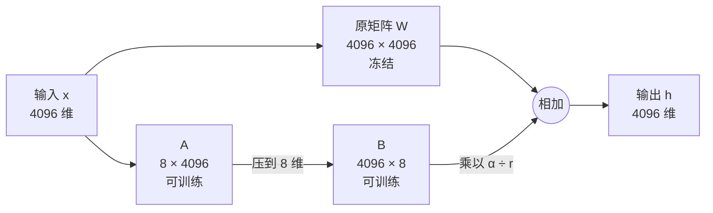
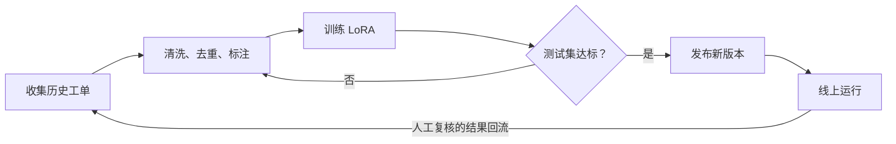

# 11 微调、LoRA、蒸馏各改了什么

> ▶ 本章配套代码：`code/ch11_lora.py`，只用 Python 标准库，可直接运行。它用纯 Python 从零训练一个 LoRA。

## 从一个问题开场

客服质检要把每通电话的记录归成 37 类，并按固定格式输出。提示词写了三千字、放了二十个示例，合格率卡在九成上不去，而且每次调用都要为这三千字付费。

篇二的所有技术都在改"这一次给模型看什么"。本章换一个旋钮：**改模型本身。** 让它不用看那三千字，也知道该怎么做。

## 掰开：权重文件里是什么

模型的全部能力存在权重里。权重的实物形态是一个文件，里面是一大批浮点数，按矩阵组织。一个 70 亿参数的模型就是 70 亿个数，用 16 位浮点存约 14 GB。

模型处理输入时，输入向量依次与这些矩阵相乘。所谓"改模型"，就是改这些数。三种技术的区别在于改多少、怎么改：

| 技术 | 改了什么 | 产出物 |
|---|---|---|
| 全量微调 | 所有参数都更新 | 一份完整的新权重，和原模型一样大 |
| LoRA | 原权重冻结，旁边加一小组新参数，只训练新参数 | 一个很小的附加文件 |
| 蒸馏 | 不改原模型，训练另一个小模型去模仿它 | 一个更小的新模型 |

## 掰开：微调

微调是在已训练好的模型上，用你的数据继续训练。训练数据的实物形态是一批输入输出对：

```json
{"messages": [
  {"role": "user", "content": "客户说上周刚换的雨刮又不动了，要求退费。"},
  {"role": "assistant", "content": "{\"类别\": \"维修质量投诉\", \"紧急度\": \"高\", \"诉求\": \"退费\"}"}
]}
```

训练过程：把输入喂给模型，比较它的输出和标准答案的差距，朝缩小差距的方向把每个参数调一点点。几千条数据过几遍之后，模型看到类似输入时，就倾向于产出类似格式和风格的输出。

微调擅长改的是**行为**：输出格式、语气、分类口径、领域术语的用法。它不擅长的是**灌输事实**，原因在第 12 章展开。

## 掰开：LoRA 改了哪里

LoRA 的全称是 Low-Rank Adaptation，低秩适配。一句话：**不动大模型原来的参数，在它的一部分矩阵旁边各挂一组很小的、可以训练的参数，只训练这一小组。**

可以这样理解：14 GB 的底座模型是一台已经造好的通用机器，几 MB 的 LoRA 文件是一套可以随时更换的功能插件。一个售后质量系统可以这样搭：

| 部件 | 负责什么 | 体积 |
|---|---|---|
| 底座模型 | 理解中文、分析、推理 | 14 GB，只有一份 |
| LoRA 甲 | 客诉分类 | 几 MB |
| LoRA 乙 | 工单摘要 | 几 MB |
| LoRA 丙 | 故障原因归类 | 几 MB |

三个任务共用一份底座，不必为每个任务各存一份 14 GB 的模型。

### 一层里发生的事

模型里的一层，核心是一次矩阵乘法。输入向量 x 乘以权重矩阵 W，得到输出 h：

**h = W · x**

设 W 是 4096 行 4096 列。全量微调要更新这 16,777,216 个数。

LoRA 冻结 W，在旁边加两个小矩阵：A 是 r 行 4096 列，B 是 4096 行 r 列。r 叫作秩，远小于 4096，常取 8。计算变成两条支路相加：

**h = W · x + (α ÷ r) · B · (A · x)**



下面那条支路做的事是：先用 A 把 4096 维的输入压缩成 8 维，再用 B 把这 8 维展开回 4096 维。α 是一个缩放系数，α ÷ r 控制这条支路对输出的影响有多大。

B 和 A 乘起来（B · A）是一个 4096 × 4096 的矩阵，它就是"对 W 的修改量"。但它是由两个小矩阵相乘得到的，所以它的秩最多是 r。这就是"低秩"的含义：**LoRA 假设让模型适应一个新任务所需的权重变化，可以用一个秩很低的矩阵来表示。** 它不是把原矩阵缩小了，原矩阵一个数都没变。

### 手算：省了多少参数

取 r = 8：

| | 参数个数 | 计算 |
|---|---|---|
| 原矩阵 W | 16,777,216 | 4096 × 4096 |
| A | 32,768 | 8 × 4096 |
| B | 32,768 | 4096 × 8 |
| LoRA 合计 | 65,536 | |
| 比例 | **0.39%** | 65,536 ÷ 16,777,216 |

只训练千分之四的参数。通用公式：一个 d 行 k 列的矩阵，LoRA 参数是 **r × (d + k)** 个。

再算整个文件有多大。假设对模型里的 64 个这样的矩阵都挂上 LoRA（例如 32 层、每层挂两个）：

- 可训练参数 = 64 × 65,536 = 4,194,304 个
- 用 16 位浮点存：4,194,304 × 2 字节 ≈ **8 MB**

一个 14 GB 的模型，它的 LoRA 文件只有 8 MB。这个数不是固定的，四个因素决定它：

**文件大小 ≈ 挂了多少个矩阵 × r × (d + k) × 每个数的字节数**

r 翻倍，文件翻倍；多挂一类矩阵，文件按比例增加。

## 掰开：LoRA 是怎么训练的

训练过程和普通的神经网络训练一样，区别只有一条：梯度只用来更新 A 和 B。

配套代码用纯 Python 把这个过程从零实现了一遍。它用一个 16 × 16 的矩阵代表底座里的一层，"新任务"要求这一层的行为发生一个秩为 2 的变化，看旁挂的 A、B 能不能把这个变化学出来。真实的 LoRA 做的是同一件事，只是矩阵大得多、层多得多。

### 第一步：准备训练数据

和上面微调的数据一样，一批输入输出对，通常存成每行一条 JSON 的文件：

```json
{"instruction": "分析客诉", "input": "车辆启动后中控黑屏，重启后恢复", "output": "故障分类：座舱显示异常；严重等级：高；建议：采集启动日志"}
{"instruction": "分析客诉", "input": "导航偶尔定位漂移", "output": "故障分类：导航定位异常；严重等级：中；建议：检查定位数据"}
```

数据越规范、标注口径越一致，训练出来的行为越稳定。

### 第二步：初始化 A 和 B

- A 用小的随机数初始化；
- **B 初始化为全零。**

B 全零意味着 B · A 等于零，下面那条支路的输出是零。所以刚挂上 LoRA、还没开始训练时，模型的行为和原来完全一样。配套代码验证了这一点：

```text
一、初始状态：B 全零，挂上 LoRA 后输出与底座完全相同
  与底座输出的最大差值：0.000000
```

这个设计让训练从"原模型"这个已知的好起点出发，而不是从一个被随机扰动过的模型出发。

### 第三步：前向计算

输入一条数据，按上面的公式算出输出。配套代码里就是一行：

```python
def forward(W, A, B, x, scale):
    ax = matvec(A, x)
    return [w + scale * b for w, b in zip(matvec(W, x), matvec(B, ax))], ax
```

`matvec(W, x)` 是冻结的底座那条支路，`matvec(B, ax)` 是 LoRA 那条支路。

### 第四步：计算损失

比较模型的输出和标准答案，差距用一个数表示，叫损失。例如模型输出"严重等级：中"，标准答案是"严重等级：高"，损失就大。

### 第五步：反向传播，只更新 A 和 B

| 参数 | 算不算梯度 | 更不更新 |
|---|---|---|
| 底座的 W | 不算 | 不更新 |
| A | 算 | 更新 |
| B | 算 | 更新 |

这里有一个容易误解的地方：**冻结底座不等于训练时不需要底座。** 每一步的前向计算都要完整地经过底座的所有层，反向传播时梯度也要穿过这些层才能到达各处的 A 和 B。省掉的只是"为 W 存梯度和更新 W"这一部分。所以 LoRA 训练时底座模型仍然要完整地加载进显存，它省的是可训练参数对应的那部分开销，而不是全部。

### 第六步：重复

读下一批数据，重复第三到第五步，过几遍全部数据。配套代码的训练记录：

```text
二、训练过程（r=2）：损失逐步下降
  第    1 到   50 步平均损失：23.2955
  第   51 到  200 步平均损失：3.3104
  第  201 到  500 步平均损失：0.0001
  第  501 到 1000 步平均损失：0.0000
```

训练结束后检查三件事：

```text
三、训练结束后
  底座 W 是否被改动：否
  旁挂计算与合并后计算的最大差值：0.000000
  学到的变化量与目标变化量的最大差值：0.0000
```

- 底座一个数都没变；
- A、B 学到的变化量，与任务真正需要的变化量一致；
- 把 B · A 加回 W 里再计算，和旁挂着计算，结果相同。这是后面"合并"的依据。

### 秩 r 选多大

配套代码里，任务需要的变化量秩是 2。分别用 r = 1、2、4 去学：

```text
四、秩选多大：目标变化量的秩是 2
  r=1  最后 100 步平均损失：8.5472
  r=2  最后 100 步平均损失：0.0000
  r=4  最后 100 步平均损失：0.0000
```

r = 1 学不会：一个秩为 1 的矩阵表达不了秩为 2 的变化，损失停在高位降不下去。r = 2 刚好够。r = 4 也能学会，但参数多了一倍，没有带来任何好处。

真实任务里没人知道"需要的秩"是多少，只能试。经验上的取值范围：

| r | 特点 |
|---|---|
| 4 到 8 | 常见起点，格式、风格、分类这类任务多数够用 |
| 16 到 32 | 任务更复杂，或者 8 明显欠拟合时 |
| 64 以上 | 参数预算更高，过拟合风险和训练成本同步上升 |

r 调大不保证效果变好，只保证参数变多。先从小的试起，用第 32 章的评测决定要不要加。

## 掰开：训练出来的文件里有什么

以最常用的开源工具库 Hugging Face PEFT 为例，训练完成后的输出目录是这样的：

```text
complaint-lora/
├── adapter_config.json
└── adapter_model.safetensors
```

### 配置文件

`adapter_config.json` 说明这个 LoRA 是怎么挂上去的：

```json
{
  "base_model_name_or_path": "Qwen/Qwen2.5-7B-Instruct",
  "r": 8,
  "lora_alpha": 16,
  "lora_dropout": 0.05,
  "target_modules": ["q_proj", "k_proj", "v_proj", "o_proj"],
  "bias": "none",
  "task_type": "CAUSAL_LM"
}
```

| 字段 | 含义 | 改它的影响 |
|---|---|---|
| `base_model_name_or_path` | 它是为哪个底座训练的 | 换底座就不能用了 |
| `r` | 秩 | 越大参数越多 |
| `lora_alpha` | 缩放系数 α | α ÷ r 决定 LoRA 支路的影响幅度 |
| `lora_dropout` | 训练时随机丢弃的比例 | 用来降低过拟合 |
| `target_modules` | 挂在哪些矩阵旁边 | 决定挂多少个、挂在哪 |
| `bias` | 是否顺带训练偏置项 | 影响可训练参数的范围 |
| `task_type` | 任务类型 | 影响工具库怎样包装模型 |

`target_modules` 里的 `q_proj`、`k_proj`、`v_proj`、`o_proj` 是注意力层里的四个矩阵的名字。不同模型的命名不一样，要对照所用模型的结构填写。LoRA 的原始论文只挂了注意力层里的两个，现在常见的做法是注意力层的全部矩阵都挂，有时连前馈层也挂。

### 权重文件

`adapter_model.safetensors` 里是所有 A、B 矩阵的数值。里面的每一项都有名字，形如：

```text
…layers.0.self_attn.q_proj.lora_A.weight     形状 8 × 4096
…layers.0.self_attn.q_proj.lora_B.weight     形状 4096 × 8
…layers.0.self_attn.v_proj.lora_A.weight
…layers.0.self_attn.v_proj.lora_B.weight
…layers.1.self_attn.q_proj.lora_A.weight
……
```

名字里写明了它属于第几层的哪个矩阵。由此可见 LoRA 文件的本质：

**它不是一个独立的模型，而是针对某个特定底座的特定几层的一组修改量。** 脱离那个底座，这些数没有意义。一个为甲模型训练的 LoRA 不能挂到乙模型上，同一个模型的不同版本之间通常也不通用，因为层的形状和原有权重都不一样。

## 掰开：LoRA 怎么加载

三种方式，对应三种部署需求。下面的代码基于 Hugging Face 的 Transformers 和 PEFT 库，用来说明用法。本书的配套代码只用标准库，这几段没有在本仓库里运行验证，接口细节以官方文档为准。

### 方式一：动态挂载

底座只加载一次，要做哪个任务，就挂上对应的 LoRA。

```python
from transformers import AutoModelForCausalLM, AutoTokenizer
from peft import PeftModel

base_path = "Qwen/Qwen2.5-7B-Instruct"

# 1. 加载底座，只做一次
model = AutoModelForCausalLM.from_pretrained(base_path, torch_dtype="auto", device_map="auto")
tokenizer = AutoTokenizer.from_pretrained(base_path)

# 2. 挂上客诉分类的 LoRA
model = PeftModel.from_pretrained(model, "./lora/complaint")

# 3. 推理
inputs = tokenizer("车辆启动后中控黑屏", return_tensors="pt").to(model.device)
outputs = model.generate(**inputs, max_new_tokens=200)
print(tokenizer.decode(outputs[0], skip_special_tokens=True))
```

同一个模型实例上可以预先挂多个，按名字切换：

```python
model.load_adapter("./lora/ticket_summary", adapter_name="summary")   # 再挂一个

model.set_adapter("summary")    # 切到工单摘要
model.set_adapter("default")    # 切回客诉分类；第一个挂上的默认叫 default
```

切换只是改变"当前用哪一组 A、B"，不需要重新加载 14 GB 的底座，所以很快。

要注意并发：切换是对整个模型实例生效的。两个请求同时进来，一个要分类、一个要摘要，如果直接切换，后一个请求会改掉前一个正在用的适配器。在线服务要么用支持按请求指定适配器的推理框架，要么自己做好请求排队和隔离。

### 方式二：合并进底座

把修改量直接加回原矩阵：

**W′ = W + (α ÷ r) · B · A**

合并之后只剩一个普通的模型，不再有旁挂的支路。

```python
from transformers import AutoModelForCausalLM
from peft import PeftModel

base = AutoModelForCausalLM.from_pretrained("Qwen/Qwen2.5-7B-Instruct")
model = PeftModel.from_pretrained(base, "./lora/complaint")

merged = model.merge_and_unload()            # 合并
merged.save_pretrained("./merged/complaint")  # 存成一个独立的完整模型
```

配套代码里"旁挂计算与合并后计算的最大差值：0.000000"说的就是这件事：两种算法在数学上等价。

| | 动态挂载 | 合并 |
|---|---|---|
| 推理速度 | 每层多算一条小支路，略慢 | 与原模型完全相同 |
| 磁盘占用 | 一份底座加若干个小文件 | 每个任务一份完整模型 |
| 切换任务 | 换适配器，快 | 换整个模型，慢 |
| 撤销或修改 | 卸掉即可 | 合并后难以还原 |
| 部署工具 | 需要支持适配器 | 任何能跑原模型的工具都行 |

选择很直接：只跑一个任务、追求部署简单，就合并；多个任务共用一份底座，就动态挂载。

合并有一个坑：底座如果是量化过的（例如 4 位），直接合并会遇到精度和格式的兼容问题，通常要先在未量化的底座上合并，再重新量化。

### 方式三：多个 LoRA 叠加

PEFT 支持把几个适配器按权重合成一个新的：

```python
model.add_weighted_adapter(
    adapters=["complaint", "summary"],
    weights=[0.7, 0.3],
    adapter_name="combined",
    combination_type="linear",
)
```

数学上是把两个修改量加权相加。但这不等于得到了"七成的分类能力加三成的摘要能力"。两个 LoRA 是各自独立训练的，它们的修改量可能在同一批参数上互相抵触，叠加后两个任务都变差是常见结果。

把它当作一种实验手段：可以试，试完必须用测试集验证。多任务的稳妥做法仍然是每个任务一个 LoRA、按任务切换。

## 掰开：怎么修改一个训练好的 LoRA

客诉分类的 LoRA 上线后，类别体系从 3 类扩成了 7 类。怎么办？

首先排除一个错误做法：打开 `adapter_config.json` 改几个字段。配置文件只是说明书，能力在权重文件里。改说明书不会改变能力，改错了还会导致加载失败。

可行的办法有三种：

### 一、在原来的基础上继续训练

```python
model = PeftModel.from_pretrained(base, "./lora/complaint", is_trainable=True)
# 然后用新数据接着训练
```

保留已有的学习成果，不必从零开始。

风险是**灾难性遗忘**：如果只用新增 4 类的数据训练，模型会逐渐忘掉原来 3 类怎么分。对策是新旧数据混在一起训练。

### 二、重新训练一个新版本

```text
lora/
├── complaint_v1/
├── complaint_v2/
└── complaint_v3/
```

用完整的新数据集从头训练，旧版本原样保留。

正式业务系统推荐这种做法。LoRA 文件只有几 MB，多存几个版本没有成本，换来的是可追溯、可对比、可回滚：新版本上线后发现问题，切回旧版本只需要换一个文件。

### 三、改秩

发现 r = 8 不够用，想换成 r = 16。

这不能通过改配置实现：A 的形状从 8 × 4096 变成 16 × 4096，原来的权重文件对不上了。需要按新的 r 重新训练。

三种办法都离不开同一样东西：一个固定的测试集（第 32 章）。没有它，就无法判断修改之后是变好了还是变坏了。

## 动手：训练一个 LoRA 的骨架

用 Transformers 加 PEFT，核心配置只有几行：

```python
from transformers import AutoModelForCausalLM
from peft import LoraConfig, get_peft_model

model = AutoModelForCausalLM.from_pretrained("Qwen/Qwen2.5-7B-Instruct")

config = LoraConfig(
    r=8,
    lora_alpha=16,
    lora_dropout=0.05,
    target_modules=["q_proj", "k_proj", "v_proj", "o_proj"],
    bias="none",
    task_type="CAUSAL_LM",
)

model = get_peft_model(model, config)   # 挂上 LoRA，并冻结底座
model.print_trainable_parameters()      # 打印可训练参数的数量和占比
```

最后一行会告诉你可训练参数占总参数的比例，通常远小于 1%。数字和预期差很多时，多半是 `target_modules` 写错了。

之后接上数据集和训练器，执行训练，最后只保存适配器：

```python
trainer.train()
model.save_pretrained("./lora/complaint")
```

这是骨架。完整流程还需要分词器、数据格式化、训练参数和显存配置。有两点最容易出错：

- **训练和推理要用同一种提示词格式。** 训练数据是"指令、输入、输出"三段，推理时也要按同样的格式组织输入，否则效果会大打折扣。
- **显存不够时用 QLoRA。** 先把底座量化到 4 位再加载，A、B 仍用较高精度训练。底座占用的显存降到原来的几分之一，单张消费级显卡也能微调较大的模型。量化的细节见第一卷。

## LoRA 的限制

| 问题 | 说明 | 对策 |
|---|---|---|
| 文件大小不是固定的 | 取决于挂多少矩阵、秩、矩阵形状、数值精度 | 按上面的公式自己算 |
| 训练仍然吃显存 | 底座要完整加载，每层的中间结果也要存 | 显存不足用 QLoRA |
| 不适合装事实 | 改的是行为倾向，不是一个可以查询的知识库 | 事实交给 RAG（第 5、6 章） |
| 多个 LoRA 可能互相干扰 | 各自训练的修改量未必兼容 | 分任务训练、分任务评测 |
| 绑定底座 | 依赖特定底座的结构和原有权重 | 固定底座版本；底座升级后重训 |
| 参数少不代表容易训好 | 效果主要取决于数据质量 | 先建测试集，再准备数据 |

第三行值得用例子说清楚。同一个售后系统里的四个需求：

| 需求 | 用什么 | 原因 |
|---|---|---|
| 按公司的口径给客诉分类 | LoRA | 这是行为，口径稳定 |
| 按公司的模板写工单摘要 | LoRA | 这是格式和风格 |
| 查某个故障码的最新处理案例 | RAG | 这是事实，而且会更新 |
| 查某供应商当前的缺陷数量 | 工具调用（第 13 章） | 这是实时数据 |

一个完整的系统通常四样都有：底座模型负责理解和推理，LoRA 固化各项任务的行为，RAG 提供会变的知识，工具去取实时数据和执行操作，再用第 32 章的评测把关每一次改动。第 37 章的客诉分诊案例就是这样组合的。

## 掰开：蒸馏

蒸馏解决的是另一个问题：大模型效果好但又贵又慢，能不能让一个小模型在特定任务上达到接近的效果？

做法是让大模型（教师）给一批输入生成输出，再拿这些输入输出对去训练小模型（学生）。

| 步骤 | 做什么 |
|---|---|
| 1 | 收集真实输入，例如十万条客服记录，不需要人工标注 |
| 2 | 用大模型配上精心写的提示词，为每条生成输出 |
| 3 | 抽检并清洗这批输出 |
| 4 | 用这批数据微调小模型 |

第 4 步就是一次普通的微调，通常用 LoRA。所以蒸馏可以理解为**数据由大模型来标注的微调**。它把人工标注的成本换成了大模型的调用费。

经典的蒸馏还会让学生学习教师输出的完整概率分布，而不只是最终答案，这需要能拿到教师模型的内部输出。通过接口调用大模型时拿不到，只能用最终文本，上面描述的就是这种做法。

学生模型的上限是教师在这个任务上的水平，教师的错误也会被学过去。

## 三者的关系

它们不互斥，常见组合是：用大模型加长提示词把任务跑通，把它的输出收集起来（蒸馏的数据），再用 LoRA 微调一个小模型（训练的方法）。

| 你的目的 | 用什么 |
|---|---|
| 让模型稳定地按某种格式、风格、口径输出 | 微调，通常用 LoRA |
| 缩短提示词，降低每次调用的成本 | 微调 |
| 把大模型的效果搬到小模型上，降本提速 | 蒸馏 |
| 在自己的硬件上部署 | 蒸馏或微调开源小模型 |
| 多个任务共用一份模型 | 每个任务一个 LoRA，动态挂载 |

把数据准备、训练、评测、发布串成一条自动化的流水线，就是常说的"训练工厂"：



这条流水线里技术含量最高的是"清洗、标注"和"测试集"两环。训练那一步反而最标准化。

## 为什么这样设计

提示词是每次调用都要重新交代的临时说明，权重是一次写入、长期生效的习惯。任务固定、调用量大时，把说明"烧"进权重更划算。

LoRA 的设计来自一个经验事实：让模型适应一个新任务，需要的改动量远小于模型的总容量。既然改动量本身是低秩的，就没必要为它准备一个满秩矩阵那么多的参数。把修改量做成可拆卸的小文件，又顺带解决了多任务的存储和切换问题。

## 优势、劣势、什么时候不该用

**优势**：行为稳定；提示词可以大幅缩短；可以换用更小更快的模型；LoRA 让一份底座服务多个任务，版本管理和回滚都很轻。

**劣势**：
- 需要训练数据，通常几百到几千条高质量样本，数据质量直接决定结果；
- 迭代慢：改提示词是秒级，改一次微调要重新训练和评测，以小时计；
- 底座模型升级后，微调要重做；
- 可能在训练数据没覆盖的输入上退化。

**不该用的时候**：
- 需求还在变。微调把行为固化下来，需求一改就要重训。还在变的做事方法，写成第 29 章的技能更合适；
- 缺的是知识而不是行为，应该用篇二的技术；
- 调用量不大，训练和维护成本摊不回来。第 12 章给算法；
- 用的是只提供接口的闭源模型，且厂商不开放微调。这时只能用提示词和蒸馏到开源小模型两条路。

## 常见误解

**"微调能让模型学会我们的文档。"** 微调几千条问答对，模型学到的主要是"这类问题该用什么方式回答"。要它准确复述具体数值和条款，效果远不如 RAG，而且文档一更新就要重训。

**"LoRA 是打了折扣的微调。"** 在多数任务适配场景下，LoRA 与全量微调的效果接近。它是默认选项，全量微调是特殊情况。

**"LoRA 把模型压缩了。"** 底座一个数都没变，也没有变小。LoRA 文件小，是因为它只存修改量。

**"冻结了底座，训练就不需要多少显存。"** 底座仍然要完整加载并参与每一步计算。省的是可训练参数那部分的开销。

**"LoRA 文件可以拿到别的模型上用。"** 它是针对特定底座的修改量，换底座无效。

**"改一下配置文件里的 r 就能扩容。"** 权重的形状对不上，需要重新训练。

**"蒸馏出的小模型和大模型一样强。"** 只在被蒸馏的那个任务上接近。任务之外的通用能力，小模型仍然是小模型。

**"微调之后就不用写提示词了。"** 还是要写，只是可以很短。训练时用什么提示词格式，推理时就要用同样的格式。

## 小结

- 微调改权重，擅长固化行为；LoRA 冻结原权重，在一部分矩阵旁各挂两个小矩阵 A 和 B，只训练它们，参数量通常不到原来的百分之一；蒸馏用大模型的输出训练小模型。
- LoRA 文件是针对特定底座的一组修改量：可以动态挂载以共用底座，也可以合并回去得到一个普通模型；修改它靠继续训练或重新训练，不靠改配置。
- 需求稳定、调用量大、缺的是行为一致性时才值得微调；缺知识用 RAG，取实时数据用工具。

## 参考

- Hu et al., *LoRA: Low-Rank Adaptation of Large Language Models*, 2021
- Dettmers et al., *QLoRA: Efficient Finetuning of Quantized LLMs*, 2023
- Hinton, Vinyals & Dean, *Distilling the Knowledge in a Neural Network*, 2015
- Hugging Face, *PEFT 文档：LoRA 概念指南与接口参考*, huggingface.co/docs/peft
- 本系列第一卷：权重、量化与「资源账本」篇
