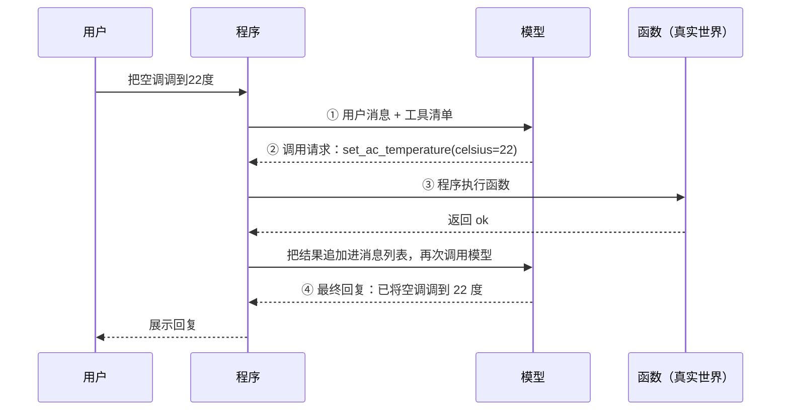

# 13 函数调用：模型是怎么"调"工具的

> ▶ 本章配套代码：`code/ch13_function_call.py` 和 `code/car.py`，只用 Python 标准库，可直接运行。

## 从一个问题开场

第 3 章的探针三里，用户说"把空调调到 22 度"，模型回复"已为您调好"，空调纹丝不动。

模型只能输出文字。那么市面上那些能订票、能查天气、能控制设备的助手是怎么做到的？

答案有点出人意料：**模型自始至终没有调用过任何东西。** 它只是写了一张条子，上面写着"我想调这个函数，参数是这些"。真正去执行的是外面的程序。本章把这张条子和它的往返过程掰开。

## 掰开：三样实物

### 一、工具清单

程序事先告诉模型有哪些工具可用。每个工具是一段 JSON，包含名字、说明、参数格式：

```json
{
  "name": "set_ac_temperature",
  "description": "设置空调温度。",
  "parameters": {
    "type": "object",
    "properties": {
      "celsius": { "type": "integer", "description": "目标温度，16 到 32" }
    },
    "required": ["celsius"]
  }
}
```

这段 JSON 会进入上下文窗口，也就是第 2 章图 F03 里的第二格。模型对工具的全部了解就来自这段文字，它看不到函数的代码。

### 二、调用请求

模型判断需要用工具时，输出的不是给用户的话，而是这样一段结构化内容：

```json
{
  "role": "assistant",
  "tool_calls": [
    { "id": "call_1", "name": "set_ac_temperature", "arguments": "{\"celsius\": 22}" }
  ]
}
```

这就是那张条子。它是模型生成的一段文字，只是格式特殊。模型在训练时见过大量这种格式，所以写得出来。

### 三、工具结果

程序执行完函数，把结果作为一条新消息放回对话：

```json
{ "role": "tool", "tool_call_id": "call_1", "content": "{\"ok\": true, \"ac_celsius\": 22}" }
```

`tool_call_id` 用来对上是哪一次请求的结果，一轮里有多个调用时靠它区分。

## 四步往返



*图 F06　函数调用的四步往返。模型被调用了两次，函数由程序执行。*

运行配套代码，可以看到每一步之后空调的真实状态：

```text
调用前，空调真实状态：24 度

第 2 步　模型 → 程序：调用请求（只是一段文字，此刻什么都没发生）
此刻，空调真实状态：24 度

第 3 步　程序执行函数，结果 → 模型
此刻，空调真实状态：22 度

第 4 步　模型 → 用户：最终回复
{ "role": "assistant", "content": "已将空调调到 22 度。" }

一次工具调用，模型被调用 2 次，消息列表从 1 条涨到 4 条。
```

状态是在第 3 步变的，那一步里没有模型参与。配套代码里执行工具的核心只有一行：

```python
result = car.run_tool(call["name"], json.loads(call["arguments"]))
```

程序按名字找到函数、解析参数、调用。这一行决定了一件重要的事：**执行权在程序手里。** 程序可以在这里检查参数、弹窗让用户确认、拒绝执行、记日志。第 34 章的权限控制全部加在这个位置。

## 资源账本：工具调用的三笔开销

**一、每次调用都要带工具清单。** 配套代码里 3 个工具的清单序列化后是 528 个字符。真实系统里一个工具的说明常有几百 token，接入 30 个工具，清单就是上万 token，每一次调用模型都要付这笔输入费，哪怕这一轮根本不用工具。

**二、模型至少被调用两次。** 一次生成调用请求，一次读结果写回复。第二次的输入包含第一次的全部内容，所以总输入量大于两倍的单次量。

**三、延迟叠加。** 总耗时 = 第一次模型调用 + 函数执行 + 第二次模型调用。函数如果是一个慢接口，用户要等的就是三段之和。

模型也可以在一轮里同时发出多个互不依赖的调用请求，程序并行执行后一并返回，这样能省掉几次往返。

## 工具说明怎么写

模型选哪个工具、填什么参数，完全取决于清单里的文字。工具说明就是给模型看的提示词，第 4 章的原则全部适用：

| 要点 | 差的写法 | 好的写法 |
|---|---|---|
| 说明用途和时机 | "查询" | "在车主手册里检索。用户问到车辆功能、保养、指示灯含义时使用" |
| 参数写清单位和范围 | `temp: number` | `celsius: 整数，目标温度，单位摄氏度，16 到 32` |
| 名字见名知意 | `func2` | `set_ac_temperature` |
| 返回值对模型友好 | 返回一个内部错误码 | 返回"温度超出范围，允许 16 到 32 摄氏度" |

最后一行容易被忽略。工具的返回值也是给模型看的。返回一句说清原因的错误信息，模型下一步就能自己修正参数重试；返回一个 `-1`，它只能瞎猜。

## 会出什么错

| 错误 | 表现 | 程序侧的防线 |
|---|---|---|
| 调了不存在的工具 | 名字是编的 | 按名字查表，查不到就返回错误消息 |
| 参数不合格 | 缺字段、类型不对、超范围 | 执行前校验；用第 15 章的结构化输出约束生成 |
| 该调不调 | 直接凭印象回答 | 在系统提示词里说明何时必须用工具 |
| 不该调乱调 | 一句闲聊也去查手册 | 工具说明里写清适用场景 |
| 选错工具 | 两个工具功能相近 | 合并或在说明里划清界限 |

配套代码的 `run_tool` 演示了前两条防线：名字不存在或参数不对时，返回一条错误信息而不是让程序崩溃。错误信息会作为工具结果回到模型面前，给它一次改正的机会。

## 为什么这样设计

让模型只输出"意图"、由程序执行，有三个好处。模型不需要网络和系统权限，它只是在生成文字；程序掌握执行权，可以加任意检查；工具用什么语言写、跑在哪里都无所谓，只要程序调得到。

这个设计把一个本来没有手脚的文字生成器，变成了可以接入任何系统的决策部件。

## 优势、劣势、什么时候不该用

**优势**：补上"做不了"的短板；计算、查询这类模型做不准的事可以交给确定性的程序。

**劣势**：增加调用次数和延迟；工具清单占用上下文；模型可能选错或填错，需要校验。

**不该用的时候**：流程是固定的。如果每次提问都必须先查手册，那就由程序直接查完再调模型，像第 6 章那样写成流水线，不必让模型决定。只有需要模型判断"调不调、调哪个"时，才用函数调用。

## 常见误解

**"模型调用了函数。"** 模型输出了一段描述调用的文字，程序执行了函数。

**"工具越多，助手越强。"** 工具越多，清单越长，每次调用越贵，选错的概率越高。功能重叠的工具尤其容易让模型混淆。

**"模型返回了调用请求，就说明参数是对的。"** 它可能填一个超范围的温度，或者编一个不存在的订单号。执行前必须校验。

**"函数调用是模型的一种特殊能力。"** 它是训练出来的一种输出格式。早期没有这个格式时，人们让模型输出普通文字再用正则去抠，第 19 章的代码就是那种做法。

## 小结

- 函数调用是四步往返：程序发工具清单，模型输出调用请求，程序执行并回填结果，模型写最终回复。
- 模型只写条子，执行权在程序手里，校验、确认、日志都加在程序执行的那一行。
- 工具说明和返回值都是给模型看的提示词；工具清单每次调用都计费，不是越多越好。

## 参考

- Schick et al., *Toolformer: Language Models Can Teach Themselves to Use Tools*, 2023
- OpenAI, *Function calling*, platform.openai.com/docs
- Anthropic, *Tool use with Claude*, docs.anthropic.com
