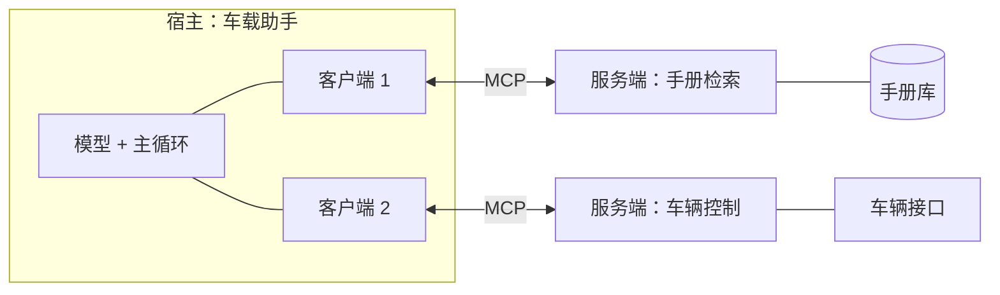

# 14 MCP：工具接入的标准化

## 从一个问题开场

第 13 章给车载助手写了三个工具。现在公司还有一个客服助手、一个研发用的编程助手，它们也想用"查手册"这个工具。

三个助手用了三套不同的框架，工具的定义格式、调用方式各不相同。于是"查手册"要按三种写法各实现一遍。之后每加一个工具，都要写三遍；每加一个助手，都要把所有工具再适配一遍。

MCP 解决的就是这个重复劳动。它不改变第 13 章讲的函数调用机制，只规定了一件事：**工具的提供方和使用方之间，用什么格式说话。**

## 手算一次：标准化省了多少

假设有 5 个 AI 应用，8 个外部系统（手册库、工单系统、车辆数据平台……）。

| | 需要开发的对接数 | 计算 |
|---|---|---|
| 没有统一协议 | 40 | 5 × 8，每个应用为每个系统各写一遍 |
| 有统一协议 | 13 | 5 + 8，每个应用实现一次客户端，每个系统实现一次服务端 |

再加一个系统：前者多 5 个对接，后者多 1 个。这是所有接口标准的共同逻辑，USB 之于外设也是如此。

## 掰开：三个角色

| 角色 | 是什么 | 例子 |
|---|---|---|
| 宿主（Host） | 用户直接使用的 AI 应用，里面有模型和主循环 | 车载助手、桌面聊天应用、编程工具 |
| 客户端（Client） | 宿主里负责和某一个服务端通信的部件，一个客户端对一个服务端 | 宿主内部的连接模块 |
| 服务端（Server） | 把某个系统的能力按协议暴露出来的程序 | 手册检索服务、工单系统服务 |



注意模型不在通信链路上。和服务端说话的是客户端，模型仍然只是在生成调用请求，这一点和第 13 章完全一样。

## 掰开：线上传的是什么

MCP 的消息格式是 JSON-RPC 2.0，一种很朴素的约定：请求里写方法名和参数，响应里写结果，用 `id` 把两者对上。

### 第一步：问有哪些工具

客户端发：

```json
{ "jsonrpc": "2.0", "id": 1, "method": "tools/list" }
```

服务端回：

```json
{
  "jsonrpc": "2.0", "id": 1,
  "result": {
    "tools": [
      {
        "name": "set_ac_temperature",
        "description": "设置空调温度。",
        "inputSchema": {
          "type": "object",
          "properties": { "celsius": { "type": "integer", "description": "目标温度，16 到 32" } },
          "required": ["celsius"]
        }
      }
    ]
  }
}
```

对比第 13 章的工具清单：名字、说明、参数格式，三样东西一样不少，只是字段名叫 `inputSchema`。宿主拿到后，把它转成自己所用模型要求的格式，放进上下文。**第 13 章里手写的工具清单，现在是从服务端自动取回来的。**

### 第二步：调用工具

模型输出调用请求后，宿主让客户端发：

```json
{
  "jsonrpc": "2.0", "id": 2, "method": "tools/call",
  "params": { "name": "set_ac_temperature", "arguments": { "celsius": 22 } }
}
```

服务端执行后回：

```json
{
  "jsonrpc": "2.0", "id": 2,
  "result": { "content": [ { "type": "text", "text": "已设置为 22 度" } ], "isError": false }
}
```

宿主把 `content` 作为工具结果拼回消息列表，再次调用模型。

把这两步放回第 13 章的四步往返里看：MCP 只替换了"程序怎么知道有哪些工具"和"程序怎么执行工具"这两处，其余不变。

在这两步之前还有一次握手：双方交换协议版本，并声明各自支持哪些功能。

## 不只是工具

MCP 定义了服务端可以提供的三类东西：

| 类别 | 是什么 | 由谁决定用不用 | 例子 |
|---|---|---|---|
| 工具（Tools） | 可执行的函数 | 模型 | 设置空调、创建工单 |
| 资源（Resources） | 可读取的数据，用地址标识 | 应用或用户 | 某个文件、某条数据库记录 |
| 提示词（Prompts） | 预先写好的提示词模板 | 用户 | "按公司模板写一份故障分析" |

工具最常用。资源对应"把数据放进上下文"，提示词对应"复用一段写好的指令"。

协议也定义了反方向的能力，例如服务端可以请求宿主的模型帮它生成一段文字。这些属于进阶用法，协议仍在演进，具体以官方规范为准。

## 两种连接方式

| 方式 | 怎么连 | 适合 |
|---|---|---|
| 标准输入输出 | 宿主把服务端作为本机子进程启动，通过进程的输入输出流收发消息 | 本地工具：读写本机文件、操作本机程序 |
| HTTP | 服务端是一个网络服务，客户端通过 HTTP 请求与它通信 | 远程服务：多人共用、需要身份认证 |

本地方式简单，不涉及网络和认证。远程方式需要解决"这个客户端代表谁、有什么权限"的问题，规范为此引入了基于 OAuth 的授权流程。

## 为什么这样设计

把协议定在"工具清单"和"工具调用"这一层，是因为这一层在各家模型之间本来就高度相似，都是名字、说明、参数格式。标准化它的阻力最小，收益最直接：工具写一次，所有支持协议的应用都能用。

协议有意不规定模型怎么用这些工具。选哪个工具、什么时候调用，仍是宿主和模型的事。

## 优势、劣势、什么时候不该用

**优势**：工具可复用，生态里已有大量现成的服务端；工具的开发和 AI 应用的开发可以分给不同团队；换模型或换框架时，工具侧不用动。

**劣势**：
- **上下文开销**。每接一个服务端，它的全部工具说明都要进上下文。接十个服务端、每个十几个工具，光清单就可能是几万 token。应对办法是只加载用得到的，或者让模型先搜索工具再加载。
- **多一层间接**。出问题时要多排查一层通信。
- **安全面扩大**。见下一小节。

**不该用的时候**：只有一个应用、几个工具、都由自己团队维护。直接按第 13 章的方式写函数最简单，没有复用需求就不需要协议。

## 安全：接入第三方服务端意味着什么

接入一个服务端，等于同时做了两件事：把它写的工具说明放进你的模型的上下文，并允许模型请求它执行代码。

- 工具说明是别人写的文字，模型会把它当成指令的一部分来读。恶意的说明可以诱导模型做别的事。
- 工具返回的内容同样进入上下文，同样可能夹带指令。
- 本地服务端以你的用户权限运行，能做你能做的任何事。

所以对待第三方服务端要像对待第三方软件一样：只装来源可信的，审查它申请的权限，对有副作用的工具保留人工确认。第 25 章系统地讲这部分。

## 常见误解

**"MCP 是一种新的工具调用机制。"** 调用机制还是第 13 章那一套。MCP 标准化的是工具怎么被发现、怎么被远程执行。

**"MCP 让模型能直接访问外部系统。"** 访问外部系统的是服务端程序，发起请求的是客户端，模型仍然只输出文字。

**"接的 MCP 服务端越多越好。"** 每一个都在消耗上下文、增加选错工具的概率、扩大被攻击的面。

**"MCP 是某一家模型专用的。"** 它是开放协议，与具体模型无关，主流的模型厂商和开发工具都已支持。

## 小结

- MCP 把工具的提供和使用解耦，对接数从"应用数 × 系统数"降到"应用数 + 系统数"。
- 线上是 JSON-RPC 消息，核心两步是 `tools/list` 取清单、`tools/call` 执行；它替换的是函数调用里"清单从哪来、工具由谁执行"两处。
- 代价是上下文开销和更大的安全面；没有复用需求时直接写函数更简单。

## 参考

- Anthropic, *Introducing the Model Context Protocol*, 2024
- Model Context Protocol 规范，modelcontextprotocol.io
- JSON-RPC 2.0 Specification, jsonrpc.org
