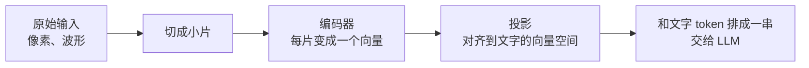

# 16 多模态输入的原理与账本：图、音、文档怎么变成 token

## 从一个问题开场

车主拍了一张仪表盘的照片发给助手："这个黄色的灯是什么意思？"

第 2 章说过，模型的输入是一串 token。照片是几百万个像素，不是文字。它是怎么进到那一串 token 里去的？进去之后占多大地方、花多少钱？

前面十五章默认输入输出都是文字。本章和下一章把这个默认放开。本章只讲到够算账的深度：各种模态怎样变成 token，每种占多少。模型内部怎样处理这些 token，留给第一卷。

## 掰开：共同的套路

不管是图、声音还是视频，进入 LLM 走的是同一个三步套路：

1. **切片**：图片切成小方块，声音切成短时间段。
2. **编码**：一个专门的编码器把每一片变成一个向量。
3. **投影**：把这些向量变换到和文字 token 同一个空间里。

做完之后，一张图在模型眼里就是一串"图像 token"，夹在文字 token 中间。从第 2 章的视角看，窗口里的六个分区没有变，只是某些分区里装的内容不再全是文字。

这带来一个直接的结论：**多模态输入同样占用上下文窗口，同样按 token 计费。** 所以它可以算账。

## 掰开：图片

### 手算：一张图多少 token

以最常见的视觉编码器结构为例，把图片切成 16 × 16 像素的小方块：

- 一张 1024 × 1024 的图：1024 × 1024 ÷ (16 × 16) = **4,096 个小方块**

每块一个 token 的话，一张图就是四千多 token。多数模型会再做一步压缩，例如把相邻的 2 × 2 个小方块合并成一个，降到 **1,024 个 token**。

各家的具体算法不同，都以自己文档里的公式为准。举一个例子：Anthropic 的文档给出的近似公式是

**图像 token ≈ 宽 × 高 ÷ 750**

一张 1000 × 1000 的图约 1,333 token。按 1 字约 1 token 粗算，**一张普通照片相当于一千多字的文本**。

### 两个推论

**分辨率是成本旋钮。** token 数与像素数成正比。边长缩小一半，token 降到四分之一。

| 图片尺寸 | 近似 token（按 ÷ 750 估） |
|---|---|
| 500 × 500 | 333 |
| 1000 × 1000 | 1,333 |
| 2000 × 2000 | 5,333（多数服务会先自动缩小） |

**分辨率也是能力上限。** 模型看到的是缩放、切片之后的结果。仪表盘照片里一个 20 像素高的小图标，缩小后可能只剩几个像素，模型就认不出来了。看不清小字、数不准密集物体，多数是这个原因。对策是裁剪：只把仪表盘那一块裁出来发过去，token 更少，细节反而更清楚。

## 掰开：声音

声音是一条随时间变化的波形。处理方式是按时间切片：先把波形转成频谱图（横轴时间、纵轴频率的一张"图"），再切成短时间段，每段编码成一个向量。

所以声音的 token 数与时长成正比。具体比例因模型而异，量级是每秒几十个 token。例如 Gemini 的文档给的是每秒音频 32 个 token：

- 1 分钟语音：60 × 32 = **1,920 token**
- 1 小时会议录音：3,600 × 32 = **115,200 token**

对比一下：1 分钟的话转成文字大约 250 字。**同一段话，以音频形式输入的 token 数是文字形式的七八倍。** 多出来的部分承载的是语气、停顿、口音、背景声这些文字里没有的信息。

这给出一个选型判断：只需要内容，就先转成文字再给模型，便宜得多；需要语气和情绪（客服质检要判断客户是否愤怒），才值得直接给音频。

## 掰开：视频

视频是一串图片加一条音轨。常见做法是按固定间隔抽帧，例如每秒一帧，每帧按图片处理。

假设每帧 258 token、每秒音频 32 token（同样取自 Gemini 文档的数字），每秒合计 290：

- 1 分钟视频：60 × 290 = **17,400 token**
- 10 分钟视频：**174,000 token**

十分钟视频就能占满一个不小的窗口。而且每秒只看一帧，快速的动作会被漏掉。视频输入的实际用法通常是先用别的手段定位到相关片段，只送那一小段。

## 掰开：文档

PDF、扫描件这类文档有两种送法：

| 方式 | 做法 | 保留了什么 | 丢了什么 |
|---|---|---|---|
| 抽文字 | 用解析工具或文字识别提取文本 | 文字内容，token 少 | 版式、图表、公式、手写批注 |
| 当图片 | 每页渲染成一张图 | 版式和图表原样保留 | 每页多花上千 token；小字可能看不清 |

有的接口两样都做：每页既送提取的文字，也送页面图像。成本是两者之和，一页常在一两千到几千 token 的量级。

选择依据是信息在哪里。纯文字的合同，抽文字就够。手册里的电路图、仪表盘图示、带合并单元格的参数表，文字提取会丢掉关键信息，这些页面应该以图片形式送。

## 账本汇总

把各模态换算成"相当于多少字"，粗略量级：

| 输入 | 近似 token | 备注 |
|---|---|---|
| 1,000 字中文 | 1,000 | 本书的基准 |
| 一张 1000 × 1000 的图 | 约 1,300 | 与像素数成正比 |
| 1 分钟音频 | 约 2,000 | 转成文字只有约 250 |
| 1 分钟视频（每秒一帧） | 约 17,000 | 主要来自画面 |
| 一页 PDF（文字加图像） | 约 2,000 到 4,000 | 因内容密度而异 |

具体数字都要以所用模型的文档和接口返回的用量为准。这张表的用处是建立量级感：**图片按千计，音频按每分钟千计，视频按每分钟万计。**

## 输出侧

上面讲的都是输入。输出侧目前的主流仍是文字，其他模态分两种情况：

- **由专门的模型生成**：LLM 输出一段文字描述或一段脚本，交给图像生成模型、语音合成模型去产出。这本质上是第 13 章的工具调用。
- **模型原生输出**：一些模型能直接输出语音或图像 token。语音交互里这一点影响很大，下一章展开。

## 为什么这样设计

把所有模态都变成 token 序列，是因为 LLM 的主体结构只认这一种输入。这样做的好处是不需要为每种模态设计一套新的推理机制，图文可以在同一个上下文里自由混排、互相引用。代价是所有模态都要挤进同一个窗口，而非文字模态的信息密度低，占地方。

## 优势、劣势、什么时候不该用

**优势**：用户不必把看到的东西转述成文字；图表、截图、界面这类难以用语言描述的信息可以直接给。

**劣势**：
- 占上下文、费用高，尤其是视频和长音频；
- 受分辨率限制，细节容易丢；
- 空间关系、精确计数、细小文字仍是弱项；
- 错误更隐蔽：模型看错了图，回答照样流畅。

**不该用的时候**：信息本来就有文字形式。有接口能读到胎压数值，就不要让模型去看仪表盘的照片；有文档的文本，就不要送扫描图。

## 常见误解

**"模型像人一样看到了图片。"** 它拿到的是缩放后切成几百上千块的向量序列。整体内容把握得不错，像素级的细节没有。

**"图片不算 token，可以多发。"** 每张都算，而且不少。对话里连发十张截图，就是一万多 token，还会留在历史里逐轮重发。

**"分辨率越高识别越准。"** 超过模型的处理上限后会被自动缩小，多出的像素只增加上传时间。针对目标区域裁剪比提高整体分辨率有效。

**"语音输入就是先转文字。"** 有两种做法：先转文字再给文本模型，或者音频直接进模型。后者保留语气信息，也贵得多。

## 小结

- 图、音、视频进入模型都走切片、编码、投影三步，最后变成和文字排在一起的 token，占窗口、按量计费。
- 量级是：一张图约一千多 token，音频每分钟约两千，视频每分钟上万；图片的 token 数与像素数成正比。
- 分辨率既是成本旋钮也是能力上限；信息已有文字形式时用文字，需要版式、图表、语气时才用原始模态。

## 参考

- Dosovitskiy et al., *An Image is Worth 16x16 Words: Transformers for Image Recognition at Scale*, 2020
- Radford et al., *Learning Transferable Visual Models From Natural Language Supervision*（CLIP）, 2021
- Liu et al., *Visual Instruction Tuning*（LLaVA）, 2023
- Radford et al., *Robust Speech Recognition via Large-Scale Weak Supervision*（Whisper）, 2022
- Anthropic, *Vision*, docs.anthropic.com；Google, *Gemini API: Understand and count tokens*, ai.google.dev
- 本系列第一卷：编码器与注意力的内部过程
