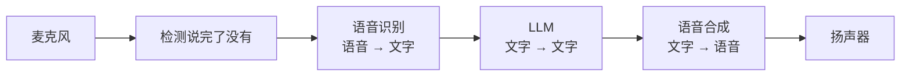

# 17 多模态接入 Agent 的接口设计

## 从一个问题开场

上一章算清了一张图、一段语音各占多少 token。现在要把它们接进系统：

- 用户发来一张照片，消息结构里怎么放？
- 工具的返回值是一张截图，怎么交还给模型？
- 车里是语音交互，用户说完到助手开口，中间经过几段、每段多久？
- 手册里一半是图，检索的时候怎么办？

这四个问题对应四个接口设计点。

## 接口一：消息里的内容块

第 2 章的消息结构里，`content` 是一个字符串。支持多模态之后，它变成一个列表，列表里每一项是一个带类型的内容块：

```json
{
  "role": "user",
  "content": [
    { "type": "text",  "text": "这个黄色的灯是什么意思？" },
    { "type": "image", "source": { "type": "base64", "media_type": "image/jpeg", "data": "…" } }
  ]
}
```

各家字段名不同，结构一致：**一条消息是若干内容块的有序列表，每块声明自己的类型。** 常见类型有文本、图像、音频、文档。

图像数据有两种给法：

| 方式 | 做法 | 适合 |
|---|---|---|
| 内嵌 | 把图片编码成 base64 字符串放进请求体 | 本地图片、一次性使用 |
| 引用 | 给一个网址，或者先上传文件拿到一个文件编号 | 图片大、要在多轮里反复用 |

内嵌方式每一轮都要把整张图重新传一遍，因为第 2 章说过每次调用都重发全部历史。多轮对话里应该用引用。

块的顺序有影响。第 4 章说过长资料放前面、问题放后面，图片同理：先放图，再放问题。有多张图时，在每张图前面加一句文字标注"图 1：仪表盘""图 2：中控屏"，模型才能在回答里准确指代。

## 接口二：工具返回图片

第 13 章的工具结果是一段文字。支持多模态后，工具结果同样可以是内容块列表：

```json
{
  "role": "tool",
  "tool_call_id": "call_3",
  "content": [
    { "type": "text",  "text": "已截取中控屏当前画面" },
    { "type": "image", "source": { "type": "base64", "media_type": "image/png", "data": "…" } }
  ]
}
```

这打开了一类重要的用法：**让 Agent 自己去看。** 工具负责拿到画面，模型负责看懂。

### 操作电脑：把屏幕当作工具

这类用法的极端形式是让模型操作图形界面。工具只有几个：

| 工具 | 输入 | 输出 |
|---|---|---|
| 截屏 | 无 | 当前屏幕的图片 |
| 点击 | 屏幕坐标 x、y | 执行结果 |
| 输入文字 | 一段文字 | 执行结果 |
| 滚动、按键 | 方向、键名 | 执行结果 |

循环就是第 19 章的 ReAct：截屏（观察），模型看图后决定点哪里（行动），程序执行，再截屏。它的意义在于不需要目标软件提供任何接口，凡是人能用鼠标键盘操作的，Agent 都能操作。

手算它的代价。假设每张截图 1,300 token，每一步连同模型输出共新增 1,400 token，固定前缀 2,000，完成一个任务要 30 步。套第 35 章的累加公式：

- 累计输入 = 30 × 2,000 + 1,400 × 30 × 29 ÷ 2 = 60,000 + 609,000 = **669,000 token**

一个三十步的界面操作任务，输入量接近七十万 token。所以这类 Agent 必须做第 23 章的上下文管理：旧截图用完就清掉，只保留最近几张。

它的局限也很明确：

- 慢，每一步都要截图、推理、执行；
- 坐标定位会出错，点偏了要多走几步才能发现；
- 屏幕上的任何文字都会被模型读到，网页里的一句恶意指令就是第 34 章的间接注入。

**有接口就用接口。** 操作界面是没有接口时的兜底手段。

## 接口三：语音链路

车载场景的主要交互方式是语音。有两种架构。

### 三段串联



每一段都是成熟的独立部件。LLM 那一段完全是文字，前面所有章节的技术（RAG、工具、Agent）原样可用。

手算用户说完到听到第一个字的时间。以下各段耗时为假设值：

| 环节 | 耗时 |
|---|---|
| 判断用户说完了（等一小段静音） | 0.3 秒 |
| 语音识别 | 0.3 秒 |
| LLM 首字延迟 | 0.8 秒 |
| 生成出第一句话（15 token ÷ 每秒 50） | 0.3 秒 |
| 语音合成出第一段音频 | 0.3 秒 |
| **合计** | **2.0 秒** |

要点是**流式衔接**：LLM 不等全部写完，第一句话出来就送去合成；合成也不等整句完成就开始播放。不做流式的话，一段 100 token 的回答光生成就要再等 2 秒。

串联的两个固有问题：

- **信息在第一段就丢了。** 语音识别只输出文字，语气、情绪、犹豫、是谁在说话，全部丢失。
- **错误会传递。** "胎压"被识别成"太压"，后面的 LLM 再强也是在错的文字上工作。

### 端到端语音模型

音频直接进模型，模型直接输出音频，中间不经过文字。

| | 三段串联 | 端到端 |
|---|---|---|
| 延迟 | 各段相加，一两秒 | 可以做到几百毫秒 |
| 语气和情绪 | 丢失 | 保留，回答也能带语气 |
| 打断 | 要额外处理 | 天然支持边听边说 |
| 可控性 | 高：中间是文字，可以检查、过滤、记日志 | 较低：中间没有文字可查 |
| 接工具和 RAG | 和文字系统完全一样 | 支持，但生态和调试手段不如文字成熟 |
| 成本 | 文字 token，便宜 | 音频 token，贵（第 16 章：约为文字的七八倍） |

选型判断：对延迟和自然度要求极高的闲聊陪伴类场景，倾向端到端；需要准确执行、可审计、要接大量工具的场景，三段串联更稳妥。车控指令属于后者，说错一个字的代价高，中间那层文字是做校验的地方。

### 语音交互特有的三个设计点

- **打断**：用户在助手说话时插话，要立刻停止播放，并且记下助手实际说到了哪里。没播出来的那部分不应该算进对话历史。
- **回答要为听而写**：不用列表、括号、网址，数字要好念。这是第 4 章那个提示词例子的出处。
- **工具执行期间不能冷场**：查询要两秒时，先说一句"我查一下"，或者把慢工具放到后台。

## 接口四：多模态 RAG

手册里有大量图示：仪表盘指示灯一览、保险丝盒布局、操作示意图。第 5 章的切块和嵌入只处理文字，这些内容怎么检索？

| 方案 | 做法 | 优点 | 缺点 |
|---|---|---|---|
| 转成文字 | 建库时用多模态模型给每张图写一段描述，描述和正文一起切块、嵌入 | 完全复用文字 RAG 链路 | 描述会丢细节；建库时每张图要调一次模型 |
| 页面当图片检索 | 每页渲染成图，用图文嵌入模型算向量；取回的页面图片直接交给多模态 LLM | 版式和图表不丢 | 每页上千 token；需要专门的嵌入模型 |
| 混合 | 文字照常处理，图表单独处理，各自检索后合并 | 兼顾 | 链路更复杂 |

多数情况从第一种开始：它不改动第 5、6 章的任何部件，只在建库时多一道"图转文字"。取回的块里带上原图的引用，回答时把原图一并展示给用户。

指示灯图标这类问题有一个更直接的解法：用户拍的照片和手册里的图标图片做图像相似度检索，找到对应条目，再取出旁边的文字说明。

## 权限与隐私

多模态输入带来几个文字时代没有的问题：

- **照片里有额外信息**：车牌、人脸、位置、屏幕上的其他内容。用户想问的是一个指示灯，发来的照片里可能有整个仪表盘和导航目的地。
- **麦克风常开**：车内其他乘客的对话也会被收进去。
- **图像和音频里可以藏指令**：图片里的一行小字、音频里的一句话，对模型来说和用户输入一样是输入（第 34 章）。

对策沿用第 33、34 章的原则：采集前告知、最小化采集和保留、写入日志前脱敏、有副作用的操作不因为多模态输入而降低确认门槛。

## 为什么这样设计

内容块列表这个结构，让多模态成了消息格式的一个扩展而不是一套新系统。主循环、工具调用、上下文管理全部不变，变的只是 `content` 里能放的东西。这也是为什么本书把多模态放在工具之后讲：它最有价值的用法，正是和工具结合，让 Agent 能看、能听。

## 常见误解

**"多模态需要另一套 Agent 架构。"** 循环不变，只是消息和工具结果里多了几种内容块。

**"让 Agent 操作界面是最通用的方案，应该优先用。"** 最通用，也最慢、最贵、最容易出错。它是没有接口时的选择。

**"端到端语音模型全面优于三段串联。"** 它赢在延迟和自然度，输在可控性、可审计性和成本。

**"图片存进向量库就能检索了。"** 需要图文对齐的嵌入模型，或者先把图转成文字描述。直接把图片丢给文字嵌入模型是不行的。

## 小结

- 多模态接入的核心结构是内容块列表：消息和工具结果都从一个字符串变成带类型的块的有序列表，主循环不变。
- 工具返回图片让 Agent 能"自己去看"，操作界面是其极端形式，通用但慢且贵，有接口时用接口。
- 语音有三段串联和端到端两种架构，前者可控可审计，后者快而自然；带图的资料先用"图转文字"接入现有 RAG。

## 参考

- Anthropic, *Computer use tool*, docs.anthropic.com
- OpenAI, *Realtime API*, platform.openai.com/docs
- Faysse et al., *ColPali: Efficient Document Retrieval with Vision Language Models*, arXiv:2407.01449, 2024
- Défossez et al., *Moshi: a speech-text foundation model for real-time dialogue*, 2024
