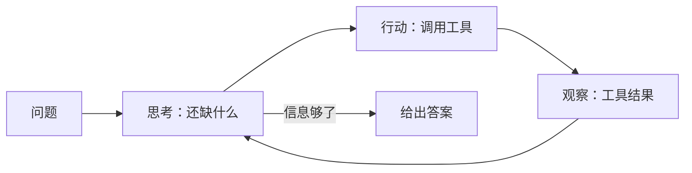

# 19 ReAct：想一步、做一步、看一步

> ▶ 本章配套代码：`code/ch19_react.py`，只用 Python 标准库，可直接运行。

## 从一个问题开场

用户问："我的胎压正常吗？"

第 18 章的思维链帮不上忙。模型可以想得很深，但它不知道现在四个轮胎各是多少，也不知道这款车的标准值。想不出来。

第 13 章的函数调用能读到胎压，但一次调用解决不了：读到数值后才发现还需要标准值，查到标准值后才发现还需要报警线。下一步查什么，取决于上一步看到了什么。

把两者接起来：**想一步，做一步，看到结果再想下一步。** 这就是 ReAct，名字取自 Reasoning 和 Acting。

## 掰开：一轮的三个部件

| 部件 | 谁产生 | 内容 |
|---|---|---|
| 思考（Thought） | 模型 | 现在知道了什么，还缺什么，下一步该做什么 |
| 行动（Action） | 模型 | 调用哪个工具，参数是什么 |
| 观察（Observation） | 程序 | 工具返回的结果 |

模型写前两样，程序执行行动并填上第三样，然后把三样都拼回提示词，进入下一轮。



*图 F07　ReAct 循环。思考和行动由模型生成，观察由程序填入。*

## 掰开：跑一遍

配套代码用的是 ReAct 最原始的形态：纯文本协议。提示词里规定格式，模型照着格式续写，程序用正则把行动抠出来。提示词开头是这样的：

```text
你可以使用以下工具：
get_tire_pressure[] 读取四个轮胎的当前胎压
search_manual[关键词] 在车主手册里检索
finish[答案] 给出最终答案并结束

请按下面的格式交替输出，每次只输出一组"思考"和"行动"：
思考：分析现在知道了什么、还缺什么
行动：工具名[参数]

问题：我的胎压正常吗？
```

实际运行的完整输出：

```text
--- 第 1 轮 ---
思考：要判断胎压正不正常，先得知道现在四个轮胎各是多少。
行动：get_tire_pressure[]
观察：{"左前": 238, "右前": 185, "左后": 251, "右后": 249}
--- 第 2 轮 ---
思考：右前185明显比其他三个低，但我不知道这款车的标准值和报警线。
行动：search_manual[胎压标准值]
观察：第三章 车轮与轮胎。本车冷态胎压标准值为前轮240千帕、后轮250千帕，满载时后轮应调整至270千帕。……
--- 第 3 轮 ---
思考：标准值查到了，前轮240、后轮250，还缺报警线是多少。
行动：search_manual[胎压低于多少报警]
观察：……胎压监测系统在任一轮胎压力低于190千帕时点亮黄色警告灯。警告灯点亮后请尽快减速并靠边检查。……
--- 第 4 轮 ---
思考：前轮标准240，右前只有185，低于报警线190；其余三个与标准相差不超过2。信息够了。
行动：finish[右前轮胎压185千帕，低于190千帕的报警线，也远低于前轮标准240千帕，请尽快减速靠边检查；其余三个轮胎正常。]
```

配套代码里的模型是替身，它根据已出现的观察条数决定下一步；循环、解析、工具执行、拼接提示词都是真实的。

看这四轮里发生的事：

- **第 2 轮的行动是第 1 轮的观察引出来的。** 看到 185 这个异常值，才想到要查标准。
- **第 3 轮的行动是第 2 轮的观察引出来的。** 查到的那一块里有标准值，没有报警线，于是换个关键词再查。
- **第 4 轮判断信息够了，主动结束。**

这三件事是固定流水线做不到的。第 6 章的 RAG 只检索一次，查什么在提问那一刻就定了。

## 掰开：循环的代码

去掉打印，核心逻辑如下：

```python
def react(question, max_steps=6):
    prompt = PROMPT_HEAD.format(question=question)
    for step in range(max_steps):
        output = model(prompt)                              # 模型写思考和行动
        match = re.search(r"行动：(\w+)\[(.*)\]", output, re.S)
        if not match:
            observation = "格式错误，请按 行动：工具名[参数] 输出"
        else:
            name, arg = match.group(1), match.group(2).strip()
            if name == "finish":
                return arg                                  # 模型决定结束
            observation = run_tool(name, arg)               # 程序执行
        prompt += f"{output}\n观察：{observation}\n"        # 拼回去
    return "达到步数上限，未完成"
```

有三处细节，是所有循环式系统的共同要求：

1. **步数上限。** 模型可能一直查下去，或在两个动作之间来回打转。没有上限的循环迟早会烧掉一大笔费用。
2. **格式错误也是一种观察。** 模型没按格式写时，把错误信息当作观察喂回去，让它自己改正，而不是让程序崩溃。
3. **提示词只增不减。** 每一轮的思考、行动、观察都留在提示词里。这是模型知道"我已经查过什么"的唯一途径，也是成本增长的来源。

## 思考那一行有什么用

既然程序只执行行动，思考那一行能不能省掉？

可以省，但效果会变差，原因就是第 18 章讲的：思考是草稿纸。"右前 185 明显偏低，但我不知道标准值"这句话写出来之后，下一个行动选"查标准值"就顺理成章。没有这一行，模型要在生成工具名的那一刻同时完成全部判断。

思考的另一个用处是给人看。任务跑错时，顺着每一轮的思考往下读，很容易找到是哪一步的判断出了偏差。

## 资源账本：轮数的代价

第 n 轮的输入 = 提示词开头 + 前 n − 1 轮的全部内容。假设开头 500 token，每轮（思考、行动、观察）新增 300 token，跑 4 轮：

| 轮次 | 输入 token |
|---|---|
| 第 1 轮 | 500 |
| 第 2 轮 | 800 |
| 第 3 轮 | 1,100 |
| 第 4 轮 | 1,400 |
| **合计** | **3,800** |

对比一次性调用的 500。任务跑 4 轮，输入量是单次的 7.6 倍，而且每多一轮，增量都比上一轮大。第 35 章给出通用公式。

延迟同理：四次模型调用加三次工具执行，串行相加。

## 从文本协议到原生工具调用

配套代码用正则解析文字，是为了让机制一目了然。现在的实际做法是用第 13 章的原生函数调用：

| | 文本协议（本章代码） | 原生函数调用（第 21 章代码） |
|---|---|---|
| 行动的形式 | 一行文字，`工具名[参数]` | 结构化的调用请求 |
| 解析方式 | 正则，容易因格式偏差失败 | 接口直接返回结构化数据 |
| 思考的形式 | "思考："开头的一行文字 | 调用请求前的一段文字，或推理模型的内置思考 |
| 一轮多个行动 | 不支持 | 支持并行调用 |

形式变了，循环没变：模型决定下一步，程序执行，结果拼回去。**第 21 章的 Agent 主循环，就是用原生函数调用实现的 ReAct。**

## 为什么这样设计

只推理不行动，模型困在自己的权重里，缺的信息永远缺。只行动不推理，模型不知道下一步该干什么，也不知道什么时候算完成。ReAct 让两者互相供给：行动给推理带来新的事实，推理决定下一个行动。

## 优势、劣势、什么时候不该用

**优势**：能处理"下一步取决于上一步结果"的任务；每一步的理由都留在记录里，便于排查。

**劣势**：
- 费用和延迟随轮数增长；
- 一步判断错，后面的步骤都建立在错误之上；
- 可能原地打转，重复调用同一个工具。

**不该用的时候**：步骤是固定的、事先就知道的。每次都是"检索一次然后回答"，就写成流水线，更快、更便宜、更可预测。

## 常见误解

**"ReAct 是一种提示词模板。"** 它是一种循环结构。模板只是早期的实现方式，换成原生函数调用后模板消失了，循环还在。

**"ReAct 和函数调用是两种不同的技术。"** 函数调用是一次往返的机制，ReAct 是把多次往返串起来的控制流。前者是后者的零件。

**"观察是模型生成的。"** 观察必须由程序填入真实的工具结果。早期文本协议下，模型有时会顺着格式自己把"观察："也写了，等于编造结果。实现上要在"观察："出现之前截断模型的输出。

**"轮数上限设大一点更保险。"** 上限是费用的保险丝。正常任务用几轮就设在几轮附近，超出说明任务跑偏了，应该停下来。

## 小结

- ReAct 是思考、行动、观察的循环：模型想并提出行动，程序执行并返回观察，模型据此再想。
- 它处理的是下一步依赖上一步结果的任务；思考那一行是草稿纸，也是排错线索。
- 输入随轮数累加，必须设步数上限；步骤固定的任务用流水线。

## 参考

- Yao et al., *ReAct: Synergizing Reasoning and Acting in Language Models*, 2022
- Wei et al., *Chain-of-Thought Prompting Elicits Reasoning in Large Language Models*, 2022
