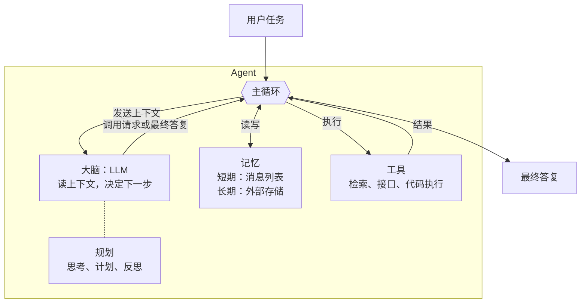

# 21 Agent 主循环：五十行代码的最小 Agent

> ▶ 本章配套代码：`code/ch21_agent.py` 和 `code/car.py`，只用 Python 标准库，可直接运行。

## 从一个问题开场

用户说："帮我看看胎压正不正常，另外车里有点热，把空调调低两度。"

一句话里有两个任务。第一个要读数据、查手册、做判断；第二个要先知道现在是几度，再去设置。没有人事先写好这个流程，用户下一句可能是完全不同的组合。

第 1 章说 Agent 是一个循环。前面十几章已经把零件备齐了：上下文（篇二）、工具（篇四）、推理（篇六）。本章把它们装起来，你会看到装配图短得出乎意料。

## 掰开：Agent 的全部代码

配套代码的上半部分是 Agent 本体：

```python
SYSTEM = "你是车载助手。需要数据或操作时调用工具，不要凭印象回答。任务完成后直接给出答复。"

def agent(task, model, max_turns=8):
    messages = [{"role": "system", "content": SYSTEM}, {"role": "user", "content": task}]
    for turn in range(1, max_turns + 1):
        reply = model(messages, car.TOOLS)              # 1. 让模型决定下一步
        messages.append(reply)
        calls = reply.get("tool_calls", [])
        if not calls:                                   # 2. 没有工具调用：任务结束
            return reply["content"]
        for call in calls:                              # 3. 程序替模型执行工具
            result = car.run_tool(call["name"], json.loads(call["arguments"]))
            messages.append({                           # 4. 结果拼回上下文，进入下一轮
                "role": "tool",
                "tool_call_id": call["id"],
                "content": json.dumps(result, ensure_ascii=False),
            })
    return "达到轮数上限，任务未完成。"                    # 5. 兜底：不允许无限循环
```

加上 `car.py` 里按名字执行工具的 `run_tool`，总共不到五十行。这就是 Agent：**一个 while 循环，里面是第 13 章的函数调用。**

五处编号对应五件事：

| 编号 | 做什么 | 来自哪一章 |
|---|---|---|
| 1 | 把完整的消息列表和工具清单发给模型 | 第 2、13 章 |
| 2 | 模型不再请求工具，视为任务完成 | |
| 3 | 程序执行模型请求的工具 | 第 13 章 |
| 4 | 把结果追加到消息列表 | 第 13 章 |
| 5 | 轮数上限 | 第 19 章 |

和第 19 章的 ReAct 对照：思考、行动、观察的循环原封未动，只是行动从正则解析的文字换成了结构化的调用请求。

## 跑一遍

```text
任务：帮我看看胎压正不正常，另外车里有点热，把空调调低两度。

第 1 轮｜输入 135 字符｜调用 get_tire_pressure、search_manual
第 2 轮｜输入 576 字符｜调用 search_manual
第 3 轮｜输入 843 字符｜调用 set_ac_temperature
第 4 轮｜输入 1057 字符｜给出最终答复

答复：胎压：右前185千帕，低于手册规定的190千帕报警线（前轮标准240千帕），请尽快减速靠边检查；其余三个轮胎正常。空调已从24度调到22度。
空调真实状态：22 度
```

配套代码里的模型是替身：它读消息列表里已有的工具结果来决定下一步，代替真实模型的判断。上面的循环一行不改就能接真实模型，只需把 `model` 换成一次真实的接口调用。

四轮里值得注意的：

- **第 1 轮一次发出两个调用。** 读胎压和查标准值互不依赖，可以同时进行，省一次往返。
- **第 2 轮是被第 1 轮的结果引出来的。** 查到的那一块有标准值，没有报警线，于是再查。
- **输入逐轮变长**：135、576、843、1057 字符。每一轮都把之前的全部内容重发一遍。
- **最后一行验证的是真实状态**，不是模型的说法。这是第 3 章探针三的原则。

## 掰开：四个组件



*图 F08　Agent 主循环与四组件。主循环是程序，大脑是模型，规划是模型的输出方式，记忆和工具是程序管理的资源。*

把图和代码对上：

| 组件 | 在代码里是什么 |
|---|---|
| 主循环 | `for turn in range(...)` |
| 大脑 | `model(messages, tools)` 这一次调用 |
| 规划 | 模型输出里的思考内容；复杂任务时是第 20 章的计划清单 |
| 记忆 | `messages` 列表是短期记忆；长期记忆要另接存储（第 10 章） |
| 工具 | `car.TOOLS` 和 `car.run_tool` |

这就是第 1 章引用的那个拆法：大脑加规划、记忆、工具。

## 什么时候算 Agent

一个实用的区分：**流程由谁决定。**

| | 工作流 | Agent |
|---|---|---|
| 下一步做什么 | 代码里写死的 | 模型根据当前情况决定 |
| 步数 | 固定 | 不固定 |
| 例子 | 第 6 章的 RAG：检索、重排、生成 | 本章的循环 |
| 可预测性 | 高 | 较低 |
| 成本 | 固定，可预估 | 随任务变化 |

两者不是对立的。实际系统经常是工作流里嵌一个 Agent 步骤，或者 Agent 把一条工作流当作工具来调用。

## 五十行之外：一个能上线的 Agent 还缺什么

最小 Agent 能演示原理，离上线还有距离。缺的每一样，后面都有专门的章节：

| 缺什么 | 不补会怎样 | 在哪一章 |
|---|---|---|
| 上下文管理 | 任务一长，消息列表撑爆窗口，或者模型迷失在历史里 | 第 23 章 |
| 权限与确认 | 模型请求什么就执行什么，包括删除数据 | 第 34 章 |
| 错误处理 | 工具超时、接口限流时循环中断 | 第 33 章 |
| 可观测 | 出错后不知道是哪一轮的哪个决定造成的 | 第 33 章 |
| 评测 | 改了提示词后不知道变好还是变坏 | 第 32 章 |
| 成本控制 | 只有轮数上限，没有费用上限 | 第 35 章 |
| 扩展机制 | 每加一种做法都要改系统提示词，越改越长 | 第 29 章 |
| 检查点与恢复 | 做错了退不回去，断了要从头再来 | 第 31 章 |

**循环很短，工程量在循环之外。** 循环之外的这一整层有个名字叫 harness，篇八专门讲它。

## 为什么这样设计

把控制权交给模型，是为了应对事先写不完的情况。用户的请求千变万化，为每种组合写一条流程不现实。Agent 的做法是只提供工具和目标，让模型在运行时自己组合。

把循环本身做得极简，是因为一切智能都在模型里，循环越简单，越不会妨碍模型升级后的能力。很多早期框架在循环外面包了很多层控制逻辑，后来随着模型变强反而成了负担。

## 优势、劣势、什么时候不该用

**优势**：能处理开放的、事先无法穷举的任务；能根据中间结果调整做法；加能力只需加工具。

**劣势**：
- 费用和耗时不可预估，同一类任务这次 4 轮、下次 12 轮；
- 行为难以完全预测，评测和调试都更难；
- 错误会累积，前面一步判断错，后面全在错的基础上进行；
- 有了行动能力，出错的后果从"说错话"变成"做错事"。

**不该用的时候**：任务的步骤可以事先写清楚。能用一次调用解决的不用工作流，能用工作流解决的不用 Agent。每升一级，灵活性增加，可预测性和成本控制变差。

## 常见误解

**"Agent 是一种更高级的模型。"** 模型还是那个模型。Agent 是包在它外面的循环和工具。

**"Agent 需要用专门的框架。"** 框架提供便利，核心就是本章这几十行。先理解循环再选框架，能少走弯路。

**"模型说任务完成了，任务就完成了。"** 循环结束只说明模型不再请求工具。结果对不对要另行验证。

**"Agent 越自主越好。"** 自主的范围应该由出错的代价决定。只读操作可以放手，有副作用的操作要设关卡。

## 小结

- Agent 是一个循环：把上下文发给模型，模型请求工具就执行并把结果拼回去，不请求就结束；核心代码不到五十行。
- 四个组件是大脑、规划、记忆、工具；与工作流的区别在于下一步由模型决定。
- 能上线的 Agent 的工程量在循环之外：上下文管理、权限、可观测、评测、成本控制。

## 参考

- Lilian Weng, *LLM Powered Autonomous Agents*, 2023
- Yao et al., *ReAct: Synergizing Reasoning and Acting in Language Models*, 2022
- Anthropic, *Building Effective Agents*, 2024
