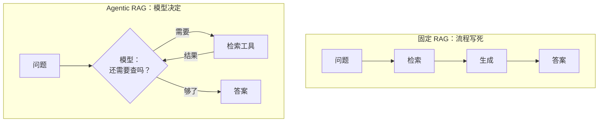

# 22 Agentic RAG：检索从流程变成工具

## 从一个问题开场

第 6 章的 RAG 是一条固定流水线：来一个问题，检索一次，生成一次。拿三个问题试它：

| 用户说 | 固定流水线的表现 | 问题在哪 |
|---|---|---|
| "谢谢，没事了" | 照样去检索，把不相干的手册片段塞给模型 | 不需要检索 |
| "我的胎压正常吗？" | 检索到胎压标准值，但不知道当前胎压 | 需要检索之外的数据 |
| "胎压标准是多少，低于多少会报警？" | 只检索一次，两个答案在不同的块里，可能只取回一个 | 需要多次检索 |

第 6 章结尾留了一句话：这时应该让模型自己决定查不查、查什么。第 1 章也预告过：RAG 进了 Agent 之后，从流程降级为工具。本章把这件事讲完。

## 掰开：改了什么

改动只有一处：**把"检索"从主流程里拿出来，包成一个工具，放进第 21 章的 Agent 循环。**



`code/car.py` 里的 `search_manual` 就是这样一个工具。它内部是第 6 章的两路召回加 RRF，对外只暴露一个参数 `query`。第 19 章和第 21 章的运行记录，实际上已经是 Agentic RAG 了。

## 模型接管的四个决定

固定流水线里由代码写死的四件事，现在交给模型：

| 决定 | 固定 RAG | Agentic RAG |
|---|---|---|
| 查不查 | 每次必查 | 闲聊不查，问手册内容才查 |
| 查什么 | 用户原话直接当查询 | 模型改写成适合检索的关键词，可以拆成多个查询 |
| 查哪里 | 一个库 | 手册库、工单库、网页搜索，各是一个工具，模型挑 |
| 够不够 | 查一次就生成 | 看了结果再决定：再查一次、换个说法查、还是可以回答了 |

回看第 21 章的运行记录，第三、第四个决定都出现了：

```text
第 1 轮｜调用 get_tire_pressure、search_manual     ← 同时用了两个来源
第 2 轮｜调用 search_manual                        ← 判断第一次查得不够，换关键词再查
```

第一次检索用的是"胎压标准值"，取回的块里有 240 和 250，没有报警线。模型读了结果，判断信息不完整，用"胎压低于多少报警"又查了一次。这个"读完结果再决定"的动作，固定流水线里没有位置安放。

第二个决定同样重要。用户的原话"那个灯亮了咋办"直接拿去检索，效果很差。模型会结合上下文把它改写成"胎压警告灯点亮 处理方法"。第 7 章失败点 2 里列的几种原因，改写查询能解决一大半。

## 资源账本：灵活的代价

比较两种方式回答"胎压标准是多少，低于多少会报警"的输入量。假设系统提示词加工具清单 800 token，问题 50 token，每次检索返回 5 块 × 400 字 = 2,000 token，模型每次输出的调用请求约 50 token。

**固定 RAG**：一次调用，输入 = 100 + 2,000 = **2,100**

**Agentic RAG，检索两次**：

| 调用 | 输入包含 | token |
|---|---|---|
| 第 1 次（决定查什么） | 800 + 50 | 850 |
| 第 2 次（读第一批结果，决定再查） | 850 + 50 + 2,000 | 2,900 |
| 第 3 次（读第二批结果，作答） | 2,900 + 50 + 2,000 | 4,950 |
| **合计** | | **8,700** |

输入量约为固定 RAG 的 4 倍，模型调用 3 次，延迟也大致是 3 倍。

反过来，对"谢谢，没事了"这句话：固定 RAG 仍然花 2,100，Agentic RAG 只花 850，因为它判断不需要查。

所以总成本取决于问题的构成。绝大多数问题一次检索就能答时，Agentic RAG 更贵；闲聊和复杂问题占比高时，它不一定更贵，而且答得更对。

## 检索工具怎么设计

把检索包成工具后，第 13 章关于工具设计的原则都适用，另有几点专属于检索：

| 设计点 | 建议 | 原因 |
|---|---|---|
| 返回量 | 每次返回少量、最相关的几块，允许模型翻页或再查 | 一次返回太多会淹没上下文，这是第 7 章的失败点 4 |
| 返回内容 | 每块带上来源和章节标题 | 模型要判断这块可不可信，答案要标出处 |
| 查不到时 | 明确返回"没有找到相关内容"，并提示可以换什么说法 | 空结果也是信息，模型据此换查询或者如实告知用户 |
| 工具说明 | 写清库里有什么、没有什么 | 模型据此决定查不查、查哪个库 |
| 多个库 | 每个库一个工具，名字和说明区分清楚 | 让"查哪里"这个决定有依据 |

## 两种更轻的折中

完整的 Agent 循环不是唯一选择。有两种做法介于固定流水线和完全放手之间：

**检索后自检**。流程仍然是固定的，但在检索之后加一步判断：让模型或一个小模型评估取回的块是否足以回答问题。足够就生成；不够就改写查询重查，或改走网页搜索。检索质量评估后再分支，这是 CRAG 一类方法的思路。

**按需检索加自我核对**。让模型在生成过程中自己判断何时需要检索，并在生成后核对答案是否有资料支持。Self-RAG 通过训练模型输出特殊标记来实现这一点。

它们的共同点是给流水线加上有限的几个判断点，比完全交给 Agent 更可控、成本更可预估。

## 为什么这样设计

固定流水线假设所有问题都长一个样：需要且只需要检索一次。真实的问题不是这样。把检索变成工具，是把"怎么用检索"这个决定从写代码的时候推迟到了运行的时候，由看得见具体问题的模型来做。

## 优势、劣势、什么时候不该用

**优势**：
- 不需要检索的问题不白查；
- 复杂问题可以多次检索、换角度检索；
- 检索可以和其他工具组合，例如先读实时数据再查手册；
- 查询由模型改写，召回质量通常更好。

**劣势**：
- 费用和延迟更高，而且不固定；
- 多了"该查不查"这种失败：模型自信地凭印象回答，没有去查；
- 评测更复杂，除了答案对错，还要看检索决策是否合理。

**不该用的时候**：
- 问题类型单一，几乎都是一次检索就能回答的事实查询；
- 对延迟要求严格，例如语音交互要求一两秒内响应；
- 合规要求每个回答都必须基于检索结果。这时"必查"恰恰是需要的性质，应该保留固定流水线。

## 常见误解

**"Agentic RAG 是 RAG 的下一代，应该全面替换。"** 它是用成本和可预测性换灵活性。问题简单时，固定流水线仍然是更好的选择。

**"让模型决定查不查，它会查得更少。"** 也可能查得更多。没有约束时，有的模型会反复检索求稳。需要在提示词里说明什么情况下可以直接回答，并设轮数上限。

**"变成工具之后，第 5、6 章的内容就不重要了。"** 工具内部仍然是切块、嵌入、召回、重排。检索质量差，模型查多少次都查不到。

**"模型会自己判断资料够不够。"** 它会判断，但会判断错，尤其容易在资料只是部分相关时认为够了。关键场景要在提示词里明确"答案中的每个数值都必须能在检索结果里找到"。

## 小结

- Agentic RAG 把检索从固定流程改成 Agent 的一个工具，查不查、查什么、查哪里、够不够四个决定交给模型。
- 它解决固定流水线的三个问题：白查、查一次不够、需要和其他数据组合；代价是更高且不固定的费用和延迟。
- 问题简单、延迟敏感、或要求必查时保留固定流水线；也可以用"检索后自检"这类折中方案。

## 参考

- Asai et al., *Self-RAG: Learning to Retrieve, Generate, and Critique through Self-Reflection*, 2023
- Yan et al., *Corrective Retrieval Augmented Generation*, arXiv:2401.15884, 2024
- Yao et al., *ReAct: Synergizing Reasoning and Acting in Language Models*, 2022
