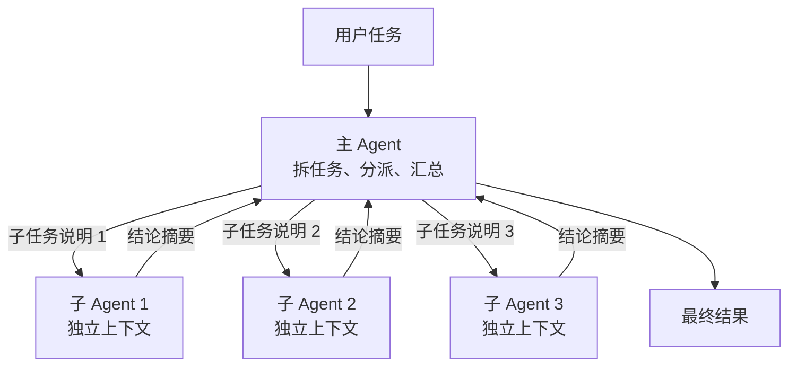

# 22 多 Agent：什么时候值得拆

## 从一个问题开场

任务是："调研市面上 10 款同级别车型的座椅加热功能，整理成对比表。"

交给第 19 章的单个 Agent：它要逐个搜索、打开网页、阅读。每款车型读进来两万 token 的资料，10 款就是二十万，第 21 章的问题全部出现。而且 10 款车型只能一款一款串行地查。

一个自然的想法是多派几个人：一个负责人拆任务，十个调研员每人查一款，查完各交一份摘要。这就是多 Agent。

本章要回答的问题是它什么时候划算。先说结论：**多数任务不需要。**

## 掰开：多 Agent 的实物形态

"多个 Agent"听起来像多个模型，其实通常是同一个模型的多次独立运行。区别只在于：**每个 Agent 有自己独立的消息列表。**

最常见的结构是主从式：

实现上，"派一个子 Agent"就是主 Agent 的一个工具。这个工具的参数是一段任务说明，内部是把第 19 章的 `agent()` 函数再运行一次，返回值是子 Agent 的最终答复。

所以主 Agent 的视角里，子 Agent 和 `search_manual` 没有区别：发出一个请求，拿回一段文字。

两个接口决定了整个系统的质量：

| 接口 | 内容 | 写不好的后果 |
|---|---|---|
| 下行：任务说明 | 目标、范围、要返回什么格式、有什么限制 | 子 Agent 不知道背景，做偏、做重、做多 |
| 上行：结论摘要 | 子 Agent 的发现，压缩成一小段 | 关键细节在摘要里丢了，主 Agent 无从得知 |

子 Agent 看不到主 Agent 的上下文。用户说过的要求、之前的发现，只要没写进任务说明，对子 Agent 就不存在。这是多 Agent 系统最常见的故障来源。

## 拆的三个正当理由

### 理由一：隔离上下文

这是第 21 章的第五种手段。子 Agent 在自己的窗口里读完大量资料，只把结论交回来。

手算开场的例子。每款车型的资料 20,000 token，每份结论摘要 500 token：

| | 单 Agent | 主从式 |
|---|---|---|
| 主上下文里累积的资料 | 10 × 20,000 = 200,000 | 10 × 500 = 5,000 |
| 单个上下文的峰值 | 200,000 以上，可能超出窗口 | 子 Agent 约 20,000，主 Agent 约 5,000 |

主 Agent 的上下文缩小到四十分之一，没有任何一个上下文过载。

### 理由二：并行

10 个子任务互不依赖，可以同时跑。假设每款车型的调研耗时 2 分钟：

- 串行：10 × 2 = 20 分钟
- 并行：约 2 分钟，外加主 Agent 拆分和汇总的时间

### 理由三：职责分离

不同的子 Agent 可以配不同的系统提示词、工具和权限。例如只读的调研 Agent 不给写入工具；负责审查的 Agent 和负责编写的 Agent 分开，审查者不受编写者思路的影响。

## 代价

### 一、总 token 更多

隔离上下文省的是每个窗口的峰值，不是总量。每个子 Agent 都要带一遍系统提示词和工具清单，主 Agent 还要花 token 写任务说明、读摘要。

Anthropic 在介绍其多 Agent 研究系统的文章里给过一个量级：相对普通聊天，单 Agent 的 token 用量约为 4 倍，多 Agent 系统约为 15 倍。具体倍数因任务而异，方向是确定的：**多 Agent 用更多的总 token，换更短的耗时和更干净的上下文。**

### 二、传话损耗

信息每经过一次"写成摘要再被另一方阅读"，就损失一次。子 Agent 读到了一个重要的例外情况，但觉得不重要，没写进摘要，主 Agent 就永远不知道。

### 三、协调问题

子任务之间有依赖时，麻烦迅速增加：

- 两个子 Agent 各自做了互相冲突的假设；
- 两个子 Agent 同时修改同一个文件；
- 任务边界没划清，做了重复的工作，或者中间漏了一块没人做。

### 四、调试更难

出错时，要在多份互相独立的记录之间追查是哪一个 Agent 的哪一步出了问题。

## 判据：值得拆吗

| 问题 | 倾向拆 | 倾向不拆 |
|---|---|---|
| 子任务之间是否独立 | 独立，互不需要对方的中间结果 | 紧密耦合，后一步依赖前一步的细节 |
| 子任务的输入量 | 大，但结论可以压缩成一小段 | 小，或者结论无法压缩 |
| 是否需要并行提速 | 是 | 否 |
| 任务的价值能否覆盖数倍的 token 成本 | 能 | 不能 |
| 是读还是写 | 以读为主：调研、检索、分析 | 以写为主：多方同时修改同一份产出 |

最后一行值得展开。**读可以并行，写很难并行。** 十个 Agent 各自调研一款车型，互不干扰。十个 Agent 同时写同一份文档的不同章节，风格、术语、前后引用都会对不上，因为每个 Agent 都看不到别人正在写什么。写的工作更适合由一个 Agent 在掌握全部结论之后统一完成。

一个稳妥的默认做法：先用单 Agent。遇到上下文不够用或者明显可并行的环节，只把那一个环节拆给子 Agent。

## 任务说明怎么写

主 Agent 给子 Agent 的任务说明，相当于给一位不了解任何背景的外包同事写的需求。应该包含：

| 要素 | 例子 |
|---|---|
| 目标 | 调研 A 车型的座椅加热功能 |
| 背景 | 这是 10 款车型对比的一部分，最终要汇成一张表 |
| 范围 | 只看当前在售的款型；只用官方资料 |
| 返回格式 | 档位数、是否支持后排、是否支持预约、来源链接；查不到的项写"未找到" |
| 停止条件 | 最多搜索 5 次；找不到官方资料就直接返回 |

"返回格式"一项决定了主 Agent 汇总时的难度。十份格式各异的自由文本，和十份字段相同的记录，汇总成表的工作量天差地别。

## 为什么这样设计

多 Agent 的本质是用上下文的边界来划分工作。每个 Agent 一个干净的窗口，只装自己那部分任务需要的内容。边界带来隔离和并行，也带来信息壁垒。值不值得，取决于任务能不能沿着这条边界自然地切开。

## 优势、劣势、什么时候不该用

**优势**：突破单个上下文的容量；并行缩短耗时；按职责配置不同的工具和权限。

**劣势**：总 token 成倍增加；信息在传递中损耗；协调和调试的复杂度上升。

**不该用的时候**：
- 单 Agent 已经能完成；
- 子任务之间需要频繁共享细节；
- 任务以修改同一份产出为主；
- 成本敏感的高频场景。

## 常见误解

**"多 Agent 模拟一个团队，角色越多越专业。"** 设置"产品经理、架构师、测试"一串角色互相对话，多数情况下只是把一个 Agent 能做的事拆成了更贵、更慢、更容易传错话的几段。拆分的依据应该是上下文和并行，不是职位名称。

**"多 Agent 更省 token。"** 它省的是单个窗口的占用，总量更多。

**"子 Agent 知道主 Agent 知道的事。"** 它只知道任务说明里写了的。

**"Agent 之间应该自由对话。"** 自由对话的轮数和内容都不可控。明确的"分派、返回"结构更容易预测和调试。

## 小结

- 多 Agent 通常是同一个模型的多次独立运行，每个有自己的上下文；子 Agent 对主 Agent 来说就是一个工具。
- 值得拆的理由是隔离上下文、并行、职责分离；代价是总 token 成倍增加、传话损耗和协调复杂度。
- 子任务独立、以读为主、结论可压缩时拆；紧密耦合、以写为主时用单 Agent；默认单 Agent，只拆需要拆的环节。

## 参考

- Anthropic, *How We Built Our Multi-Agent Research System*, 2025
- Anthropic, *Building Effective Agents*, 2024
- Wu et al., *AutoGen: Enabling Next-Gen LLM Applications via Multi-Agent Conversation*, 2023
