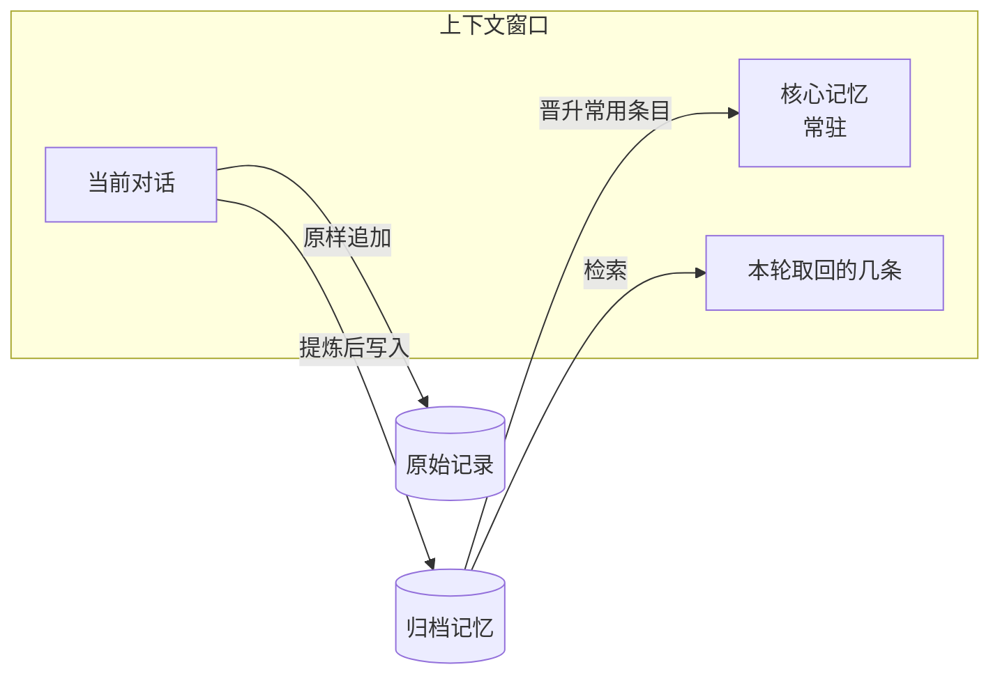
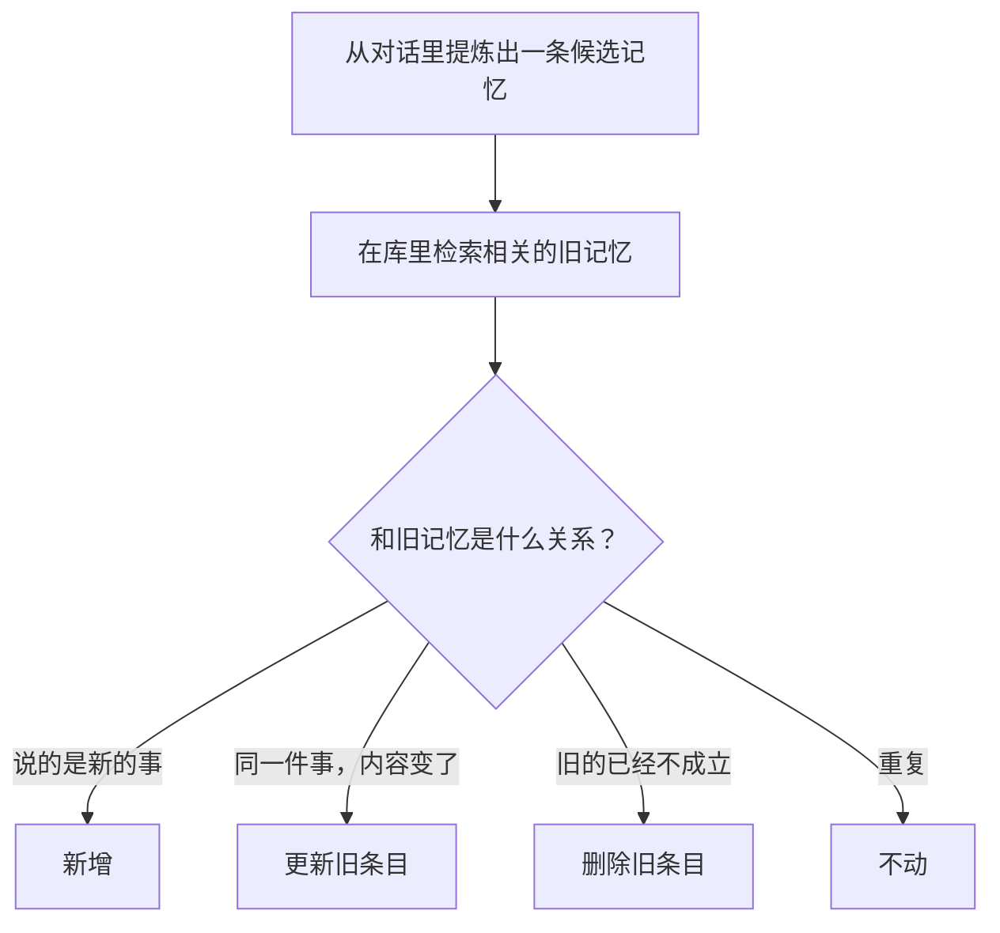

# 24 记忆系统实现：分层、存储形态、更新与合并

> ▶ 本章配套代码：`code/ch24_memory.py`，只用 Python 标准库，可直接运行。

## 从一个问题开场

第 10 章讲了记忆的原理：长期记忆要写、要取、要改，取的时候综合时近度、重要度、相关度。

真要动手做一个，立刻会碰到一串具体问题：全部记忆放一个库里吗？存成什么形态？用户改了主意，旧的那条怎么办？库越来越大怎么办？怎么知道这套系统记得对不对？

本章用一百来行代码搭一个最小的记忆系统，把这些问题逐个过一遍。

## 掰开：三层结构

不是所有记忆都该用同一种方式对待。按"多久用一次"分三层：

| 层 | 放什么 | 怎么进上下文 | 容量 |
|---|---|---|---|
| 核心记忆 | 几乎每次都用得上的：称呼、车型、最基本的偏好 | 每次都放进系统提示词 | 很小，几百 token |
| 归档记忆 | 其余提炼过的条目：偏好、经历、做事方法 | 按当前对话检索，取回几条 | 大 |
| 原始记录 | 完整的对话日志 | 不进上下文，只在需要核对时查 | 不限 |



这个分层来自 MemGPT 一类的设计，它把上下文窗口比作内存，把外部存储比作磁盘，记忆系统的工作就是在两者之间换入换出。

核心记忆的大小要严格控制。它每一轮都在上下文里，占的是第 35 章公式里的固定前缀。归档记忆里某条被反复取回，说明它该晋升到核心层；核心层里某条长期没用，就该降回去。

## 掰开：存储形态

归档记忆存成什么，有三种主流选择：

| 形态 | 一条记忆长什么样 | 怎么取 | 适合 |
|---|---|---|---|
| 向量库 | 一段文字加它的向量和元数据 | 相似度检索 | 条目多、内容零散 |
| 图 | 实体和关系：（用户，偏好，座椅加热一档） | 沿关系查询 | 记忆之间关联强、要做推理 |
| 纯文本文件 | 一个人和模型都能直接读写的文件 | 整个读入，或让模型用文件工具查 | 条目不多、需要人直接维护 |

第三种看起来最土，实际用得很广。编程类 Agent 普遍采用这种做法：在项目目录里放一个约定名字的说明文件，写着项目的构建命令、代码规范、注意事项，每次会话开始时自动读入。Claude Code 的 `CLAUDE.md` 就是这种形态，并且按目录层级叠加，个人的、项目的、子目录的各一份。

它的优点恰恰来自简单：

- **人能直接看、直接改**。记错了，打开文件删掉那一行。第 10 章说过，让用户能查看和修改记忆是最有效的纠错途径。
- **能进版本管理**。谁在什么时候加了哪条，有记录，可以回退。
- **没有检索环节**。整份读入，也就没有第 7 章那些检索失败。

代价是它只适合小规模。文件每次整份进上下文，写到几千行就成了负担。所以实际系统常常混用：稳定、少量、每次都要的规则放文件，大量、零散的经历放向量库。

## 掰开：写入时的冲突处理

这是记忆系统里最容易做错的一步。用户月初说"座椅加热默认二档"，月中说"以后开一档就行"。

配套代码对比了两种写入策略。先看只新增、不查冲突的结果，第 30 天用户说"开一下座椅加热"时，各条记忆的得分：

```text
== 只新增不更新：库里 6 条 ==
  1.58 = 时近 0.20 + 重要 0.80 + 相关 0.58  座椅加热默认开一档
  1.26 = 时近 0.03 + 重要 0.80 + 相关 0.43  座椅加热默认开二档
  0.74 = 时近 0.04 + 重要 0.70 + 相关 0.00  右前轮慢漏气，已约周六补胎
  0.73 = 时近 0.23 + 重要 0.50 + 相关 0.00  右前轮已补好
  ……
  取回：座椅加热默认开一档；座椅加热默认开二档
  取回的两条互相矛盾
```

两条互相矛盾的偏好同时进了上下文。新的那条排在前面，因为它时近度高（0.20 对 0.03），但旧的那条并没有消失。模型拿到两条矛盾的指示，行为就不可预测了。

验算一下时近度：新的那条是第 400 小时写入的，到第 720 小时过了 320 小时，0.995³²⁰ ≈ 0.20。旧的那条过了 720 小时，0.995⁷²⁰ ≈ 0.03。与第 10 章的衰减表一致。

再看写入前先查冲突的策略：

```text
== 写入前查冲突并更新：库里 4 条 ==
  1.58 = 时近 0.20 + 重要 0.80 + 相关 0.58  座椅加热默认开一档
  0.73 = 时近 0.23 + 重要 0.50 + 相关 0.00  右前轮已补好
  ……
  取回：座椅加热默认开一档；右前轮已补好
  取回的两条没有矛盾
```

库里从 6 条变成 4 条：座椅加热的旧偏好被覆盖，"右前轮慢漏气"被"已补好"取代。

### 写入流程



"是什么关系"这个判断，真实系统里交给一次模型调用：把候选记忆和检索到的几条旧记忆一起给模型，让它从四个动作里选一个。配套代码用一个写死的 `slot` 字段代替这一步，标明每条记忆说的是哪件事。

所以**每写入一条记忆，要付出一次检索加一次模型调用**。这笔开销是值得的：读的次数远多于写的次数，写的时候把库整理干净，每次读都受益。

## 掰开：遗忘与合并

配套代码在第 60 天做了一次清理，规则是时近度加重要度低于 0.3 的删除：

```text
== 遗忘：第 60 天清理一次 ==
  删除：今天问过空调滤芯多久换一次
  剩余 3 条
```

被删的那条重要度只有 2，又一个多月没被用到。"常去的充电站是城南站"同样很久没用，但重要度 6，留了下来。这就是第 10 章三项打分里重要度的作用：它决定一条记忆能在不被使用的情况下活多久。

注意 `retrieve` 里的一行：被取回的记忆会刷新"上次使用时间"。常用的记忆因此不断续命，不用的逐渐沉底。

删除之外还有一种更温和的做法是合并：把多条零散的经历概括成一条。"3 月 2 日问过滤芯""3 月 9 日问过雨刮""3 月 20 日问过刹车片"，合并成"用户关心保养周期"。这一步通常安排在空闲时由后台任务批量完成，不占用对话时间。

## 一个故意留下的问题

看代码最后的输出：

```text
【相关记忆】
座椅加热默认开一档
常去的充电站是城南站
```

用户问的是座椅加热，取回的第二条是充电站，毫不相关（相关度 0.00）。原因是代码固定取前 2 名，而库里只剩一条相关的。

**固定取前 k 条，库里相关的不足 k 条时就会用无关内容凑数。** 修法是加一道相关度门槛，低于门槛的宁可不取。这是第 7 章失败点 4 在记忆系统里的翻版，也说明记忆检索和文档检索是同一类问题，第 6 章的重排、第 7 章的定位方法都适用。

## 怎么评测

记忆系统要单独评测，第 32 章的方法在这里的具体形式：

| 测什么 | 怎么测 |
|---|---|
| 记得住 | 在一段长对话的早期给出一个事实，隔很多轮或跨会话后提问 |
| 会更新 | 先说一个偏好，后来改口，再提问，答案应该是新的 |
| 会拒答 | 问一件从没提过的事，应该说不知道，而不是编 |
| 时间推理 | "我上次保养是什么时候"，需要记忆条目带时间 |
| 不串人 | 多用户时，一个用户的记忆不应出现在另一个用户的回答里 |

第二项和第三项最容易暴露问题。只新增不更新的系统在第二项上必然失败。

## 为什么这样设计

三层结构是按访问频率分配上下文这种稀缺资源：最常用的常驻，偶尔用的检索，几乎不用的只存档。写入时整理而不是读取时整理，是因为读多写少。这两条都是存储系统里的老办法，记忆系统是它们在 LLM 应用里的重现。

## 优势、劣势、什么时候不该用

**优势**：跨会话的连续性；核心层很小，常驻成本可控；写入时消解冲突，读取时干净。

**劣势**：
- 每次写入多一次检索和一次模型调用；
- 冲突判断本身会出错，可能把不该覆盖的覆盖了。所以原始记录那一层要留着，出错时能追溯；
- 三层之间的晋升和降级需要调参。

**不该用的时候**：见第 10 章。另外规模很小时不必上三层，一个纯文本的记忆文件往往就够了。

## 常见误解

**"记忆系统就是给聊天记录建个向量库。"** 那只是原始记录层。没有提炼和更新，取回的是大量过时和重复的内容。

**"记忆越多越好。"** 库越大，取到无关条目的概率越高。遗忘和合并是保持检索质量的手段。

**"文件形态的记忆太原始。"** 在需要人参与维护的场景里，它往往是最可靠的。

**"更新就是把新的追加进去，检索时让时近度去区分新旧。"** 上面的输出显示，旧条目仍会被取回。必须在写入时处理。

## 小结

- 记忆按访问频率分三层：核心记忆常驻、归档记忆检索、原始记录存档；存储形态有向量库、图、纯文本文件，后者最适合人参与维护。
- 写入前要查冲突，在新增、更新、删除、不动四个动作里选一个；只新增不更新会让矛盾的记忆同时进入上下文。
- 遗忘和合并保持库的质量；评测重点是会不会更新、会不会拒答。

## 参考

- Packer et al., *MemGPT: Towards LLMs as Operating Systems*, 2023
- Park et al., *Generative Agents: Interactive Simulacra of Human Behavior*, 2023
- Chhikara et al., *Mem0: Building Production-Ready AI Agents with Scalable Long-Term Memory*, arXiv:2504.19413, 2025
- Maharana et al., *Evaluating Very Long-Term Conversational Memory of LLM Agents*（LoCoMo）, 2024
- Anthropic, *Manage Claude's memory*, code.claude.com/docs
