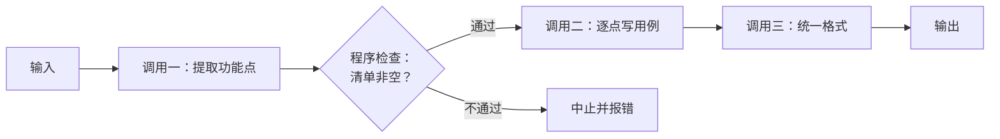
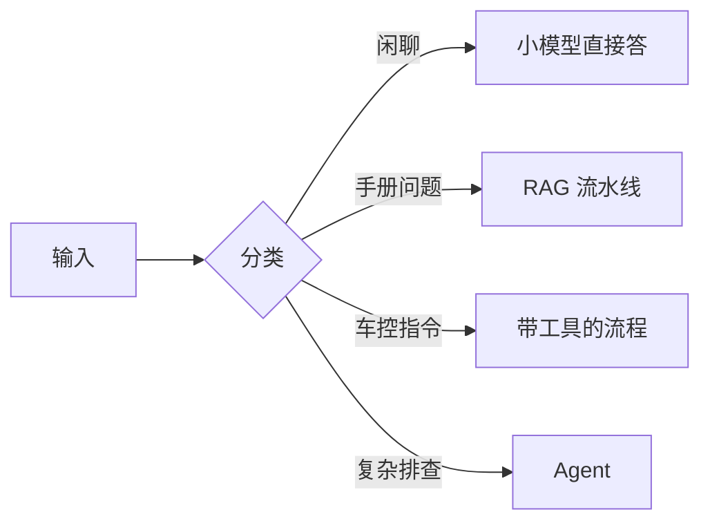
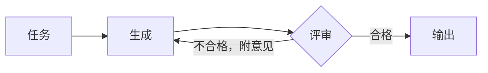
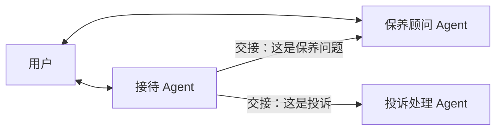

# 25 编排模式：串联、路由、并行、生成加评审、交接

## 从一个问题开场

第 21 章把系统分成两类：流程写死的工作流，和模型自己决定步骤的 Agent。当时只用一张表带过了工作流。

可实际项目里，多数系统是工作流。第 37 章的三个案例中，手册问答是一条流水线，客诉分诊是一次调用加一个分支，只有用例生成用到了 Agent，而且外面还套着固定的阶段。

"把几次模型调用按固定结构组合起来"这件事，有几种反复出现的搭法。本章把它们列出来。它们是比 Agent 低一级的方案，按第 36 章的复杂度阶梯，应该先于 Agent 被考虑。

## 掰开：五种模式

### 一、串联

把任务拆成固定的几步，上一步的输出是下一步的输入。步与步之间可以插入程序检查。

**适合**：任务能清楚地拆成先后几步，每一步单独做比合在一起做更准。

**道理**：第 18 章讲过，模型一次生成能完成的推理有限。一个提示词里塞三件事，每件都做得马虎；拆成三次调用，每次只专注一件。

**代价**：调用次数是原来的几倍，延迟相加。第 7 章的连乘在这里同样成立：每步 95%，三步就是 86%。所以步间的程序检查很重要，它把错误拦在传下去之前。

第 6 章的 RAG（改写问题、检索、生成）就是一条串联。

### 二、路由

先判断输入属于哪一类，再交给对应的处理流程。

**适合**：输入明显分成几类，每类的最佳处理方式不同。

**道理**：一套提示词伺候所有类型，往往哪类都不够好。分开之后每条路线可以单独优化，互不干扰。

路由还是最直接的省钱手段。手算一下，沿用第 35 章的假设单价，大模型输入每百万 10 元、输出 40 元，小模型输入 2 元、输出 8 元。每次请求输入 1,000、输出 200：

| | 计算 | 单次费用 |
|---|---|---|
| 全部用大模型 | (1,000 × 10 + 200 × 40) ÷ 1,000,000 | 0.0180 元 |
| 小模型处理一次 | (1,000 × 2 + 200 × 8) ÷ 1,000,000 | 0.0036 元 |
| 路由判断一次（小模型，输入 300，输出 5） | (300 × 2 + 5 × 8) ÷ 1,000,000 | 0.0006 元 |

假设八成请求是简单的，交给小模型；两成交给大模型：

- 平均费用 = 0.0006 + 0.8 × 0.0036 + 0.2 × 0.0180 ≈ **0.0071 元**

比全部用大模型的 0.018 元省了约六成。

**代价**：分类错了，后面全错。把复杂问题分到简单路线，答案质量下降；把车控指令分到闲聊路线，指令就丢了。路由器的准确率要单独评测，高风险类别宁可多分不可漏分。

分类器本身不一定用 LLM。关键词规则、传统的小分类模型都可以，更快也更便宜。

### 三、并行

几次调用同时进行，结果由程序汇总。有两种用法：

| 用法 | 做什么 | 例子 |
|---|---|---|
| 分片 | 把任务拆成互不依赖的几块，各做各的 | 一份长文档分章节同时总结；回答问题的同时另起一次调用检查输入是否违规 |
| 投票 | 同一个任务独立做几遍，取多数或综合 | 第 18 章的自洽性投票；多个审查者各查一类问题 |

**道理**：分片把延迟从各段之和降到最慢那一段。三次调用各 3 秒，串行 9 秒，并行 3 秒。投票用费用换正确率，第 18 章算过：单次 0.7，三票多数 0.78。

**代价**：并行只省时间，总 token 不变或更多。分片要求各块之间确实独立，否则汇总时会发现前后对不上。

"回答的同时另起一次调用做安全检查"是一个常用的搭法：主调用专心回答，检查调用专心判断，比让一个提示词同时兼顾两件事更可靠。

### 四、生成加评审

一次调用生成，另一次调用按标准评审并提意见，不合格就带着意见重写，循环到合格或达到次数上限。

这就是第 20 章的反思，写成了固定结构。第 20 章的结论原样适用：评审要有外部依据，程序校验优于模型评审；轮数要设上限。

**适合**：有明确的评判标准，并且修改意见确实能让结果变好。判断方法是让人来提意见试试，如果人提了意见模型能改好，这个模式就有效。

### 五、交接

几个专门的 Agent 各管一摊，当前 Agent 判断任务不归自己时，把整个对话移交给另一个。

实现上，"交接"是一个特殊的工具：调用它之后，程序把后续对话的系统提示词和工具清单换成目标 Agent 的那一套。

它和路由的区别在于时机：路由在入口处一次性分流，交接可以发生在对话中途，聊着聊着发现该换人。

它和第 26 章主从式多 Agent 的区别在于控制权：

| | 主从式 | 交接 |
|---|---|---|
| 子 Agent 做完之后 | 把结果交回主 Agent | 不交回，直接接着和用户对话 |
| 谁面对用户 | 始终是主 Agent | 当前持有对话的那个 |
| 上下文 | 子 Agent 有独立的干净上下文 | 通常带着完整对话历史移交 |
| 适合 | 可并行的子任务 | 按领域分工的客服类场景 |

**代价**：交接时带不带历史、带多少，是设计难点。全带，新 Agent 的上下文一上来就很长；不带，用户要把情况重讲一遍。常见做法是带一份交接摘要。

## 模式之间的组合

这些模式是积木，可以嵌套：

- 路由的每条分支可以是一条串联；
- 串联的某一步可以是并行分片；
- 串联的最后可以接一个生成加评审；
- 任何一步都可以替换成一个 Agent。

第 37 章的用例生成案例就是组合：串联（规划、生成、校验）里，生成那一步是并行的 Agent，校验那一步是生成加评审。

跨组织的 Agent 之间要互相调用时，还需要约定通信格式。第 14 章的 MCP 约定的是 Agent 和工具之间怎么说话；Agent 和 Agent 之间也有类似的协议在发展，例如 A2A。只在单个系统内部编排时用不到。

## 选哪个

| 任务的特点 | 模式 |
|---|---|
| 能拆成固定的先后几步 | 串联 |
| 输入分成差别明显的几类 | 路由 |
| 子任务互不依赖，想提速 | 并行分片 |
| 想用费用换正确率 | 并行投票 |
| 有明确标准，改一轮能变好 | 生成加评审 |
| 按领域分工，对话中途可能换人 | 交接 |
| 步骤无法事先确定 | 以上都不合适，用 Agent（第 21 章） |

## 为什么这样设计

这些模式的共同点是：控制流写在代码里，模型只负责每个节点内部的工作。这样做牺牲了灵活性，换来三样东西：成本固定可预估、行为可预测、出错时能定位到具体哪个节点。在步骤已知的任务上，这三样比灵活性值钱。

## 优势、劣势、什么时候不该用

**优势**：可预测、可评测、可调试；每个节点可以用不同的模型和提示词分别优化。

**劣势**：只能处理事先设计好的流程。遇到设计时没想到的情况，工作流不会变通。

**不该用的时候**：任务的步骤确实取决于中间结果，用工作流硬写会变成一棵分支越来越多、没人敢改的判断树。这是该换成 Agent 的信号。

## 常见误解

**"工作流是 Agent 出现之前的过时做法。"** 在步骤固定的任务上，它更便宜、更快、更稳定。生产系统里大多数调用跑在工作流上。

**"用了编排框架才算做了编排。"** 这五种模式用普通代码都能写：串联是顺序调用，路由是 if，并行是并发执行，评审是循环。框架提供的是便利，不是能力。

**"并行能省钱。"** 只省时间。

**"交接就是多 Agent。"** 交接是多 Agent 的一种，同一时刻只有一个 Agent 在工作。它没有主从式的并行和上下文隔离。

## 小结

- 五种编排模式：串联拆步骤，路由分类型，并行提速或投票，生成加评审做质量循环，交接按领域换人。
- 它们的控制流都写在代码里，成本和行为可预测；可以互相嵌套，任何节点也可以换成 Agent。
- 步骤能事先确定就用这些模式；步骤取决于中间结果、判断树越写越大时，才换成 Agent。

## 参考

- Anthropic, *Building Effective Agents*, 2024
- OpenAI, *Swarm* 与 *Agents SDK* 文档中的 handoff 机制，github.com/openai
- Google, *Agent2Agent (A2A) Protocol*, 2025
- Wang et al., *Self-Consistency Improves Chain of Thought Reasoning in Language Models*, 2022
