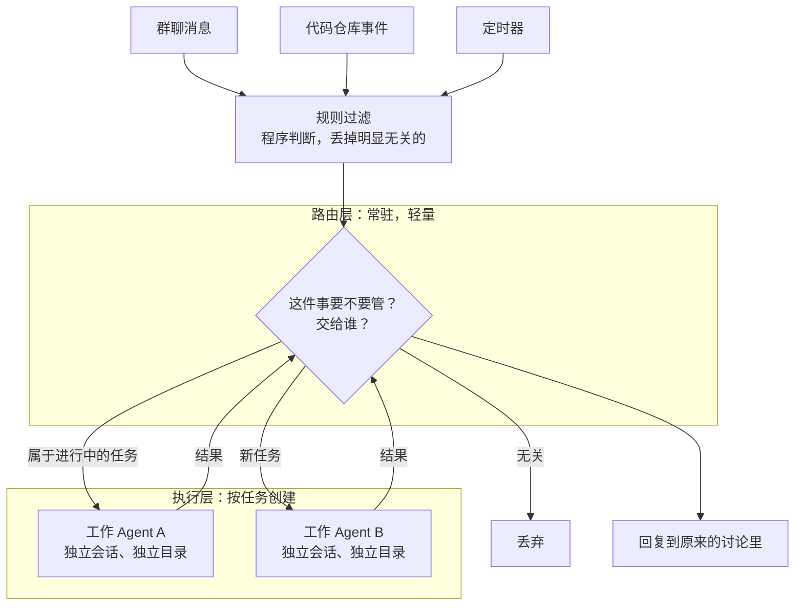

# 27 常驻 Agent：从被动应答到主动找活

## 从一个问题开场

前面所有的 Agent 有一个共同点：用户说一句，它动一下；任务完成，循环结束。它是被叫来的。

换一种设想。团队群里有人说："登录页在安卓上又崩了。"没有人召唤任何助手。十分钟后，群里出现一条消息："我在后台复现了这个问题，原因是某次提交改了某个接口，修复已提交，请审核。"

这个 Agent 没有人叫它。它一直在线，自己看见了问题，自己判断值得做，做完才出声。

这类系统叫常驻 Agent，或者主动式 Agent。它和第 21 章的 Agent 用的是同一个主循环，区别在循环外面：**循环由什么启动。**

## 掰开：从请求驱动到事件驱动

| | 请求驱动（第 21 章） | 事件驱动（本章） |
|---|---|---|
| 谁启动循环 | 用户发来一条消息 | 外部世界发生了一件事 |
| 生命周期 | 一个任务，跑完即止 | 长期在线 |
| 输入 | 明确的指令 | 一条事件流，绝大部分与它无关 |
| 首要问题 | 怎么把任务做好 | 这件事该不该我管 |
| 做完之后 | 把结果交给发起人 | 先判断值不值得打扰人 |

事件的来源：

| 来源 | 例子 |
|---|---|
| 消息 | 群聊里的讨论、工单评论、邮件 |
| 系统状态 | 构建失败、监控告警、合并请求有新评论 |
| 时间 | 每天早上、每小时、某个截止日前 |
| 自己之前的安排 | "这个发布完半小时后回来检查一遍" |

最后一行说明常驻 Agent 需要一种新工具：给未来的自己安排任务。请求驱动的 Agent 不需要它，因为任务结束它就不存在了。

## 掰开：两层结构

所有事件都直接启动一个完整的 Agent 是不可行的。群里一天几百条消息，每条都让一个带着全部工具的大模型处理一遍，费用和打扰都无法接受。

常见的结构是分两层：

| | 路由层 | 执行层 |
|---|---|---|
| 职责 | 接收事件、判断要不要管、分派、掌握全局 | 把一个具体任务做完 |
| 生命周期 | 一直在线 | 每个任务一个，做完即止 |
| 上下文 | 跨任务的概况：有哪些任务在跑、各到哪了 | 只有自己这个任务的内容 |
| 工具 | 很少：创建任务、查询状态、发消息 | 完整的工具集 |
| 模型 | 理解和分派为主，可以用较轻的模型 | 干活，用强模型 |

这其实是前面几章的组合：路由层是第 25 章的路由模式，执行层是第 26 章的子 Agent，每个任务一个独立上下文是第 23 章的隔离。新东西只有一样：路由层不结束。

一个值得注意的优化是订阅。某个执行层 Agent 提交了合并请求之后，这个合并请求上的后续评论直接送给它，不必每次都经路由层重新判断归属。

## 手算一次：过滤漏斗

假设一个团队的群聊加代码仓库，每天产生 3,000 个事件，其中真正需要 Agent 动手的有 30 个，占 1%。

**不过滤，全部交给路由层的模型判断。** 每次判断输入 1,500 token（事件内容加当前任务概况），沿用第 35 章假设的小模型输入单价每百万 2 元：

- 3,000 × 1,500 = 450 万 token，约 9 元一天

**先用程序规则过滤。** 规则很朴素：机器人自己发的消息不看、纯表情不看、不在关注范围内的仓库不看。假设规则能丢掉 80%：

- 剩 600 个事件进路由层：600 × 1,500 = 90 万 token，约 1.8 元一天

钱不多。更重要的是另一笔账：**误判的代价。**

假设路由层的判断有 5% 的误报率，也就是把不该管的事当成该管的。600 个事件里约 570 个是不该管的：

- 570 × 5% ≈ **每天 28 次不该有的动作**

真正该做的只有 30 件。也就是说，这个 Agent 的输出里将近一半是多余的。如果每次多余的动作都在群里发一条消息，团队很快会把它静音。

这就引出常驻 Agent 最特殊的一项成本。

## 注意力是最贵的资源

请求驱动的 Agent 做错了，浪费的是提问者一个人的时间，而且他本来就在等结果。常驻 Agent 在公共频道里说一句没用的话，打断的是所有人。

所以这类系统的核心设计目标是**少说话**。几种做法：

| 做法 | 说明 |
|---|---|
| 先做后说 | 在后台把事情做到能验证的程度，确认问题属实、修复可行，才出声；确认不了就悄悄放弃 |
| 提高出声门槛 | 宁可漏掉一些该做的，也不做不该做的。误报比漏报代价高 |
| 回复到原处 | 结果发在原来的讨论串里，不另开话题 |
| 合并通知 | 多条进展攒成一条 |
| 明确的授权范围 | 只在被指定的人提出请求、或团队规则明确允许时主动行动 |

"先做后说"有一个前提：后台做的事必须没有副作用。在自己的隔离目录里复现一个 bug 可以，往主分支推代码不行。

## 权限：三档开关

主动行动意味着没有人在动手之前点"同意"。第 34 章的人工确认在这里行不通，因为根本没有人在场。替代方案是把自主程度做成档位：

| 档位 | 行为 | 用途 |
|---|---|---|
| 关闭 | 只响应明确的召唤 | 默认的保守状态 |
| 观察 | 照常判断哪些事该管，但只记录"我本来会做什么"，不执行 | 上线前校准 |
| 自动 | 判断该管就去做 | 校准通过后，对限定范围开放 |

观察档是这类系统特有的、非常实用的设计。它让你在零风险的情况下回答一个问题：如果放手让它干，它会干些什么？跑一两周，把记录拿出来逐条看，误报率是多少、漏了什么，都有了数字。这相当于第 32 章的评测，只是测试集是真实的事件流。

第 29 章的配套代码用一个执行前钩子实现了观察档：有副作用的工具只记录、不执行。

其余的安全要求比请求驱动的 Agent 更严：

- **执行环境必须隔离。** 它长期在线、读取大量不可信内容（任何人在群里说的话、任何人提的评论）、拥有执行权限。第 34 章的危险三角在这里天然凑齐，只能靠隔离和最小权限来限制后果。
- **每个任务的授权范围固定。** 任务创建时确定"谁要求的、要做什么、能动什么"，执行过程中读到的内容不能扩大这个范围。
- **要有看门狗。** 没人盯着，就得有程序检查它是否在原地打转、是否长时间没有进展、费用是否超限。

## 案例：DeepSeek 的 Super-agent

2026 年 10 月 31 日，DeepSeek 的 Harness 团队发表文章《Super-agent 设计探索：迈向更自主的 Agent 系统》，并以 MIT 许可开源了一个研究原型 `dsh-superagent-prototype`。它是上述设计的一个公开实例。

以下内容来自媒体对该文章和代码仓库的报道，本书作者未逐条核对原文；标"据单一来源"的细节尤其需要读者自行确认。

| 设计点 | 报道中的做法 |
|---|---|
| 两层结构 | Router 常驻，接收事件、决定分派、维护跨任务上下文；Worker 各自在独立的会话和目录里执行，可以再派生子 Agent |
| 事件来源 | 公开原型支持代码托管平台和团队群聊 |
| 过滤 | 先由程序规则丢弃无关消息，再由模型结合上下文判断是否行动（据单一来源） |
| 订阅 | 合并请求上的后续评论直接送达负责它的 Worker，不再经 Router 判断 |
| 任务授权 | 每个请求生成一张带有不可变授权范围的工单，各自运行在独立会话中（据单一来源） |
| 档位 | 关闭、观察、自动三档，默认观察（据单一来源） |
| 先做后说 | 后台复现问题，确认属实且有简单修复时才给出结果（据单一来源） |
| 不阻塞 | 运行超过数秒的命令转入后台，Worker 可以继续接收消息（据单一来源） |

报道中引用的评测是合成负载，不代表真实代码质量：每轮约 300 条消息、其中约 20 个工作请求，完成时间中位数 12.4 分钟、95 分位 15.7 分钟；对照的单会话方案 95 分位为 29.5 分钟。300 条里 20 个是活，占 6.7%，与上面手算里"绝大部分事件与它无关"的前提一致。

同样值得记下的是它自己列出的问题：

- 原型以操作系统用户的完整权限运行，官方要求使用前先做隔离；
- 提示注入或服务端被攻破，可能波及代码仓库、敏感数据和本地凭证；
- 跨越数周数月的长期记忆尚未解决；
- 人工审核、进度可见性、审批流程的设计仍是开放问题；
- 一个服务整个团队的 Agent 可能浪费整个团队的注意力。

它的版本号是 0.1.0，官方说明是研究原型而非正式产品，公开代码与其内部版本也有差异。把它当作一份设计思路的参考，而不是可以直接部署的方案。

## 为什么这样设计

请求驱动的 Agent 把"发现问题、描述问题、分派问题"的工作留给了人。常驻 Agent 试图把这一段也接过来。两层结构的原因是这两件事的性质不同：发现和分派要求一直在线、看得广、反应快、成本低；执行要求专注、上下文干净、能力强。让一个 Agent 同时做两件事，两件都做不好。

## 优势、劣势、什么时候不该用

**优势**：省掉人工发现和分派的环节；能处理"没人有空管"的琐碎问题；多个任务天然并行。

**劣势**：
- 误报直接消耗团队的注意力，这是它独有的、最难控制的成本；
- 没有人在动手前把关，权限和隔离的要求更高；
- 长期运行带来新的工程问题：状态持久化、崩溃恢复、长期记忆（第 31 章）；
- 是否"该管"的判断很难评测，没有标准答案。

**不该用的时候**：
- 请求驱动的版本还没做好。先让它在被召唤时可靠，再考虑让它主动；
- 没有条件做执行环境隔离；
- 事件流里该管的事很少，人顺手处理更快。

## 常见误解

**"常驻 Agent 是一种新的 Agent 架构。"** 执行层就是第 21 章的循环。新的是触发方式和外面那层路由。

**"越主动越好。"** 主动的价值要减去打扰的成本。一个每天多说二十句废话的 Agent，净价值是负的。

**"默认开启自动模式，有问题再关。"** 顺序应该反过来：先观察，用记录校准，再对限定范围开放。

**"它一直在线，所以一直在消耗大量 token。"** 没有事件时它不调用模型。成本取决于事件量和过滤效率。

## 小结

- 常驻 Agent 由事件而不是请求启动，首要问题从"怎么做好"变成"该不该管"；常见结构是常驻的轻量路由层加按任务创建的执行层。
- 它最特殊的成本是团队的注意力：误报比漏报代价高，原则是先做后说、少说话。
- 没有人在动手前把关，所以用关闭、观察、自动三档控制自主程度，先观察校准再放开，并且必须隔离执行环境。

## 参考

- DeepSeek Harness 团队，《Super-agent 设计探索：迈向更自主的 Agent 系统》，2026 年 10 月 31 日；原型仓库 github.com/deepseek-ai/dsh-superagent-prototype
- 相关报道：The Next Web, *DeepSeek open-sources Super-Agent, a coding agent that reads team chats*；Dataconomy, *DeepSeek Releases Open-source Dsh-superagent Coding Agent*，2026 年 11 月
- Anthropic, *Building Effective Agents*, 2024
