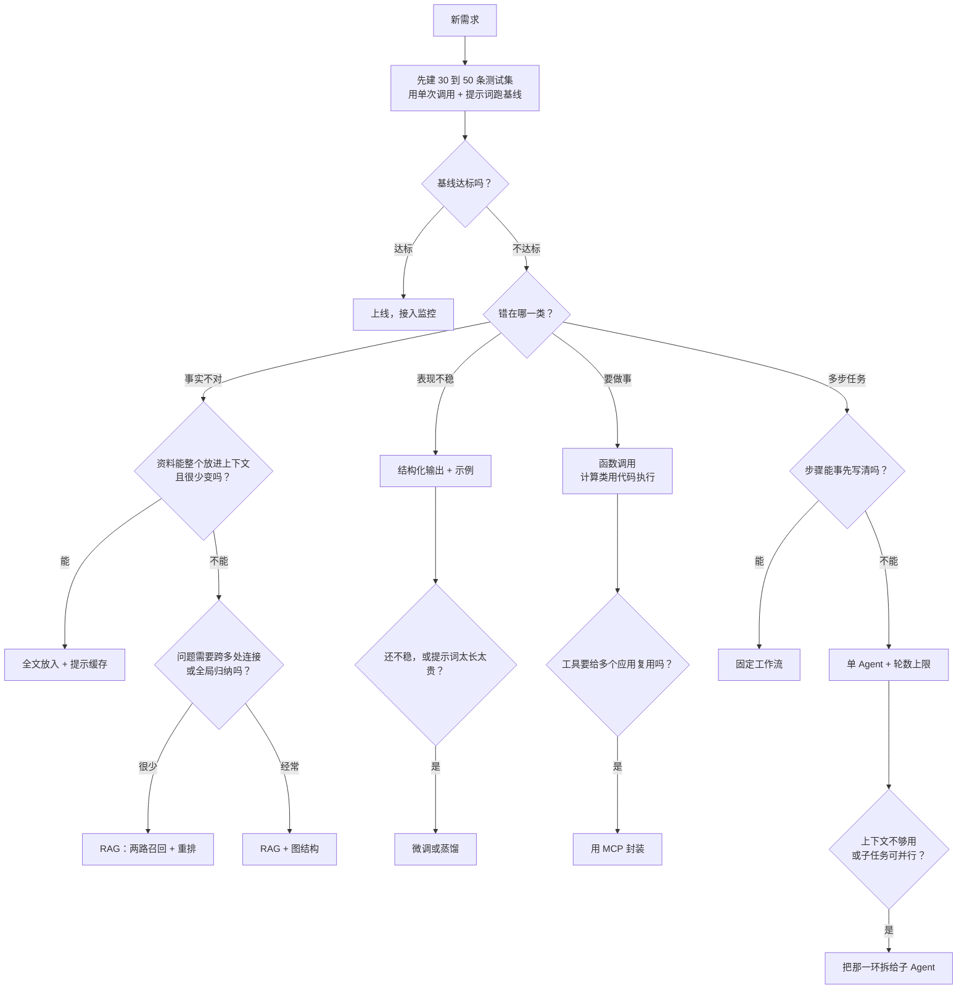

# 27 决策树：给定场景怎么组合

## 从一个问题开场

读到这里，你手里有二十多种技术。拿到一个新需求，比如"做一个售后助手"，从哪里下手？

常见的错误是从技术出发："我们上个 Agent 吧"、"先搭个向量库"。前面每一章的"什么时候不该用"都在说同一件事：**从需求和短板出发，用能解决问题的最简单的方案。**

本章把全书的判据收成一棵树和三条原则。

## 原则一：复杂度阶梯

方案按复杂度排成一个阶梯。每往上一级，能力更强，同时成本更高、更难预测、更难调试。

| 级别 | 方案 | 模型调用次数 | 可预测性 |
|---|---|---|---|
| 1 | 单次调用加一段好提示词 | 1 | 高 |
| 2 | 单次调用加外部资料（CAG 或 RAG） | 1 | 高 |
| 3 | 固定工作流：几次调用按写死的顺序串起来 | 固定的几次 | 较高 |
| 4 | 单 Agent：模型自己决定步骤 | 不固定 | 中 |
| 5 | 多 Agent | 不固定，更多 | 低 |

**从第 1 级开始，只在评测证明当前一级不够用时才往上走一级。** 不要因为上一级"更先进"而跳级。

## 原则二：从短板出发

第 1 章的四个旋钮是这棵树的主干。先用第 3 章的探针确定系统错在哪一类：

| 症状 | 短板 | 旋钮 |
|---|---|---|
| 事实错误、过时、编造 | 不知道 | 改上下文 |
| 格式、口径、风格时好时坏 | 不稳定 | 先约束输出，再改权重 |
| 需要查实时数据、执行操作、精确计算 | 做不了 | 改外部能力 |
| 多步任务做不完整、推理出错 | 想不深 | 改推理过程 |

多数真实系统不止一个短板，逐个处理即可。

## 原则三：先评测，后优化

每加一样技术之前，先有第 23 章的测试集。否则无法知道加了之后是变好还是变坏。

## 决策树

*图 F09　选型决策树。每个叶子都是"先试这个"，试完回到顶部重新评测。*

这棵树要循环着用：加了一样技术后，重新跑测试集，看剩下的错例属于哪一类，再走一遍。

## 各分支的判据速查

下表把各章的判据集中在一起。

### 资料怎么给

| 条件 | 方案 | 章 |
|---|---|---|
| 资料小、稳定、访问密集、需要通读 | 全文放入加缓存 | 9 |
| 资料大或常变，问题以查具体事实为主 | RAG | 5、6 |
| 资料里有型号、编码、数字 | RAG 必须带关键词一路 | 6 |
| 多跳问题、全局归纳问题占比高 | 加图结构 | 8 |
| 专业领域、要求严谨推理、有稳定的类型体系 | KAG 一类方案 | 8 |
| 需要跨会话记住用户 | 记忆 | 10 |
| 问题有的要查、有的不要查、有的要查多次 | 检索做成工具 | 20 |

### 要不要改模型

| 条件 | 方案 | 章 |
|---|---|---|
| 格式要求严格 | 结构化输出 | 15 |
| 需求还在变 | 不要微调 | 11 |
| 行为类问题，提示词压不住，需求稳定 | 微调 | 11 |
| 调用量大，想降本提速 | 蒸馏 | 11、12 |
| 缺的是知识 | 不要微调，用 RAG | 12 |

### 控制流怎么选

| 条件 | 方案 | 章 |
|---|---|---|
| 一次调用能完成 | 单次调用 | 4 |
| 需要推理但不需要外部信息 | 思维链或推理模型 | 16 |
| 步骤固定 | 工作流 | 6、19 |
| 下一步取决于上一步的结果 | Agent | 17、19 |
| 任务长、易跑偏 | 加规划和基于外部依据的反思 | 18 |
| 任务超出单个上下文 | 上下文管理 | 21 |
| 子任务独立、以读为主、可并行 | 子 Agent | 22 |

### 约束条件怎么影响选择

同一个需求，约束不同，答案不同：

| 约束 | 对选型的影响 |
|---|---|
| 延迟要求一两秒内 | 排除多轮 Agent 和大思考预算；用固定流水线、小模型、短输出、流式 |
| 成本敏感且调用量大 | 优先缓存、精简输入、模型分级；量够大时考虑蒸馏 |
| 出错后果严重 | 收紧权限、加人工确认、加校验；倾向可预测的工作流 |
| 必须给出处 | RAG，并在提示词里要求标注来源 |
| 数据不能出内网 | 自部署模型，选型范围受限于能部署的模型大小 |
| 没有评测数据 | 先建测试集，其他都往后放 |

## 检查清单：上线之前

无论选了哪条路，上线前逐项确认：

- [ ] 有固定的测试集，当前版本的指标有记录（第 23 章）
- [ ] 每次模型调用的完整输入输出有追踪（第 24 章）
- [ ] 所有循环有轮数上限，单个任务有费用上限（第 19、26 章）
- [ ] 工具按最小权限配置，不可撤销的操作需要确认（第 25 章）
- [ ] 危险三角没有凑齐，或者有额外防护（第 25 章）
- [ ] 资料缺失、检索失败、工具出错时，系统会明确告知而不是编造（第 6、24 章）
- [ ] 估算过每月费用和 95 分位延迟，并在预期并发下实测过（第 26 章）

## 为什么这样设计

决策树的每一层都把"更简单的方案"放在前面。原因是这个领域里复杂度的代价是确定的（更贵、更慢、更难调试），收益却要靠评测证明。先简后繁，可以保证你加上的每一层复杂度都是被一个具体的、测出来的问题逼出来的。

## 常见误解

**"选型是项目开始时做一次的事。"** 它是循环的：评测、定位短板、加一样技术、再评测。

**"越多技术叠在一起，系统越强。"** 每多一个环节，就多一个出错点、多一份成本。第 7 章的连乘算式对整个系统同样适用。

**"业界都在用 Agent，我们也该用。"** 看任务。步骤固定的任务用 Agent，只会得到一个更贵、更慢、更不稳定的工作流。

**"这棵树是标准答案。"** 它是一个起点。模型能力在变，窗口变大、推理变强、价格下降，都会移动各个分支的临界点。每隔一段时间，值得用最简单的方案重新跑一次基线，也许之前需要的复杂结构已经不再需要了。

## 小结

- 方案按复杂度分五级：单次调用、加资料、工作流、单 Agent、多 Agent；从最低一级开始，评测证明不够再升级。
- 选型从短板出发：不知道改上下文，不稳定改约束和权重，做不了加工具，想不深改控制流。
- 延迟、成本、风险、合规等约束会改变答案；选型是"评测、定位、加一样、再评测"的循环。

## 参考

- Anthropic, *Building Effective Agents*, 2024
- 本书第 3、7、9、12、20、22、23、26 章的判据与算式
