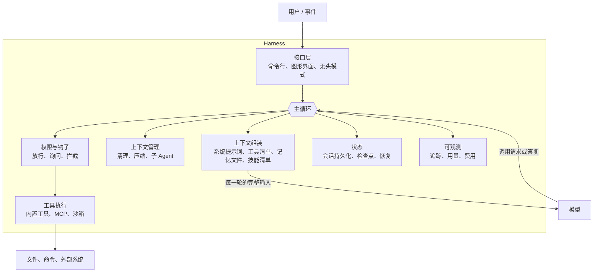

# 28 Harness：模型之外的那层壳

## 从一个问题开场

两个编程助手用的是同一个模型，一个能连续工作几小时把功能做完，另一个改到第三个文件就开始丢三落四。

模型相同，差别在哪？

在模型外面那一层。第 21 章用五十行写了一个 Agent，并列了一张"五十行之外还缺什么"的表：上下文管理、权限、错误处理、可观测、成本控制。把那张表里的东西全部做出来，再加上工具、记忆、扩展机制，合起来有一个名字：**harness**。

这个词原意是马具、线束，指把一股力量套住并引到有用方向上的那套装置。本书书名叫《模型之外》，harness 就是"之外"的那部分在 Agent 系统里的具体形态。

**Agent = 模型 + harness。**

## 掰开：harness 里有什么

每个部件在本书里都有对应的章节：

| 部件 | 做什么 | 在哪一章 |
|---|---|---|
| 主循环 | 调模型、执行工具、拼回结果 | 21 |
| 上下文组装 | 决定每一轮模型看到什么 | 2、4、24 |
| 工具执行 | 内置工具、MCP、代码沙箱 | 13、14、15 |
| 上下文管理 | 清理旧结果、压缩、隔离 | 23 |
| 子 Agent 与编排 | 拆任务、并行 | 25、26 |
| 扩展机制 | 技能、命令、钩子 | 29 |
| 接口层 | 命令行、无头模式 | 30 |
| 状态 | 检查点、恢复、人工介入 | 31 |
| 权限 | 权限模式、确认、隔离 | 31、34 |
| 可观测与成本 | 追踪、用量统计 | 33、35 |

所以前面各章其实一直在讲 harness 的零件，只是没有给整体起名字。本章做的事是把它们装成一张图，并回答一个问题：这一层该怎么设计。

## 模型决定什么，harness 决定什么

| 由模型决定 | 由 harness 决定 |
|---|---|
| 下一步做什么 | 模型能看到什么 |
| 调哪个工具、填什么参数 | 有哪些工具可调 |
| 什么时候算做完 | 调用请求会不会被执行 |
| 回复的内容 | 历史保留多少、怎么压缩 |
| | 出错了怎么办、能不能撤回 |
| | 花了多少钱、最多能花多少 |

左边是判断，右边是条件和边界。**模型的能力决定了上限，harness 决定了能发挥出几成，以及出错时的下限。**

开场那个问题的答案就在右边一列：跑不了长任务的那个助手，多半是上下文管理没做好，早先的内容把窗口挤满了；或者工具返回了太多无用信息；或者没有任何机制让它记下自己做到哪了。

## 手算一次：harness 自己占多少上下文

harness 每一轮都要往上下文里放一批固定内容。估算一个中等规模的编程 Agent：

| 固定内容 | 估算 | token |
|---|---|---|
| 系统提示词 | 行为规范、工具使用指引 | 3,000 |
| 工具清单 | 20 个工具，每个约 300 | 6,000 |
| 记忆文件 | 项目说明、约定 | 2,000 |
| 技能清单 | 几十个技能，每个一两行 | 2,000 |
| **合计** | | **13,000** |

用户还没开口，一万三千 token 已经在上下文里了。这就是第 35 章公式里的固定前缀 F。一个 30 轮的任务：

- 固定前缀累计 = 30 × 13,000 = **390,000 token**
- 按假设的输入单价每百万 10 元，3.9 元

仅仅是每轮重发这些固定内容。开启提示缓存后，第一轮按全价，其余 29 轮按缓存价（每百万 1 元）：

- (13,000 × 10 + 29 × 13,000 × 1) ÷ 1,000,000 ≈ **0.51 元**

降到约八分之一。这解释了 harness 设计里两条看起来琐碎的纪律：

- **固定内容必须逐字稳定。** 系统提示词里放一个当前时间，缓存就每轮失效，费用回到 3.9 元。
- **每加一样常驻内容都要算账。** 多接一个有 30 个工具的 MCP 服务端，前缀增加九千 token。第 29 章的技能机制就是为了让"能力很多"和"前缀很小"能够并存。

## 两条设计原则

### 原则一：能交给模型的，不要写死在 harness 里

早期的 Agent 框架在循环外面包了很多控制逻辑：强制的规划步骤、固定的反思环节、复杂的状态机。当时的模型需要这些拐杖。

模型变强之后，这些写死的流程反而成了限制：它规定必须先列计划再动手，而模型已经能判断一个三步的小任务不需要计划。

所以趋势是 harness 变薄：提供工具、信息和边界，把怎么做交给模型。判断一个 harness 部件该不该留，可以问：**换上更强的模型之后，这个部件是变得更有用，还是变得多余？** 沙箱、权限、检查点属于前者，强制的流程编排多属于后者。

### 原则二：必须发生的事，不要托付给模型

这是上一条的反面。有些事不是"通常应该"，而是"必须"：

- 不能删除某个目录；
- 每次改完代码必须跑一遍格式化；
- 单个任务的费用不能超过上限。

这些写在提示词里是软约束。第 34 章说过，能用代码强制的规则不要托付给提示词。harness 是这些代码住的地方：权限规则、钩子、轮数和费用上限。

两条原则合起来是一个分工：**判断交给模型，保证交给 harness。**

## harness 也是一种产品形态

同一套 harness 可以有不同的入口。以 Claude Code 为例，它的主循环、工具、权限、扩展机制是一套，对外有命令行、桌面应用、网页、编辑器插件几种界面，还有一个把同样的循环以程序库形式提供的 SDK。OpenAI 的 Codex、DeepSeek 的 Harness 也是类似的组织方式：一个核心循环，多个入口。第 27 章的 Super-agent 在报道中被描述为运行在 DeepSeek Harness 之上的一个配置。

这带来一个选型上的现实选择：自己写 harness，还是用现成的。

| | 用现成的 harness | 自己写 |
|---|---|---|
| 得到什么 | 上下文管理、权限、检查点、扩展机制都已做好并经过大量使用 | 完全的控制 |
| 付出什么 | 受它的设计约束；它的更新节奏不由你定 | 第 21 章那张表里的每一项都要自己做 |
| 适合 | 任务形态接近它的设计目标（多为编程和文件操作类）；想尽快得到可用的 Agent | 任务形态特殊（如车载语音）；有严格的部署和合规限制 |

折中的做法是用它们提供的 SDK：循环和基础设施用现成的，工具、提示词、权限规则自己定。

## 另一个同名的东西

"评测 harness"指的是另一件事：跑测试集的那套框架，负责喂题目、收输出、判分、汇总（第 32 章）。两者都叫 harness，是因为都是"套在模型外面让它干活的装置"，但一个是产品运行时的壳，一个是测试用的架子。上下文里通常分得清。

两者有一个重要的交集：**评测 Agent 时，被评测的是模型加 harness 的整体。** 同一个模型在不同 harness 下的任务完成率可以相差很多，所以看到某个模型的 Agent 类榜单成绩时，要问它是在哪套 harness 下跑出来的。

## 为什么这样设计

把模型之外的部分单独看成一层，是因为它和模型的变化节奏不同。模型几个月换一代，由厂商决定；harness 是你自己的工程资产，沉淀的是对任务的理解：哪些工具有用、哪些信息该常驻、哪些操作要拦。一个设计得好的 harness，换上新模型之后能直接把模型的进步变成产品的进步。

## 优势、劣势、什么时候不该用

这一章讲的是一个视角，不是一项可选的技术：只要做 Agent，就有一个 harness，区别只在于是认真设计的还是随手堆出来的。

值得警惕的是两个方向的过度：

- **过厚**：为模型做了太多决定，流程僵硬，模型升级后大量逻辑需要拆除。
- **过薄**：什么都交给模型，没有边界和兜底，出错的后果不可控。

## 常见误解

**"Agent 的能力取决于模型。"** 取决于模型和 harness 的组合。上下文组装和管理做得差，强模型也发挥不出来。

**"harness 就是一个 Agent 框架。"** 框架是搭 harness 的一种工具。harness 指的是最终那套东西，包括提示词、工具集、权限规则这些框架不会替你定的部分。

**"harness 是给编程 Agent 用的概念。"** 这个词在编程 Agent 领域最常用，但任何 Agent 都有这一层。车载助手的 harness 包括语音链路、车控工具、行驶状态下的权限限制。

**"模型越来越强，harness 会消失。"** 流程控制的部分会变薄。边界、隔离、状态、可观测这些部分不会，模型越自主，它们越重要。

## 小结

- Harness 是模型之外让 Agent 运转的整层：主循环、上下文组装与管理、工具执行、权限与钩子、状态、可观测；Agent 等于模型加 harness。
- 分工是判断交给模型、保证交给 harness；流程控制随模型变强而变薄，边界和兜底不会。
- Harness 每轮注入的固定内容是成本的常驻项，必须逐字稳定以命中缓存；评测 Agent 时测的是模型与 harness 的整体。

## 参考

- Anthropic, *Building Effective Agents*, 2024
- Anthropic, *Effective Context Engineering for AI Agents*, 2025
- Anthropic, *Claude Code overview* 与 *Agent SDK overview*, code.claude.com/docs
- Sutton, *The Bitter Lesson*, 2019
